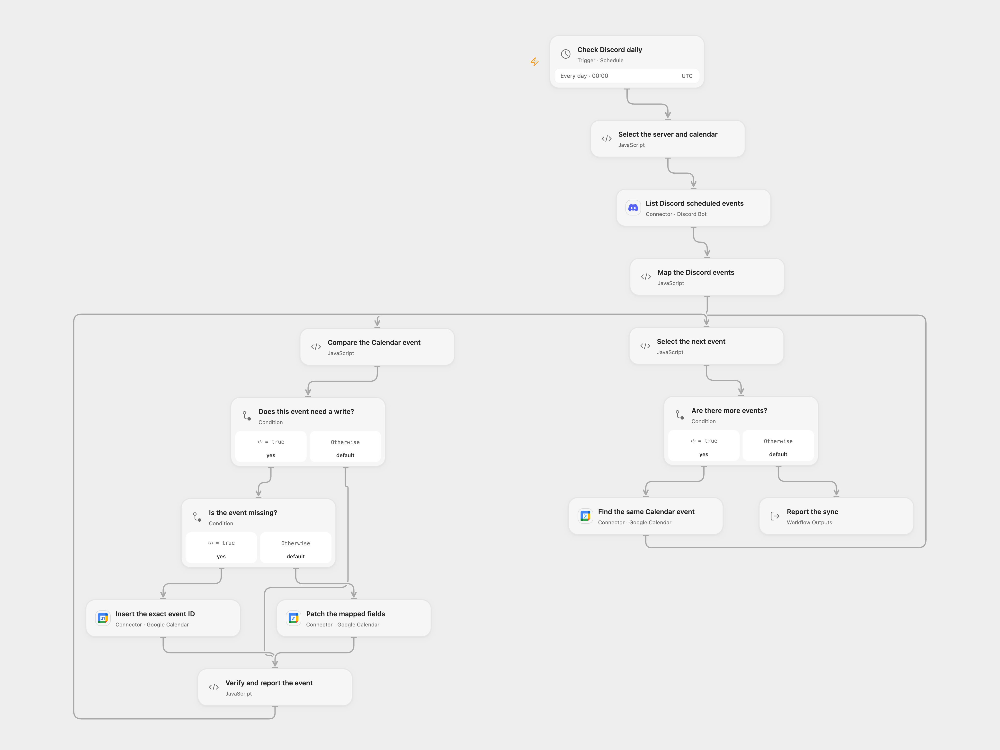

# Sync Discord Scheduled Events to Google Calendar

Add or update events in one Google Calendar using the original Discord event IDs.

<!-- template-actions:start -->
 
<!-- template-actions:end -->

<picture>
  <source media="(prefers-color-scheme: dark)" srcset="preview-dark.png">
  
</picture>

## Setup

1. In **Select the server and calendar**, enter your Discord server ID and the destination Google Calendar ID. Use `primary` for the connected account’s primary calendar.
2. In **List Discord scheduled events**, bind the Discord Bot connection installed on that server. In **Find the same Calendar event**, **Insert the exact event ID**, and **Patch the mapped fields**, bind the same Google Calendar connection with write access.
3. Publish the workflow. It runs daily at midnight UTC by default. Change the schedule’s time zone for local midnight.

## Behavior

The workflow looks up each Discord scheduled event by the same ID in Google Calendar. It copies the name, description, location, start, and end. Empty Discord descriptions or locations clear the matching Calendar field. It inserts a missing event after Calendar confirms that the ID was not found. For an existing event it patches only those fields when they differ. Attendees and other Calendar fields stay in place. Events without a valid end time and cancelled Calendar events are skipped. The workflow leaves Calendar events in place when Discord no longer returns them.

Each run reports results by event ID. A failed lookup prevents a write for that ID. A conflict or unconfirmed write is reported without an immediate retry. The next run looks up the same ID again before making any change.

In n8n

Enter the same settings in **Select the server and calendar**. In **List Discord scheduled events**, bind a Header Auth credential named `Authorization` with the value `Bot <token>`. In **Find the same Calendar event** and **Write the Calendar event**, bind the same Google Calendar OAuth2 API credential with an authorization-code grant and the `https://www.googleapis.com/auth/calendar.events` scope. Use your n8n redirect URL for the Google Cloud OAuth client. Activate the daily schedule. Enable execution history to inspect lookup decisions and write receipts.

Inspiration &amp; credits

Adapted from [Sync Discord scheduled events to Google Calendar](https://github.com/Zie619/n8n-workflows/blob/ae8cf6dc5b873cbb4f74587aa9180ed3a9f70682/workflows/Http/0313_HTTP_Schedule_Create_Scheduled.json) in [Zie619/n8n-workflows](https://github.com/Zie619/n8n-workflows). Attribution: Zie619 / n8n-workflows.

The collection’s [MIT notice](https://github.com/Zie619/n8n-workflows/blob/94007c1445d9258a7da116646b79473e7c7c3282/LICENSE) is pinned at a later revision. This is the collection notice at that revision; it does not establish a separate original template author's license. Our changes are listed above; see [repository licensing](../../README.md#licensing).

> MIT License
>
> Copyright (c) 2025 Zie619
>
> Permission is hereby granted, free of charge, to any person obtaining a copy
> of this software and associated documentation files (the "Software"), to deal
> in the Software without restriction, including without limitation the rights
> to use, copy, modify, merge, publish, distribute, sublicense, and/or sell
> copies of the Software, and to permit persons to whom the Software is
> furnished to do so, subject to the following conditions:
>
> The above copyright notice and this permission notice shall be included in all
> copies or substantial portions of the Software.
>
> THE SOFTWARE IS PROVIDED "AS IS", WITHOUT WARRANTY OF ANY KIND, EXPRESS OR
> IMPLIED, INCLUDING BUT NOT LIMITED TO THE WARRANTIES OF MERCHANTABILITY,
> FITNESS FOR A PARTICULAR PURPOSE AND NONINFRINGEMENT. IN NO EVENT SHALL THE
> AUTHORS OR COPYRIGHT HOLDERS BE LIABLE FOR ANY CLAIM, DAMAGES OR OTHER
> LIABILITY, WHETHER IN AN ACTION OF CONTRACT, TORT OR OTHERWISE, ARISING FROM,
> OUT OF OR IN CONNECTION WITH THE SOFTWARE OR THE USE OR OTHER DEALINGS IN THE
> SOFTWARE.

