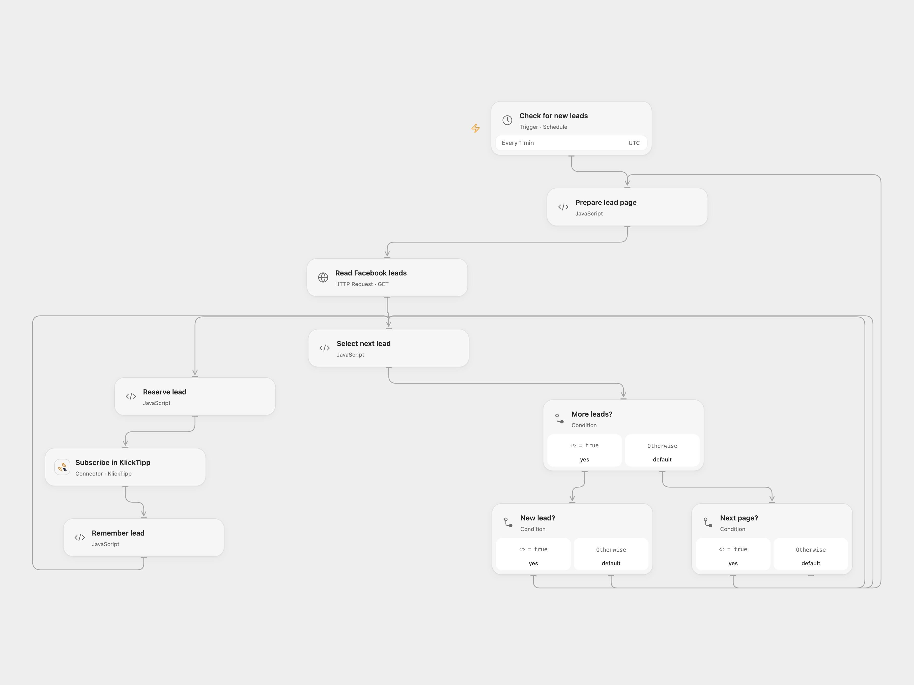

# Sync Facebook Leads to KlickTipp

Import Facebook Lead Ads contacts and form answers into KlickTipp.

<picture>
  <source media="(prefers-color-scheme: dark)" srcset="preview-dark.png">
  
</picture>

[Open Flow JSON](templates/sync-facebook-leads-to-klicktipp.openflow.json) · [n8n JSON](templates/sync-facebook-leads-to-klicktipp.n8n.json)

## Setup

Enable persistent State and prevent overlapping runs. Configure the form ID in **Prepare lead page**, bind secret Variable FACEBOOK_PAGE_TOKEN with a Page token permitted to retrieve the form's leads (including leads_retrieval and the Page/ad permissions required by Meta), and connect KlickTipp using a Listbuilding API key configured for the intended opt-in and tag. In **Select next lead**, set the three KlickTipp field keys for comments, course and payment method. The form must contain email, full name and the source's three German question keys; adapt mappings for your form. Configure Facebook, form, KlickTipp opt-in and custom fields in n8n and activate one format.

## Behavior

Open Flow polls all pages of the form every minute. Its first completed poll records existing lead IDs as a baseline; subsequent polls subscribe unseen leads and remember them after KlickTipp confirms. IDs accumulate in State and must fit its limits. Leads created during the initial baseline may be absorbed into it. This differs from the n8n real-time trigger. The Listbuilding API key selects its opt-in and tag; custom field IDs must match the account. Full lead responses may be retained in execution history. Before each subscription Open Flow saves the lead ID as pending. If a run stops after that point, later runs stop without sending until you inspect KlickTipp. In **Select next lead**, enter the pending lead ID in acknowledgeLeadId and set resolution to confirmed if the subscription exists, or retry if it is safe to send again. Run once, then clear both fields.

Inspiration &amp; credits

## Changes to the source

- Poll Meta's form leads with a Page token and persistent IDs in Open Flow; n8n retains the Facebook trigger. Replace private form, opt-in and field IDs.

Adapted from [Facebook Lead Ads to KlickTipp](https://github.com/Zie619/n8n-workflows/blob/ae8cf6dc5b873cbb4f74587aa9180ed3a9f70682/workflows/Facebookleadads/0896_Facebookleadads_Stickynote_Automate_Triggered.json) in [Zie619/n8n-workflows](https://github.com/Zie619/n8n-workflows). The source export does not identify a separate template author or license.

The collection’s [MIT notice](https://github.com/Zie619/n8n-workflows/blob/94007c1445d9258a7da116646b79473e7c7c3282/LICENSE) is pinned at a later revision. This is the collection notice at that revision; it does not establish a separate original template author's license. Our changes are listed above; see [repository licensing](../../README.md#licensing).

> MIT License
>
> Copyright (c) 2025 Zie619
>
> Permission is hereby granted, free of charge, to any person obtaining a copy
> of this software and associated documentation files (the "Software"), to deal
> in the Software without restriction, including without limitation the rights
> to use, copy, modify, merge, publish, distribute, sublicense, and/or sell
> copies of the Software, and to permit persons to whom the Software is
> furnished to do so, subject to the following conditions:
>
> The above copyright notice and this permission notice shall be included in all
> copies or substantial portions of the Software.
>
> THE SOFTWARE IS PROVIDED "AS IS", WITHOUT WARRANTY OF ANY KIND, EXPRESS OR
> IMPLIED, INCLUDING BUT NOT LIMITED TO THE WARRANTIES OF MERCHANTABILITY,
> FITNESS FOR A PARTICULAR PURPOSE AND NONINFRINGEMENT. IN NO EVENT SHALL THE
> AUTHORS OR COPYRIGHT HOLDERS BE LIABLE FOR ANY CLAIM, DAMAGES OR OTHER
> LIABILITY, WHETHER IN AN ACTION OF CONTRACT, TORT OR OTHERWISE, ARISING FROM,
> OUT OF OR IN CONNECTION WITH THE SOFTWARE OR THE USE OR OTHER DEALINGS IN THE
> SOFTWARE.

