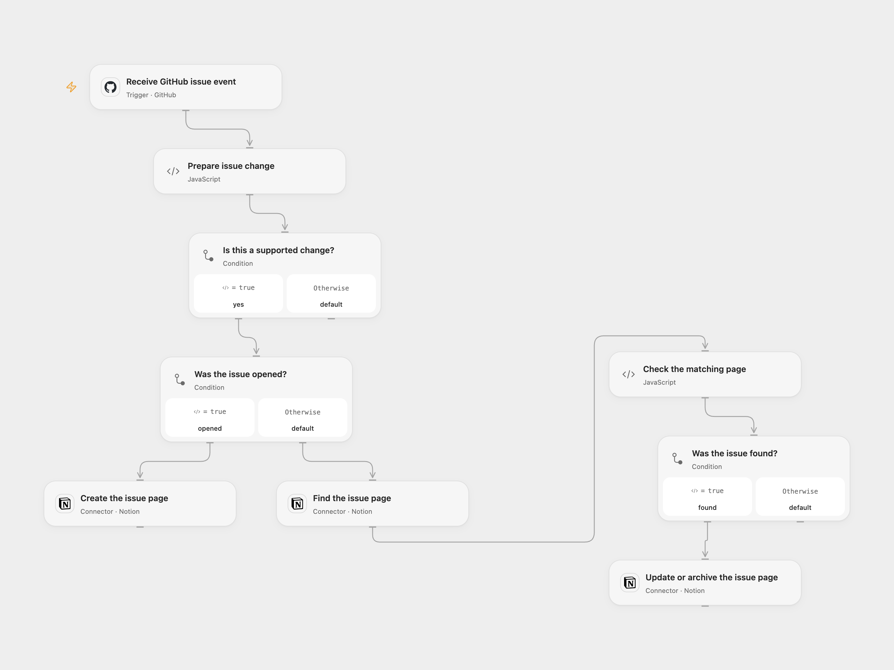

# Sync GitHub Issues to a Notion Database

Create and maintain Notion database pages for GitHub issue lifecycle events.

<picture>
  <source media="(prefers-color-scheme: dark)" srcset="preview-dark.png">
  
</picture>

[Open Flow JSON](templates/sync-github-issues-to-notion-database.openflow.json) · [n8n JSON](templates/sync-github-issues-to-notion-database.n8n.json)

## Setup

Connect GitHub in **Receive GitHub issue event** and set the repository owner and name. The account must be able to manage repository webhooks. Share the Notion database with the Notion connection, and connect that account in each Notion node. The database needs **Issue** (title), **Issue ID** (number), **Link** (URL) and **Closed** (checkbox) properties.

In Open Flow set the Notion data source ID in **Prepare issue change**. In n8n select the database in **Create database page** and **Find database page**. The data source ID and database ID can differ. Activate only one format.

## Behavior

An opened issue creates a page with its title, numeric GitHub ID, link and unchecked Closed property. For edited, closed, reopened or deleted issues, the workflow finds the page by issue ID. It changes the title, checks or clears Closed, or archives the page, respectively. Other issue events are ignored; no matching page produces no update. Duplicate matching pages stop before updating.

Notion or GitHub errors stop the run. There is no automatic retry or transactional guarantee; inspect Notion before replaying an uncertain write. Repeated opened deliveries can create duplicate pages. Avoid overlapping runs and restrict access to issue details and workflow history.

Inspiration &amp; credits

## Changes to the source

- Replace repository and database identifiers with configuration and validate the issue payload.
- Stop when more than one page matches an issue instead of updating multiple pages. Open Flow uses the current Notion data source API.

Adapted from [Sync Github Issues to Notion](https://github.com/Zie619/n8n-workflows/blob/ae8cf6dc5b873cbb4f74587aa9180ed3a9f70682/workflows/Github/0264_GitHub_Stickynote_Create_Triggered.json) in [Zie619/n8n-workflows](https://github.com/Zie619/n8n-workflows). The source export does not identify a separate template author or license.

The collection’s [MIT notice](https://github.com/Zie619/n8n-workflows/blob/94007c1445d9258a7da116646b79473e7c7c3282/LICENSE) is pinned at a later revision. This is the collection notice at that revision; it does not establish a separate original template author's license. Our changes are listed above; see [repository licensing](../../README.md#licensing).

> MIT License
>
> Copyright (c) 2025 Zie619
>
> Permission is hereby granted, free of charge, to any person obtaining a copy
> of this software and associated documentation files (the "Software"), to deal
> in the Software without restriction, including without limitation the rights
> to use, copy, modify, merge, publish, distribute, sublicense, and/or sell
> copies of the Software, and to permit persons to whom the Software is
> furnished to do so, subject to the following conditions:
>
> The above copyright notice and this permission notice shall be included in all
> copies or substantial portions of the Software.
>
> THE SOFTWARE IS PROVIDED "AS IS", WITHOUT WARRANTY OF ANY KIND, EXPRESS OR
> IMPLIED, INCLUDING BUT NOT LIMITED TO THE WARRANTIES OF MERCHANTABILITY,
> FITNESS FOR A PARTICULAR PURPOSE AND NONINFRINGEMENT. IN NO EVENT SHALL THE
> AUTHORS OR COPYRIGHT HOLDERS BE LIABLE FOR ANY CLAIM, DAMAGES OR OTHER
> LIABILITY, WHETHER IN AN ACTION OF CONTRACT, TORT OR OTHERWISE, ARISING FROM,
> OUT OF OR IN CONNECTION WITH THE SOFTWARE OR THE USE OR OTHER DEALINGS IN THE
> SOFTWARE.

