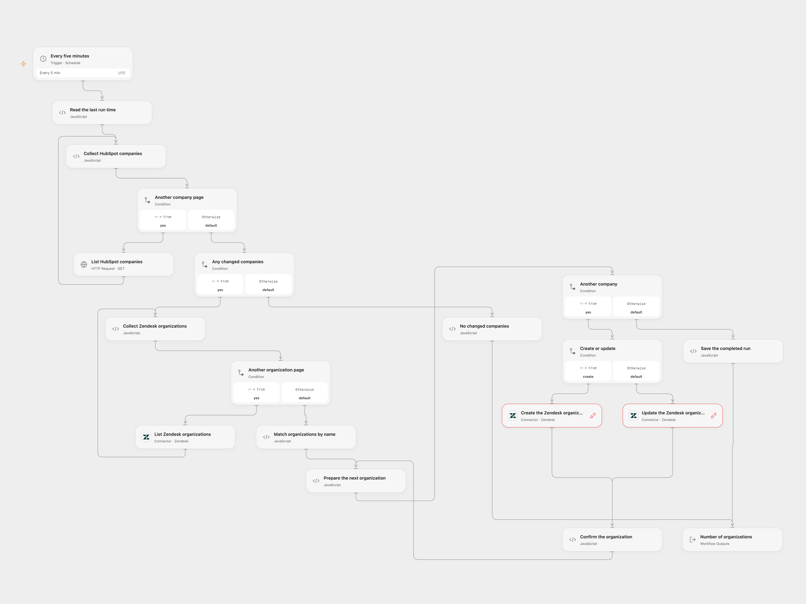

# Sync HubSpot Companies to Zendesk

Sync changed HubSpot company names and domains to matching Zendesk organizations.

<picture>
  <source media="(prefers-color-scheme: dark)" srcset="preview-dark.png">
  
</picture>

[Open Flow JSON](templates/sync-hubspot-companies-to-zendesk.openflow.json) · [n8n JSON](templates/sync-hubspot-companies-to-zendesk.n8n.json)

## Setup

Create a HubSpot app token with company read access, store it as the secret Variable HUBSPOT_PRIVATE_APP_TOKEN and bind it to **List HubSpot companies**. Connect Zendesk for organization listing and both Provider API write nodes. Use the same Zendesk account for all three. In n8n, create a Header Auth credential whose Authorization value is Bearer YOUR_HUBSPOT_TOKEN, select it on **List HubSpot companies**, select the same Zendesk credential on both Zendesk HTTP nodes, and set the Zendesk subdomain URL in **Read the last run time**. Enable only one format. Keep workflow State persistent and prevent overlapping runs.

## Behavior

Every five minutes, read HubSpot companies modified in the half-open interval from the saved time through the start of this run, match each by case-insensitive organization name, and create or update the Zendesk organization name and domain. The first run establishes the current-time baseline before reading. The workflow only considers changes after that baseline. Missing names or domains and duplicate matches stop before any organization write. Updating a matched organization replaces its existing domain list with the HubSpot domain. The saved time advances only after every write is confirmed; an empty batch keeps the previous time and is read again next run. A failed or uncertain write may already have succeeded, and earlier writes can remain; inspect Zendesk before rerunning. Full listings are not a transactional snapshot: concurrent changes while pages are read can affect which records are observed. For Open Flow, the Zendesk Action uses offset pagination and stops before writing if more than 100 pages are needed. In n8n, each listing stops before writing if more than 100 pages are needed. Large accounts can hit these limits; a long empty period can increase repeated reading. The workflow does not remove organizations when HubSpot companies are deleted.

## Changes to the source

- Replace private configuration and read all HubSpot companies without relying on an indexed search; filter by their last modification time.
- Reject duplicate organization and company names, validate the batch before writing, and use the Zendesk Provider API for creation and updates.

Source and license

Adapted from [Sync HubSpot companies to Zendesk organizations](https://github.com/Zie619/n8n-workflows/blob/ae8cf6dc5b873cbb4f74587aa9180ed3a9f70682/workflows/Zendesk/0285_Zendesk_HubSpot_Create_Scheduled.json) in [Zie619/n8n-workflows](https://github.com/Zie619/n8n-workflows). The matching [n8n listing](https://n8n.io/workflows/1840-sync-zendesk-tickets-to-your-hubspot-contacts/) credits n8n Team. No separate original template license was found.

The collection’s [MIT notice](https://github.com/Zie619/n8n-workflows/blob/94007c1445d9258a7da116646b79473e7c7c3282/LICENSE) is pinned at a later revision. This is the collection notice at that revision; it does not establish a separate original template author's license. Our changes are listed above; see [repository licensing](../../README.md#licensing).

> MIT License
>
> Copyright (c) 2025 Zie619
>
> Permission is hereby granted, free of charge, to any person obtaining a copy
> of this software and associated documentation files (the "Software"), to deal
> in the Software without restriction, including without limitation the rights
> to use, copy, modify, merge, publish, distribute, sublicense, and/or sell
> copies of the Software, and to permit persons to whom the Software is
> furnished to do so, subject to the following conditions:
>
> The above copyright notice and this permission notice shall be included in all
> copies or substantial portions of the Software.
>
> THE SOFTWARE IS PROVIDED "AS IS", WITHOUT WARRANTY OF ANY KIND, EXPRESS OR
> IMPLIED, INCLUDING BUT NOT LIMITED TO THE WARRANTIES OF MERCHANTABILITY,
> FITNESS FOR A PARTICULAR PURPOSE AND NONINFRINGEMENT. IN NO EVENT SHALL THE
> AUTHORS OR COPYRIGHT HOLDERS BE LIABLE FOR ANY CLAIM, DAMAGES OR OTHER
> LIABILITY, WHETHER IN AN ACTION OF CONTRACT, TORT OR OTHERWISE, ARISING FROM,
> OUT OF OR IN CONNECTION WITH THE SOFTWARE OR THE USE OR OTHER DEALINGS IN THE
> SOFTWARE.

