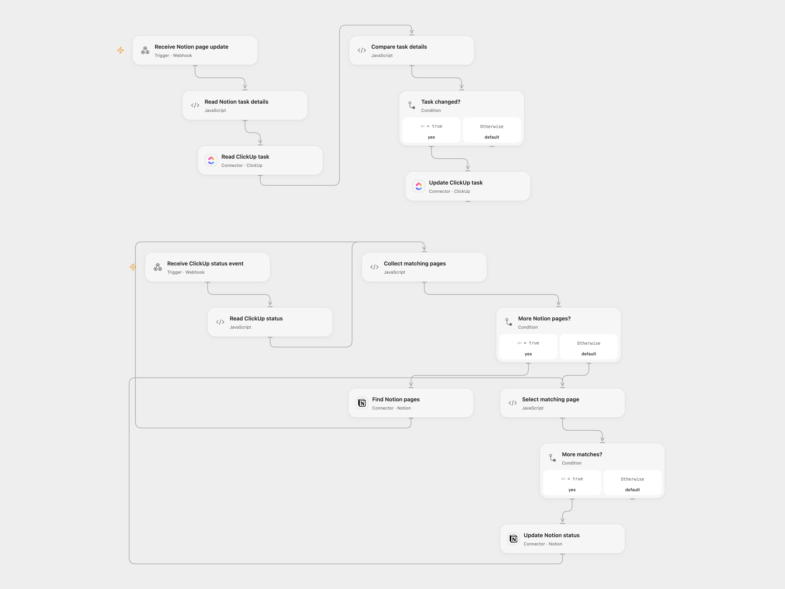

# Sync Notion and ClickUp Tasks

Synchronize Notion page details to ClickUp and ClickUp status changes back to Notion.

<picture>
  <source media="(prefers-color-scheme: dark)" srcset="preview-dark.png">
  
</picture>

[Open Flow JSON](templates/sync-notion-and-clickup-tasks.openflow.json) · [n8n JSON](templates/sync-notion-and-clickup-tasks.n8n.json)

## Setup and use

Configure Notion and ClickUp credentials, the Notion database, ClickUp workspace and matching status names in n8n. For n8n mode enable the original two triggers; for Open Flow mode disable them, enable their Open Flow counterparts and set both relay URLs. In Open Flow connect Notion and ClickUp and provide the Notion data source ID. The Notion data source needs a rich text **ClickUp ID**, title **Task name**, select **Status** and date **Deadline**. Restrict access to both Open Flow webhooks, which do not authenticate callers.

## Behavior

A changed Notion page updates the matching ClickUp task’s name, status and deadline when they differ. A ClickUp status event queries every matching Notion page by ClickUp ID and updates its Status select when it differs. Keep status names consistent and monitor both directions for repeated updates. Trigger polling and the relay are not durable queues; reconcile changes after outages or failed deliveries. Inspect both systems before retrying an uncertain write.

Inspiration &amp; credits

## Changes to the source

- Replace source identifiers with configuration and add optional n8n trigger relays. Skip unchanged values to avoid repeated writes in both directions. Open Flow queries the Notion data source with explicit pagination.

Adapted from [Notion and ClickUp task sync](https://github.com/Zie619/n8n-workflows/blob/ae8cf6dc5b873cbb4f74587aa9180ed3a9f70682/workflows/Clickup/0282_Clickup_Notion_Update_Triggered.json) in [Zie619/n8n-workflows](https://github.com/Zie619/n8n-workflows). The source export does not identify a separate template author or license.

The collection’s [MIT notice](https://github.com/Zie619/n8n-workflows/blob/94007c1445d9258a7da116646b79473e7c7c3282/LICENSE) is pinned at a later revision. This is the collection notice at that revision; it does not establish a separate original template author's license. Our changes are listed above; see [repository licensing](../../README.md#licensing).

> MIT License
>
> Copyright (c) 2025 Zie619
>
> Permission is hereby granted, free of charge, to any person obtaining a copy
> of this software and associated documentation files (the "Software"), to deal
> in the Software without restriction, including without limitation the rights
> to use, copy, modify, merge, publish, distribute, sublicense, and/or sell
> copies of the Software, and to permit persons to whom the Software is
> furnished to do so, subject to the following conditions:
>
> The above copyright notice and this permission notice shall be included in all
> copies or substantial portions of the Software.
>
> THE SOFTWARE IS PROVIDED "AS IS", WITHOUT WARRANTY OF ANY KIND, EXPRESS OR
> IMPLIED, INCLUDING BUT NOT LIMITED TO THE WARRANTIES OF MERCHANTABILITY,
> FITNESS FOR A PARTICULAR PURPOSE AND NONINFRINGEMENT. IN NO EVENT SHALL THE
> AUTHORS OR COPYRIGHT HOLDERS BE LIABLE FOR ANY CLAIM, DAMAGES OR OTHER
> LIABILITY, WHETHER IN AN ACTION OF CONTRACT, TORT OR OTHERWISE, ARISING FROM,
> OUT OF OR IN CONNECTION WITH THE SOFTWARE OR THE USE OR OTHER DEALINGS IN THE
> SOFTWARE.

