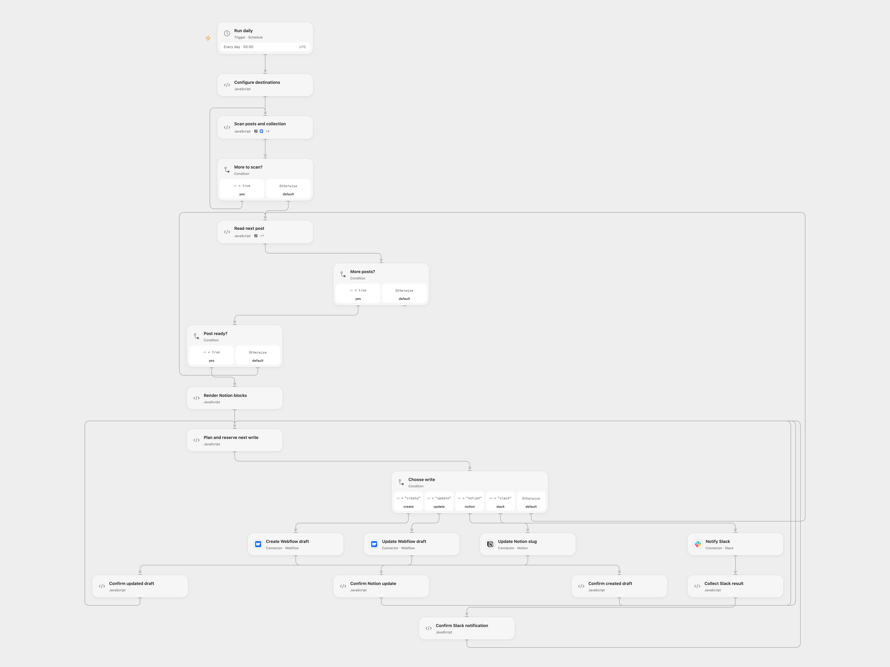

# Sync Notion Blog Posts to Webflow

Sync selected Notion posts as Webflow drafts and notify Slack.

<!-- template-actions:start -->
 
<!-- template-actions:end -->

<picture>
  <source media="(prefers-color-scheme: dark)" srcset="preview-dark.png">
  
</picture>

## Setup

Connect Notion, Webflow and Slack. Set the Notion data source ID in **Scan posts and collection**, and set the Webflow collection ID and Slack channel ID in **Configure destinations**. Use a Notion data source with a title, a rich-text property named `slug` and a checkbox named `Sync to Webflow?`. Each selected page needs an external cover image. Configure the Webflow collection field slugs used in **Plan and reserve next write**. Enable persistent State.

## Behavior

Daily at 00:00 UTC, selected pages and their direct blocks are read, matched to Webflow by slug, created or updated as drafts, written back to Notion and reported in Slack. Duplicate selected slugs stop the Open Flow run. It supports paragraphs, headings, quotes, lists, code and images; unsupported or nested blocks stop the run. Webflow list pages are fetched until a page contains fewer than 100 items. Concurrent collection changes can affect offset pagination.

Before each write a pending record is saved. If a response is uncertain, inspect the destination before retrying. In Open Flow enter the pending key and confirmed or absent in **Plan and reserve next write**; for a confirmed Webflow write also enter its item ID. Restore the earlier page content if it changed while pending. During a recovery run, already completed pages are skipped. Clear recovery fields after use to resume regular daily syncs. Earlier writes may remain after later failure.

In n8n

In n8n configure the Notion database ID, Webflow collection ID, Slack channel and a Data Table with text columns `item_key` and `status`; connect the Notion, Webflow OAuth2 and Slack credentials. Enable one format and avoid overlapping runs or edits. In n8n inspect the pending Data Table row and the destination; complete or repair the operation manually before deleting the row.

Inspiration &amp; credits

Use current Webflow v2, paginate all items, preserve page association and stop on uncertain writes. Escape rendered content and retain drafts.

Adapted from [Notion to Webflow](https://github.com/Zie619/n8n-workflows/blob/ae8cf6dc5b873cbb4f74587aa9180ed3a9f70682/workflows/Code/0506_Code_Filter_Create_Scheduled.json) in [Zie619/n8n-workflows](https://github.com/Zie619/n8n-workflows). The source export does not identify a separate template author or license.

The collection’s [MIT notice](https://github.com/Zie619/n8n-workflows/blob/94007c1445d9258a7da116646b79473e7c7c3282/LICENSE) is pinned at a later revision. This is the collection notice at that revision; it does not establish a separate original template author's license. Our changes are listed above; see [repository licensing](../../README.md#licensing).

> MIT License
>
> Copyright (c) 2025 Zie619
>
> Permission is hereby granted, free of charge, to any person obtaining a copy
> of this software and associated documentation files (the "Software"), to deal
> in the Software without restriction, including without limitation the rights
> to use, copy, modify, merge, publish, distribute, sublicense, and/or sell
> copies of the Software, and to permit persons to whom the Software is
> furnished to do so, subject to the following conditions:
>
> The above copyright notice and this permission notice shall be included in all
> copies or substantial portions of the Software.
>
> THE SOFTWARE IS PROVIDED "AS IS", WITHOUT WARRANTY OF ANY KIND, EXPRESS OR
> IMPLIED, INCLUDING BUT NOT LIMITED TO THE WARRANTIES OF MERCHANTABILITY,
> FITNESS FOR A PARTICULAR PURPOSE AND NONINFRINGEMENT. IN NO EVENT SHALL THE
> AUTHORS OR COPYRIGHT HOLDERS BE LIABLE FOR ANY CLAIM, DAMAGES OR OTHER
> LIABILITY, WHETHER IN AN ACTION OF CONTRACT, TORT OR OTHERWISE, ARISING FROM,
> OUT OF OR IN CONNECTION WITH THE SOFTWARE OR THE USE OR OTHER DEALINGS IN THE
> SOFTWARE.

