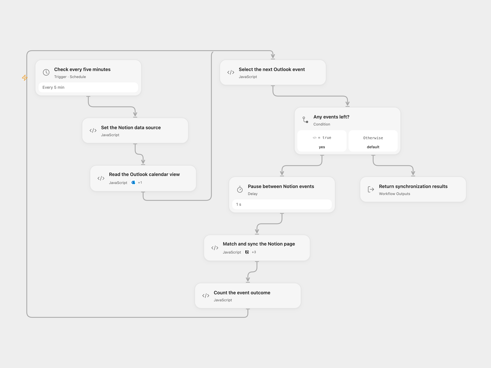

# Sync Outlook Calendar Events to Notion

Sync your primary Outlook calendar to a Notion data source, matching each event by its Outlook ID.

<!-- template-actions:start -->
 
<!-- template-actions:end -->

<picture>
  <source media="(prefers-color-scheme: dark)" srcset="preview-dark.png">
  
</picture>

## Setup

1. Create or select one Notion data source with these properties. Existing calendar rows should keep their Outlook IDs.

| Property | Type |
| --- | --- |
| Name | Title |
| Event ID | Text |
| Date | Date |
| Link | URL |

2. In **Set the Notion data source**, enter the destination data source ID. Give the Notion connection permission to read, insert and update pages in that data source, and bind it in **Match and sync the Notion page**. [Find and query a data source](https://developers.notion.com/reference/query-a-data-source)
3. Bind your Outlook Calendar connection in **Read the Outlook calendar view**. Use a calendar and Notion destination authorized to share the event details. Publish and enable the workflow.

## Behavior

Every five minutes, the workflow reads the primary calendar view through the next 365 days in UTC, including recurring event occurrences and exceptions. It reads the available calendar pages before updating Notion. The workflow stops before any Notion writes if the calendar exceeds 20 pages or 2,000 events, or if the returned data is incomplete.

Each event ID matches one page. A missing page is created. An existing page is updated only when its title, date range or link changes. The date range stores the Outlook start and end instants in UTC. Rows for events that leave the window or disappear in Outlook remain in Notion. Any cancelled event still returned with complete fields is synchronized normally.

Review the run outcomes for failed lookups and pending writes. A pending reservation blocks another write for that event ID until an operator verifies and resolves it. The workflow recognizes an already visible page whose mapped values match. Use one workflow for each Outlook calendar and Notion data source pair. Increase the interval if your initial sync cannot finish before the next scheduled run.

In n8n

Set the data source ID in **Set the Notion data source**. In **Read the Outlook calendar view**, bind a delegated OAuth2 API credential for Microsoft Graph with the `https://graph.microsoft.com/Calendars.ReadBasic` and `offline_access` scopes. Use your Microsoft Entra app registration and n8n callback URL. [Microsoft Graph calendarView](https://learn.microsoft.com/en-us/graph/api/calendar-list-calendarview?view=graph-rest-1.0)

In **Find the Notion page by Event ID** and **Create or update the Notion page**, bind a Bearer Auth credential containing your Notion integration token. Use a dedicated Data Table with a text column `request_key` in **Check for an unresolved write**, **Reserve the Notion write** and **Clear the confirmed reservation**. Run one active copy in regular mode with `N8N_CONCURRENCY_PRODUCTION_LIMIT=1` and avoid overlapping manual runs. Check a pending event in Notion before clearing its reservation. The reservation table records unresolved event keys. The loop returns per-event outcomes, and scheduled execution saving is off by default. Restrict access if you enable history for calendar runs.

Inspiration &amp; credits

## Changes to the source

Read every calendar page within the supported limit and query the Notion data source by exact event ID. Keep Notion page IDs separate from Outlook event IDs and reserve each uncertain write. Preserve the five-minute default and the 365-day window. [Original workflow by n8n Team](https://n8n.io/workflows/1945-sync-outlook-calendar-events-to-notion/).

Adapted from [Outlook Calendar to Notion](https://github.com/Zie619/n8n-workflows/blob/ae8cf6dc5b873cbb4f74587aa9180ed3a9f70682/workflows/Datetime/0316_Datetime_Schedule_Create_Webhook.json) in [Zie619/n8n-workflows](https://github.com/Zie619/n8n-workflows). Attribution: n8n Team (original workflow); Zie619 / n8n-workflows (collection).

The collection’s [MIT notice](https://github.com/Zie619/n8n-workflows/blob/94007c1445d9258a7da116646b79473e7c7c3282/LICENSE) is pinned at a later revision. This is the collection notice at that revision; it does not establish a separate original template author's license. Our changes are listed above; see [repository licensing](../../README.md#licensing).

> MIT License
>
> Copyright (c) 2025 Zie619
>
> Permission is hereby granted, free of charge, to any person obtaining a copy
> of this software and associated documentation files (the "Software"), to deal
> in the Software without restriction, including without limitation the rights
> to use, copy, modify, merge, publish, distribute, sublicense, and/or sell
> copies of the Software, and to permit persons to whom the Software is
> furnished to do so, subject to the following conditions:
>
> The above copyright notice and this permission notice shall be included in all
> copies or substantial portions of the Software.
>
> THE SOFTWARE IS PROVIDED "AS IS", WITHOUT WARRANTY OF ANY KIND, EXPRESS OR
> IMPLIED, INCLUDING BUT NOT LIMITED TO THE WARRANTIES OF MERCHANTABILITY,
> FITNESS FOR A PARTICULAR PURPOSE AND NONINFRINGEMENT. IN NO EVENT SHALL THE
> AUTHORS OR COPYRIGHT HOLDERS BE LIABLE FOR ANY CLAIM, DAMAGES OR OTHER
> LIABILITY, WHETHER IN AN ACTION OF CONTRACT, TORT OR OTHERWISE, ARISING FROM,
> OUT OF OR IN CONNECTION WITH THE SOFTWARE OR THE USE OR OTHER DEALINGS IN THE
> SOFTWARE.

