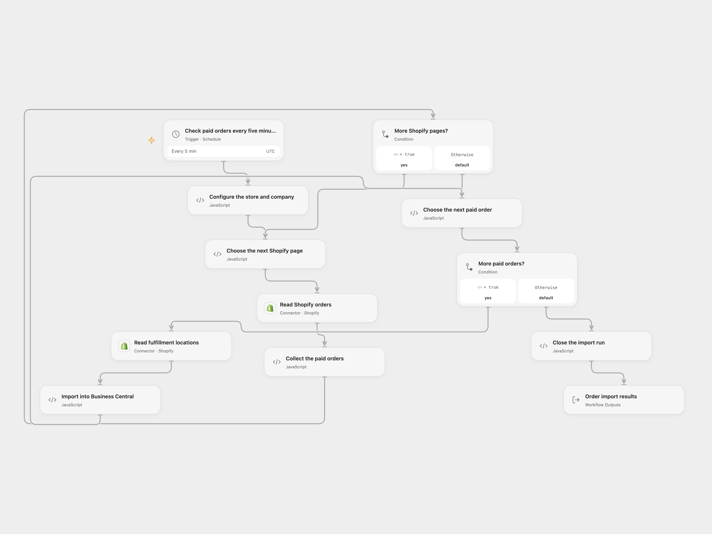

# Sync Paid Shopify Orders to Business Central

Create unposted Business Central sales invoices for paid Shopify POS orders and sales orders for other paid Shopify orders.

<!-- template-actions:start -->
 
<!-- template-actions:end -->

<picture>
  <source media="(prefers-color-scheme: dark)" srcset="preview-dark.png">
  
</picture>

## Setup

1. In **Configure the store and company**, enter the Shopify `myshopify.com` domain and the Business Central tenant, environment, and company IDs. Enable tax and discount item lines only for configured Business Central SKUs. The tax and discount switches start enabled to match the source.
2. Use the same authorized Shopify connection in **Read Shopify orders** and **Read fulfillment locations**. It needs Admin REST access for orders, customer fields and the fulfillment orders belonging to your locations. [Shopify orders](https://shopify.dev/docs/api/admin-rest/latest/resources/order) · [Fulfillment order access](https://shopify.dev/docs/api/admin-rest/latest/resources/fulfillmentorder)
3. Grant your Microsoft Entra application the Business Central application permission `API.ReadWrite.All`, grant tenant admin consent, and assign Business Central permissions for customer and sales documents in the selected company. Bind `BC_CLIENT_ID` and `BC_CLIENT_SECRET` as secret variables in **Import into Business Central**. Activate one deployment per store and company. [Business Central service-to-service setup](https://learn.microsoft.com/en-us/dynamics365/business-central/dev-itpro/administration/automation-apis-using-s2s-authentication)

## Behavior

Every five minutes, the workflow reads orders updated in the last 24 hours and selects paid orders. It checks that fulfillment lines belong to the current Shopify order and looks up a Business Central document by the exact Shopify order ID. An existing document is left alone. A new document uses the matching customer email, or creates the customer from the order when there is no match. POS orders become sales invoices. Other orders become sales orders. The workflow leaves documents unposted.

Each document uses the order date, currency and available shipping address. Product lines retain their SKU, quantity, description and unit price. Optional adjustments add tax and negative discount items. Shopify fulfillment locations are checked for association. They do not change Business Central warehouse assignments.

The workflow reads up to 50 pages of Shopify orders per run and handles orders with up to 100 lines including adjustments. Inspect **Order import results** for order IDs and outcomes. If a confirmed new document has a definite line validation failure, the workflow verifies that exact draft and uses its current ETag to remove it. Uncertain responses leave the order reserved for review. Check Business Central before clearing a reservation or retrying. If an interrupted run leaves the run reservation, verify it is no longer running before clearing it. Keep order drafts untouched during import.

In n8n

Set the same store, company and item settings in **Configure the store and company**. Bind **Header Auth** for `X-Shopify-Access-Token` to **Read Shopify orders** and **Read fulfillment locations**. Use an authorized Admin API access token for that store.

Bind **OAuth2 API** to **Send the Business Central request** using **Client Credentials**, your Microsoft Entra application, token URL `https://login.microsoftonline.com/<tenant>/oauth2/v2.0/token`, scope `https://api.businesscentral.dynamics.com/.default`, and body authentication.

Use one production execution slot and a dedicated Data Table with text columns `scope_key`, `status`, `document_id` and `stage`. Select it in **Find the order reservation**, **Reserve the order before writes** and **Record the order outcome**. Review reservations and outcomes there. Start retries from the schedule after reconciliation so the reservation check runs.

Inspiration &amp; credits

Adapted from [Shopify to Microsoft Dynamics 365 Business Central](https://github.com/Zie619/n8n-workflows/blob/ae8cf6dc5b873cbb4f74587aa9180ed3a9f70682/workflows/Splitout/1560_Splitout_Code_Automation_Webhook.json) in [Zie619/n8n-workflows](https://github.com/Zie619/n8n-workflows). Attribution: Greg Lopez (Integro Cloud Solutions, original workflow) / Zie619 (collection).

The collection’s [MIT notice](https://github.com/Zie619/n8n-workflows/blob/94007c1445d9258a7da116646b79473e7c7c3282/LICENSE) is pinned at a later revision. This is the collection notice at that revision; it does not establish a separate original template author's license. Our changes are listed above; see [repository licensing](../../README.md#licensing).

> MIT License
>
> Copyright (c) 2025 Zie619
>
> Permission is hereby granted, free of charge, to any person obtaining a copy
> of this software and associated documentation files (the "Software"), to deal
> in the Software without restriction, including without limitation the rights
> to use, copy, modify, merge, publish, distribute, sublicense, and/or sell
> copies of the Software, and to permit persons to whom the Software is
> furnished to do so, subject to the following conditions:
>
> The above copyright notice and this permission notice shall be included in all
> copies or substantial portions of the Software.
>
> THE SOFTWARE IS PROVIDED "AS IS", WITHOUT WARRANTY OF ANY KIND, EXPRESS OR
> IMPLIED, INCLUDING BUT NOT LIMITED TO THE WARRANTIES OF MERCHANTABILITY,
> FITNESS FOR A PARTICULAR PURPOSE AND NONINFRINGEMENT. IN NO EVENT SHALL THE
> AUTHORS OR COPYRIGHT HOLDERS BE LIABLE FOR ANY CLAIM, DAMAGES OR OTHER
> LIABILITY, WHETHER IN AN ACTION OF CONTRACT, TORT OR OTHERWISE, ARISING FROM,
> OUT OF OR IN CONNECTION WITH THE SOFTWARE OR THE USE OR OTHER DEALINGS IN THE
> SOFTWARE.

