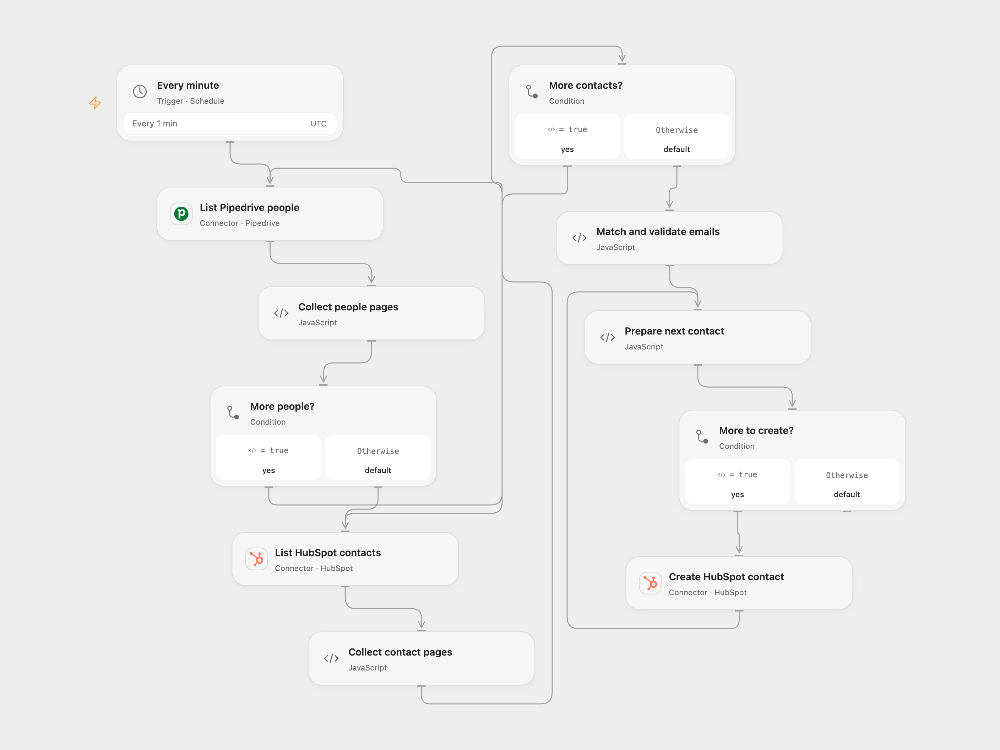

# Sync Pipedrive People to HubSpot

Create HubSpot contacts for Pipedrive people whose first email is not already present.

<picture>
  <source media="(prefers-color-scheme: dark)" srcset="preview-dark.png">
  
</picture>

[Open Flow JSON](templates/sync-pipedrive-people-to-hubspot.openflow.json) · [n8n JSON](templates/sync-pipedrive-people-to-hubspot.n8n.json)

## Setup

Connect Pipedrive in **List Pipedrive people** and HubSpot in **List HubSpot contacts** and **Create HubSpot contact**. Grant read access to people and contacts, and permission to create contacts. In n8n configure a Pipedrive HTTP Header Auth credential with name `x-api-token`, and HubSpot OAuth credentials for the two HTTP nodes. Enable only one format.

## Behavior

Every minute the workflow reads all available Pipedrive people and HubSpot contacts, compares each person's first email case-insensitively, and creates one HubSpot contact with that email and the first name when present. It does not update existing contacts. If a Pipedrive person lacks a first email, the run stops before creating any contacts. Duplicate Pipedrive emails are created once per run.

The Open Flow HubSpot search follows pages and stops without creating contacts if it reaches the 10,000-result search limit. n8n stops before creation if either list still has a next page after 100 requests, or if it reads 10,000 HubSpot contacts, even when the last page has no next cursor. Search indexing can lag, so a very recent HubSpot contact might not yet appear. Concurrent runs and uncertain create outcomes can also cause conflicts; inspect HubSpot before retrying. Earlier creates are not rolled back if a later create fails. The source used its n8n instance timezone and a stable second in each minute; Open Flow runs at minute boundaries in UTC.

Inspiration &amp; credits

## Changes to the source

- Use current Pipedrive V2 and HubSpot contact formats; the old Pipedrive V1 endpoint is deprecated. Compare normalized emails instead of the first legacy identity entry and fail before writes if a person lacks an email.
- Follow pages, deduplicate the planned creates and make partial failures explicit.

Adapted from [Hubspot Workflow](https://github.com/Zie619/n8n-workflows/blob/ae8cf6dc5b873cbb4f74587aa9180ed3a9f70682/workflows/Hubspot/0130_HubSpot_Cron_Automate_Scheduled.json) in [Zie619/n8n-workflows](https://github.com/Zie619/n8n-workflows). The source export does not identify a separate template author or license.

The collection’s [MIT notice](https://github.com/Zie619/n8n-workflows/blob/94007c1445d9258a7da116646b79473e7c7c3282/LICENSE) is pinned at a later revision. This is the collection notice at that revision; it does not establish a separate original template author's license. Our changes are listed above; see [repository licensing](../../README.md#licensing).

> MIT License
>
> Copyright (c) 2025 Zie619
>
> Permission is hereby granted, free of charge, to any person obtaining a copy
> of this software and associated documentation files (the "Software"), to deal
> in the Software without restriction, including without limitation the rights
> to use, copy, modify, merge, publish, distribute, sublicense, and/or sell
> copies of the Software, and to permit persons to whom the Software is
> furnished to do so, subject to the following conditions:
>
> The above copyright notice and this permission notice shall be included in all
> copies or substantial portions of the Software.
>
> THE SOFTWARE IS PROVIDED "AS IS", WITHOUT WARRANTY OF ANY KIND, EXPRESS OR
> IMPLIED, INCLUDING BUT NOT LIMITED TO THE WARRANTIES OF MERCHANTABILITY,
> FITNESS FOR A PARTICULAR PURPOSE AND NONINFRINGEMENT. IN NO EVENT SHALL THE
> AUTHORS OR COPYRIGHT HOLDERS BE LIABLE FOR ANY CLAIM, DAMAGES OR OTHER
> LIABILITY, WHETHER IN AN ACTION OF CONTRACT, TORT OR OTHERWISE, ARISING FROM,
> OUT OF OR IN CONNECTION WITH THE SOFTWARE OR THE USE OR OTHER DEALINGS IN THE
> SOFTWARE.

