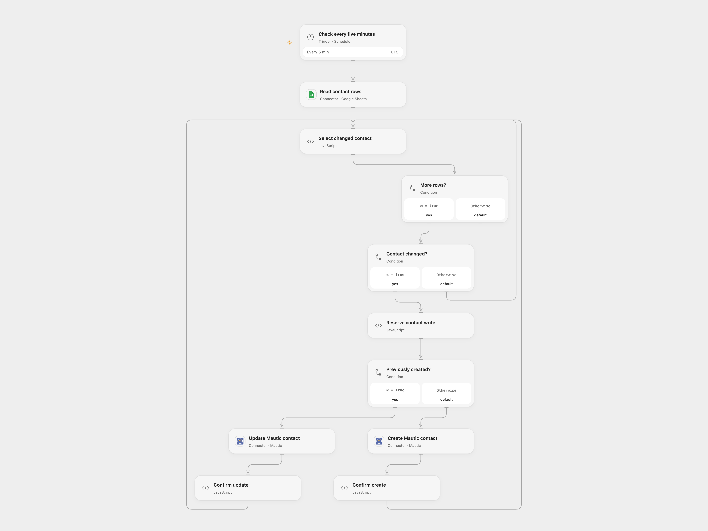

# Sync Google Sheet Contacts to Mautic

Keep Mautic contacts aligned with email, first name and mobile fields in a Google Sheet.

<picture>
  <source media="(prefers-color-scheme: dark)" srcset="preview-dark.png">
  
</picture>

[Open Flow JSON](templates/sync-sheet-contacts-to-mautic.openflow.json) · [n8n JSON](templates/sync-sheet-contacts-to-mautic.n8n.json)

## Setup and use

Connect Google Sheets and Mautic, set the spreadsheet ID, and keep the Data sheet headers email, firstname and mobile. The scheduled workflow reads Data!A:P every five minutes. Enable persistent State for Open Flow. For n8n create a Data Table with text columns email and status and a numeric contactId column, then select it in every Data Table node. Use one workflow instance per table.

## Behavior and recovery

Each sheet row maps email, firstname and mobile to Mautic. The workflow remembers IDs of contacts it creates and updates those contacts when their sheet data changes. Its state starts empty and does not import existing Mautic contacts; review Mautic for existing records before the first run. Mautic may skip blank values in updates. Do not run overlapping copies against the same state.

Before a write, the workflow records a pending operation. If a response is lost, later runs stop before writing. Inspect Mautic for the contact and operation before resolving it. In Open Flow set acknowledgeEmail and resolution to confirmed and, for an uncertain create, set confirmedContactId to the Mautic ID; choose retry only after establishing that the operation did not take effect. Clear these inputs after recovery. In n8n inspect the pending Data Table row: if the write succeeded, enter the confirmed contactId and change status to done; if it did not, delete a pending create row or restore a pending update row to done. The next schedule can then continue.

Inspiration &amp; credits

## Changes to the source

- Remove the duplicate sheet node and add persistent contact association and pending-write recovery. Repeat runs update remembered contacts instead of creating another contact for every row.

Adapted from [Google Sheets to Mautic](https://github.com/Zie619/n8n-workflows/blob/ae8cf6dc5b873cbb4f74587aa9180ed3a9f70682/workflows/Mautic/1083_Mautic_GoogleSheets_Automate_Scheduled.json) in [Zie619/n8n-workflows](https://github.com/Zie619/n8n-workflows). The source export does not identify a separate template author or license.

The collection’s [MIT notice](https://github.com/Zie619/n8n-workflows/blob/94007c1445d9258a7da116646b79473e7c7c3282/LICENSE) is pinned at a later revision. This is the collection notice at that revision; it does not establish a separate original template author's license. Our changes are listed above; see [repository licensing](../../README.md#licensing).

> MIT License
>
> Copyright (c) 2025 Zie619
>
> Permission is hereby granted, free of charge, to any person obtaining a copy
> of this software and associated documentation files (the "Software"), to deal
> in the Software without restriction, including without limitation the rights
> to use, copy, modify, merge, publish, distribute, sublicense, and/or sell
> copies of the Software, and to permit persons to whom the Software is
> furnished to do so, subject to the following conditions:
>
> The above copyright notice and this permission notice shall be included in all
> copies or substantial portions of the Software.
>
> THE SOFTWARE IS PROVIDED "AS IS", WITHOUT WARRANTY OF ANY KIND, EXPRESS OR
> IMPLIED, INCLUDING BUT NOT LIMITED TO THE WARRANTIES OF MERCHANTABILITY,
> FITNESS FOR A PARTICULAR PURPOSE AND NONINFRINGEMENT. IN NO EVENT SHALL THE
> AUTHORS OR COPYRIGHT HOLDERS BE LIABLE FOR ANY CLAIM, DAMAGES OR OTHER
> LIABILITY, WHETHER IN AN ACTION OF CONTRACT, TORT OR OTHERWISE, ARISING FROM,
> OUT OF OR IN CONNECTION WITH THE SOFTWARE OR THE USE OR OTHER DEALINGS IN THE
> SOFTWARE.

