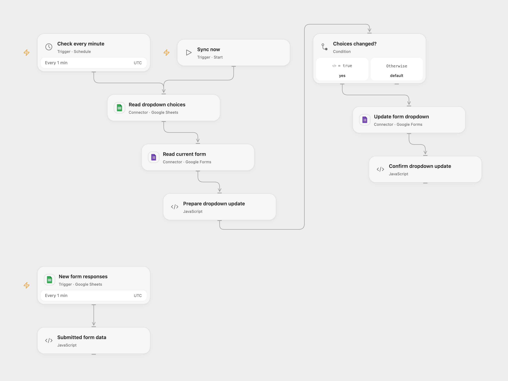

# Sync Sheet Values to a Form Dropdown

Keep a form dropdown aligned with a Google Sheets column.

<!-- template-actions:start -->
 
<!-- template-actions:end -->

<picture>
  <source media="(prefers-color-scheme: dark)" srcset="preview-dark.png">
  
</picture>

## Setup

Create a Google Form with a dropdown and a text question. Link its responses to a Google spreadsheet. Put the dropdown choices in a separate spreadsheet column, with the header `title` and one choice per row. Choices must be non-empty and distinct.

In Open Flow, connect Google Sheets and Google Forms. Set the choices spreadsheet and range in **Read dropdown choices**, the form ID in **Read current form**, and its dropdown item ID in **Prepare dropdown update**. Configure **New form responses** with the linked response spreadsheet and sheet. Enable persistent State.

## Behavior

The workflow reads the current choices and form, then updates the specified dropdown only if the values changed. Google Forms revision control rejects a stale update. The linked response sheet supplies new submissions to **Submitted form data**; connect that output to your own processing. The response trigger establishes a baseline on activation and does not replay old rows. Avoid overlapping sync runs.

If an update result is uncertain, inspect the form. In Open Flow, a matching form clears the pending marker automatically. If the desired update is absent, enter the pending key `sheet-form:<form ID>:<item ID>` in **Prepare dropdown update**, rerun once, then clear the acknowledgement. Confirm the form contents before clearing a pending marker.

In n8n

In n8n, connect the two Google Sheets triggers and **Get all values** to Google Sheets. Configure both choices nodes for the same source sheet and **New form responses** for the linked response sheet. Add a generic OAuth2 credential with Google Forms body read and write access to both HTTP nodes. Set the same form ID in their URLs and in **Prepare dropdown update**, and set its item ID there. Select one Data Table with text columns `item_key` and `status` in all checkpoint nodes. In n8n, inspect the form and remove its pending Data Table row after reconciliation, then rerun.

Inspiration &amp; credits

Use Google Forms and its linked response sheet, target one dropdown by item ID, preserve other form fields, and guard revision-controlled writes.

Adapted from [Form with Dynamic Dropdown Field](https://github.com/Zie619/n8n-workflows/blob/ae8cf6dc5b873cbb4f74587aa9180ed3a9f70682/workflows/Code/1630_Code_Form_Automation_Triggered.json) in [Zie619/n8n-workflows](https://github.com/Zie619/n8n-workflows). Attribution: Zie619 / n8n-workflows.

The collection’s [MIT notice](https://github.com/Zie619/n8n-workflows/blob/94007c1445d9258a7da116646b79473e7c7c3282/LICENSE) is pinned at a later revision. This is the collection notice at that revision; it does not establish a separate original template author's license. Our changes are listed above; see [repository licensing](../../README.md#licensing).

> MIT License
>
> Copyright (c) 2025 Zie619
>
> Permission is hereby granted, free of charge, to any person obtaining a copy
> of this software and associated documentation files (the "Software"), to deal
> in the Software without restriction, including without limitation the rights
> to use, copy, modify, merge, publish, distribute, sublicense, and/or sell
> copies of the Software, and to permit persons to whom the Software is
> furnished to do so, subject to the following conditions:
>
> The above copyright notice and this permission notice shall be included in all
> copies or substantial portions of the Software.
>
> THE SOFTWARE IS PROVIDED "AS IS", WITHOUT WARRANTY OF ANY KIND, EXPRESS OR
> IMPLIED, INCLUDING BUT NOT LIMITED TO THE WARRANTIES OF MERCHANTABILITY,
> FITNESS FOR A PARTICULAR PURPOSE AND NONINFRINGEMENT. IN NO EVENT SHALL THE
> AUTHORS OR COPYRIGHT HOLDERS BE LIABLE FOR ANY CLAIM, DAMAGES OR OTHER
> LIABILITY, WHETHER IN AN ACTION OF CONTRACT, TORT OR OTHERWISE, ARISING FROM,
> OUT OF OR IN CONNECTION WITH THE SOFTWARE OR THE USE OR OTHER DEALINGS IN THE
> SOFTWARE.

