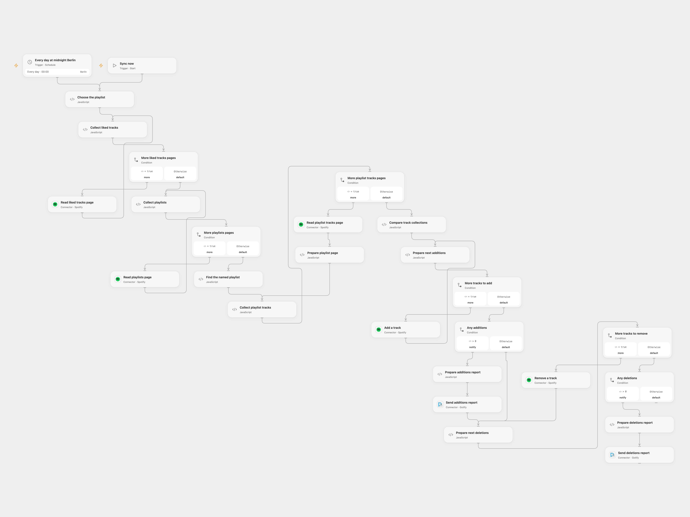

# Sync Spotify Liked Songs to a Playlist

Synchronize liked Spotify tracks to a named playlist and report additions and deletions to Gotify.

<picture>
  <source media="(prefers-color-scheme: dark)" srcset="preview-dark.png">
  
</picture>

[Open Flow JSON](templates/sync-spotify-liked-songs-to-playlist.openflow.json) · [n8n JSON](templates/sync-spotify-liked-songs-to-playlist.n8n.json)

## Setup

Both the Open Flow Spotify Connection and the n8n Spotify client must use Spotify Extended Quota Mode, where the legacy playlist tracks API remains supported. Development Mode uses a different API and is not supported by these nodes. Connect Spotify with permission to read liked tracks and read and modify the selected playlist, and connect Gotify. In Open Flow set the exact playlist name in **Choose the playlist**; in n8n set it in **Edit set Vars**. Use a unique playlist name and one format at a time.

## Behavior

Run manually or daily at midnight Europe/Berlin. The workflow reads liked tracks and the named playlist, adds missing track URIs and removes playlist URIs no longer liked. It reports additions and deletions separately to Gotify when each group is nonempty. The playlist can lose tracks: review its contents and make a backup before enabling synchronization.

Open Flow reads every page before writing. It stops if the playlist name is missing or ambiguous, a page is invalid, or a track is missing its URI or added date. An empty liked collection causes no changes. It adds to an empty playlist, repairing a source path that did not reach the comparison on an empty input. Data must fit the workflow execution limits. As in the source, only the first occurrence of each matching URI is paired. Removing an extra duplicate by URI can remove every copy of that URI; a later run may add it again. Other clients modifying the playlist while this workflow runs can invalidate the comparison. A failed or uncertain write may have succeeded; inspect Spotify and Gotify before retrying.

## Changes to the source

- Configure the playlist name and use its ID from the uniquely matching playlist. Both platforms require the legacy Spotify endpoint contract available to Extended Quota Mode apps.
- Open Flow reads all pages before changes, fails closed on ambiguous or malformed input, and processes additions before deletions. The original n8n graph remains in the n8n file.

Source and license

Adapted from [Spotify Sync Liked Songs to Playlist](https://github.com/Zie619/n8n-workflows/blob/ae8cf6dc5b873cbb4f74587aa9180ed3a9f70682/workflows/Schedule/1867_Schedule_Filter_Sync_Scheduled.json) in [Zie619/n8n-workflows](https://github.com/Zie619/n8n-workflows). The source export does not identify a separate template author or license.

The collection’s [MIT notice](https://github.com/Zie619/n8n-workflows/blob/94007c1445d9258a7da116646b79473e7c7c3282/LICENSE) is pinned at a later revision. This is the collection notice at that revision; it does not establish a separate original template author's license. Our changes are listed above; see [repository licensing](../../README.md#licensing).

> MIT License
>
> Copyright (c) 2025 Zie619
>
> Permission is hereby granted, free of charge, to any person obtaining a copy
> of this software and associated documentation files (the "Software"), to deal
> in the Software without restriction, including without limitation the rights
> to use, copy, modify, merge, publish, distribute, sublicense, and/or sell
> copies of the Software, and to permit persons to whom the Software is
> furnished to do so, subject to the following conditions:
>
> The above copyright notice and this permission notice shall be included in all
> copies or substantial portions of the Software.
>
> THE SOFTWARE IS PROVIDED "AS IS", WITHOUT WARRANTY OF ANY KIND, EXPRESS OR
> IMPLIED, INCLUDING BUT NOT LIMITED TO THE WARRANTIES OF MERCHANTABILITY,
> FITNESS FOR A PARTICULAR PURPOSE AND NONINFRINGEMENT. IN NO EVENT SHALL THE
> AUTHORS OR COPYRIGHT HOLDERS BE LIABLE FOR ANY CLAIM, DAMAGES OR OTHER
> LIABILITY, WHETHER IN AN ACTION OF CONTRACT, TORT OR OTHERWISE, ARISING FROM,
> OUT OF OR IN CONNECTION WITH THE SOFTWARE OR THE USE OR OTHER DEALINGS IN THE
> SOFTWARE.

