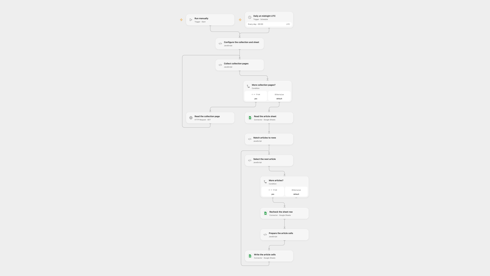

# Sync a Squarespace Collection to Sheets

Keep a Google Sheets inventory of a public Squarespace blog collection up to date.

<picture>
  <source media="(prefers-color-scheme: dark)" srcset="preview-dark.png">
  
</picture>

[Open Flow JSON](templates/sync-squarespace-collection-to-sheets.openflow.json) · [n8n JSON](templates/sync-squarespace-collection-to-sheets.n8n.json)

## Setup

Connect Google Sheets. In **Configure the collection and sheet**, enter the HTTPS URL of a public Squarespace blog collection without query parameters, a spreadsheet ID and sheet name. The sheet must have unique headers: id, tags, title, urlId, addedOn, fullUrl, assetUrl, publishOn and categories. Enable one format.

## Behavior

Run manually or daily at 00:00 UTC. The workflow reads the collection's JSON pages and matches articles by ID. It writes the listed article fields to matching rows and adds rows for new IDs, preserving other columns. Tags and categories are comma-separated; dates are UTC calendar dates. A duplicate or malformed ID, page or header stops the run. Source-provided fullUrl may be relative to your site.

Avoid overlapping runs or editing the sheet during a run. Open Flow and n8n recheck the target row, but the check and write are not atomic. Earlier row updates may remain after a later failure; an uncertain write may have succeeded. Inspect the sheet before retrying. Large collections must fit platform execution limits. The Squarespace public JSON representation must be available on your site. n8n stops before writing if the collection exceeds 100 pages or its pagination is invalid; Open Flow collects pages across invocations. Open Flow starts at the minute boundary; n8n uses a fixed second within the minute.

Inspiration &amp; credits

## Changes to the source

- Replace private configuration and update only intended cells, preserving other sheet columns and formulas. Reject duplicate IDs and repeated pagination offsets.
- Save the actual assetUrl rather than copying fullUrl into that field. Use explicit UTC dates and schedule.

Adapted from [Fetch Squarespace Blog & Event Collections to Google Sheets](https://github.com/Zie619/n8n-workflows/blob/ae8cf6dc5b873cbb4f74587aa9180ed3a9f70682/workflows/Splitout/1454_Splitout_Schedule_Import_Webhook.json) in [Zie619/n8n-workflows](https://github.com/Zie619/n8n-workflows). The matching [n8n listing](https://n8n.io/workflows/3098-fetch-squarespace-blog-and-event-collections-to-google-sheets/) credits bangank36. No separate original template license is stated.

The collection’s [MIT notice](https://github.com/Zie619/n8n-workflows/blob/94007c1445d9258a7da116646b79473e7c7c3282/LICENSE) is pinned at a later revision. This is the collection notice at that revision; it does not establish a separate original template author's license. Our changes are listed above; see [repository licensing](../../README.md#licensing).

> MIT License
>
> Copyright (c) 2025 Zie619
>
> Permission is hereby granted, free of charge, to any person obtaining a copy
> of this software and associated documentation files (the "Software"), to deal
> in the Software without restriction, including without limitation the rights
> to use, copy, modify, merge, publish, distribute, sublicense, and/or sell
> copies of the Software, and to permit persons to whom the Software is
> furnished to do so, subject to the following conditions:
>
> The above copyright notice and this permission notice shall be included in all
> copies or substantial portions of the Software.
>
> THE SOFTWARE IS PROVIDED "AS IS", WITHOUT WARRANTY OF ANY KIND, EXPRESS OR
> IMPLIED, INCLUDING BUT NOT LIMITED TO THE WARRANTIES OF MERCHANTABILITY,
> FITNESS FOR A PARTICULAR PURPOSE AND NONINFRINGEMENT. IN NO EVENT SHALL THE
> AUTHORS OR COPYRIGHT HOLDERS BE LIABLE FOR ANY CLAIM, DAMAGES OR OTHER
> LIABILITY, WHETHER IN AN ACTION OF CONTRACT, TORT OR OTHERWISE, ARISING FROM,
> OUT OF OR IN CONNECTION WITH THE SOFTWARE OR THE USE OR OTHER DEALINGS IN THE
> SOFTWARE.

