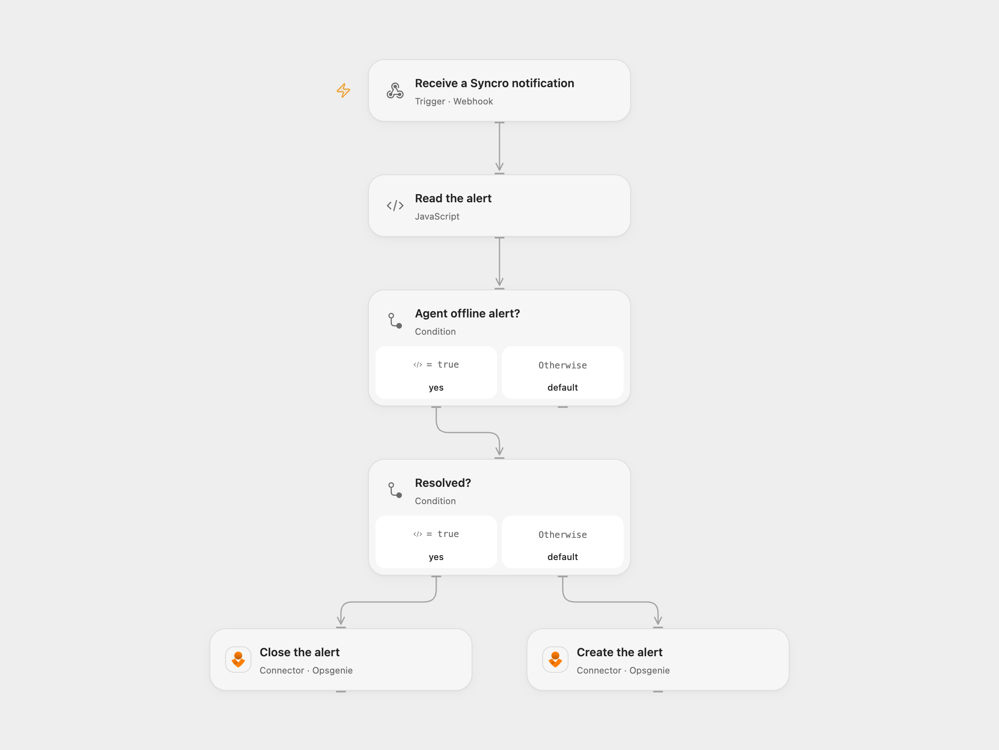

# Sync Syncro Offline Alerts to Opsgenie

Create or close an Opsgenie alert when Syncro reports an agent offline or resolved.

<picture>
  <source media="(prefers-color-scheme: dark)" srcset="preview-dark.png">
  
</picture>

[Open Flow JSON](templates/sync-syncro-offline-alerts-to-opsgenie.openflow.json) · [n8n JSON](templates/sync-syncro-offline-alerts-to-opsgenie.n8n.json)

## Setup and use

Connect Opsgenie and configure Syncro to POST its notification JSON to the workflow webhook URL. In n8n, configure the Opsgenie header credential and webhook URL. Protect the webhook URL: the source and both templates accept requests without sender verification, and a caller can create or close an alert. Opsgenie REST APIs are scheduled to retire on April 5, 2027; consult [Atlassian's transition guidance](https://support.atlassian.com/opsgenie/docs/what-happens-when-opsgenie-is-turned-off/).

## Behavior

Only agent_offline_trigger notifications are acted on. Unresolved events submit a new alert with the Syncro ID as alias; resolved events submit a close request for the same alias. Opsgenie accepts these requests asynchronously, so acceptance does not confirm the final alert state. Open Flow acknowledges the webhook upon admission; n8n returns its final node response. An uncertain create or close may have succeeded; check Opsgenie before retrying.

Inspiration &amp; credits

## Changes to the source

- Open Flow uses the Opsgenie Connector; n8n retains HTTPS requests. Explicitly preserve the native condition comparing resolved to false.

Adapted from [Sync Syncro alerts to Opsgenie](https://github.com/Zie619/n8n-workflows/blob/ae8cf6dc5b873cbb4f74587aa9180ed3a9f70682/workflows/Http/0077_HTTP_Noop_Sync_Webhook.json) in [Zie619/n8n-workflows](https://github.com/Zie619/n8n-workflows). The source export does not identify a separate template author or license.

The collection’s [MIT notice](https://github.com/Zie619/n8n-workflows/blob/94007c1445d9258a7da116646b79473e7c7c3282/LICENSE) is pinned at a later revision. This is the collection notice at that revision; it does not establish a separate original template author's license. Our changes are listed above; see [repository licensing](../../README.md#licensing).

> MIT License
>
> Copyright (c) 2025 Zie619
>
> Permission is hereby granted, free of charge, to any person obtaining a copy
> of this software and associated documentation files (the "Software"), to deal
> in the Software without restriction, including without limitation the rights
> to use, copy, modify, merge, publish, distribute, sublicense, and/or sell
> copies of the Software, and to permit persons to whom the Software is
> furnished to do so, subject to the following conditions:
>
> The above copyright notice and this permission notice shall be included in all
> copies or substantial portions of the Software.
>
> THE SOFTWARE IS PROVIDED "AS IS", WITHOUT WARRANTY OF ANY KIND, EXPRESS OR
> IMPLIED, INCLUDING BUT NOT LIMITED TO THE WARRANTIES OF MERCHANTABILITY,
> FITNESS FOR A PARTICULAR PURPOSE AND NONINFRINGEMENT. IN NO EVENT SHALL THE
> AUTHORS OR COPYRIGHT HOLDERS BE LIABLE FOR ANY CLAIM, DAMAGES OR OTHER
> LIABILITY, WHETHER IN AN ACTION OF CONTRACT, TORT OR OTHERWISE, ARISING FROM,
> OUT OF OR IN CONNECTION WITH THE SOFTWARE OR THE USE OR OTHER DEALINGS IN THE
> SOFTWARE.

