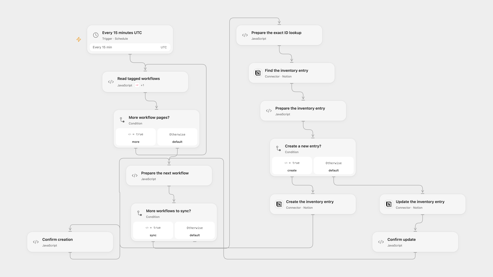

# Sync Tagged n8n Workflows to Notion

Keep a Notion inventory of tagged n8n workflows and their status up to date.

<picture>
  <source media="(prefers-color-scheme: dark)" srcset="preview-dark.png">
  
</picture>

[Open Flow JSON](templates/sync-tagged-n8n-workflows-to-notion.openflow.json) · [n8n JSON](templates/sync-tagged-n8n-workflows-to-notion.n8n.json)

## Setup

Connect n8n and Notion with access to the chosen data source. In **Prepare the next workflow**, set the Notion data source ID and the HTTPS n8n instance URL, ending in /. Tag the workflows to inventory with sync-to-notion. Create a Notion data source with Name (title), env id (rich text), URL (dev) (URL), isActive (dev) (checkbox), Workflow created at (date), Workflow updated at (date), and Error workflow setup (checkbox). In n8n, set the same instance URL and data source ID in the code of **Prepare the workflows** and connect the n8n and Notion credentials. Activate one format and prevent overlapping runs.

## Behavior

Every 15 minutes in UTC, the workflow reads all pages of tagged n8n workflows and finds a Notion entry by exact env id internal- followed by the workflow ID. It creates an entry if absent or updates its fields if exactly one exists. A duplicate match stops before that workflow's write. The data source must fit execution limits. Open Flow starts on the minute boundary; n8n uses a fixed second within the minute.

A failed or uncertain Notion write may have completed. Inspect the data source before retrying; earlier entries remain. Concurrent runs or edits can create duplicates, so do not run multiple copies at once. Removing a tag or deleting a source workflow does not delete existing inventory entries.

Inspiration &amp; credits

## Changes to the source

- Replace private identifiers, use the current Notion data source API and an exact ID match rather than substring matching. Reject duplicate matches.
- Preserve the actual error-workflow flag on updates and correct the source's misspelled updated-at property. Use UTC instead of the source instance timezone.

Adapted from [Automatically document n8n workflows directly in Notion database](https://github.com/Zie619/n8n-workflows/blob/ae8cf6dc5b873cbb4f74587aa9180ed3a9f70682/workflows/Schedule/0448_Schedule_HTTP_Create_Webhook.json) in [Zie619/n8n-workflows](https://github.com/Zie619/n8n-workflows). The matching [n8n listing](https://n8n.io/workflows/2151-automatically-document-n8n-workflows-directly-in-notion-database/) credits Mutasem. No separate original template license was found.

The collection’s [MIT notice](https://github.com/Zie619/n8n-workflows/blob/94007c1445d9258a7da116646b79473e7c7c3282/LICENSE) is pinned at a later revision. This is the collection notice at that revision; it does not establish a separate original template author's license. Our changes are listed above; see [repository licensing](../../README.md#licensing).

> MIT License
>
> Copyright (c) 2025 Zie619
>
> Permission is hereby granted, free of charge, to any person obtaining a copy
> of this software and associated documentation files (the "Software"), to deal
> in the Software without restriction, including without limitation the rights
> to use, copy, modify, merge, publish, distribute, sublicense, and/or sell
> copies of the Software, and to permit persons to whom the Software is
> furnished to do so, subject to the following conditions:
>
> The above copyright notice and this permission notice shall be included in all
> copies or substantial portions of the Software.
>
> THE SOFTWARE IS PROVIDED "AS IS", WITHOUT WARRANTY OF ANY KIND, EXPRESS OR
> IMPLIED, INCLUDING BUT NOT LIMITED TO THE WARRANTIES OF MERCHANTABILITY,
> FITNESS FOR A PARTICULAR PURPOSE AND NONINFRINGEMENT. IN NO EVENT SHALL THE
> AUTHORS OR COPYRIGHT HOLDERS BE LIABLE FOR ANY CLAIM, DAMAGES OR OTHER
> LIABILITY, WHETHER IN AN ACTION OF CONTRACT, TORT OR OTHERWISE, ARISING FROM,
> OUT OF OR IN CONNECTION WITH THE SOFTWARE OR THE USE OR OTHER DEALINGS IN THE
> SOFTWARE.

