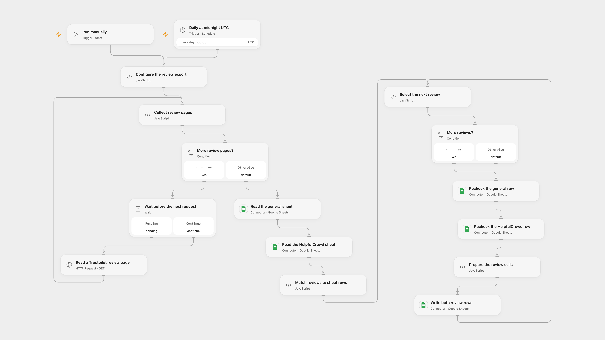

# Sync Trustpilot Reviews to Sheets

Collect public Trustpilot reviews into general and HelpfulCrowd-format sheets.

<picture>
  <source media="(prefers-color-scheme: dark)" srcset="preview-dark.png">
  
</picture>

[Open Flow JSON](templates/sync-trustpilot-reviews-to-sheets.openflow.json) · [n8n JSON](templates/sync-trustpilot-reviews-to-sheets.n8n.json)

## Setup

Obtain a Trustpilot API key with access to the public Business Units API and [find your business unit ID](https://developers.trustpilot.com/business-units-api-overview/). Connect Google Sheets. In **Configure the review export**, set the business unit ID, spreadsheet ID, two different sheet names and page limit. Create a secret Variable **TRUSTPILOT_API_KEY** and bind it to **Read a Trustpilot review page**.

The general sheet requires unique headers: Date, Author, Body, Heading, Rating, Location, review_id. The HelpfulCrowd sheet requires unique headers: title, comment, rating*, status*, verified, feedback*, review_id, product_id*, review_date*, customer_email, customer_name*. Configure the same values in n8n, connect Sheets, and use a Header Auth credential with header name `apikey` for the Trustpilot request. Set the n8n request's maximum pages to match the configured page limit. Enable one format.

## Behavior

Run manually or daily at 00:00 UTC. Read up to the configured number of API pages, default 100, then match public reviews by review_id and update both sheets. Requests are spaced five seconds apart; Open Flow also waits five seconds before its first request. Ratings and verification are preserved. The Location column contains Trustpilot's reviewer display location, which may be a city and country rather than a country code. Date and review_date use the API's review creation time. HelpfulCrowd rows describe business reviews, so product ID is left blank; status is published, and customer email and comment remain blank as in the source. HelpfulCrowd dates use yyyy/mm/dd. At the page limit the workflow keeps the pages returned in API order, which need not match the website's most recent reviews. Reviews removed upstream are not removed from the sheets; [reconcile Trustpilot deletions](https://developers.trustpilot.com/data-solutions-how-to/) at least every 28 days. Zero-star values from the API are preserved; check those rows before importing them into HelpfulCrowd.

Only the listed cells are changed, preserving other columns. Avoid concurrent sheet edits or overlapping runs; row checks and writes are not atomic. Earlier writes may remain after an error and an uncertain write may have succeeded. Inspect the sheet before retrying. Open Flow starts at the minute boundary; n8n uses a fixed second within the minute.

Inspiration &amp; credits

## Changes to the source

- Use Trustpilot's official public review API with an API key instead of scraping HTML. API pages, review creation time and display location can differ from the source website's pages, published date and country code.
- Match each review to its own author, format HelpfulCrowd dates as yyyy/mm/dd, validate pagination and identifiers, and update only the intended cells. The source uses the first review's author for every general row.

Adapted from [Scrape Trustpilot Reviews to Google Sheets](https://github.com/Zie619/n8n-workflows/blob/ae8cf6dc5b873cbb4f74587aa9180ed3a9f70682/workflows/Splitout/1412_Splitout_Code_Automation_Scheduled.json) in [Zie619/n8n-workflows](https://github.com/Zie619/n8n-workflows). The matching [n8n listing](https://n8n.io/workflows/3168-scrape-trustpilot-reviews-to-google-sheets-helpfulcrowd-compatible-csv/) credits bangank36. No separate original template license is stated.

The collection’s [MIT notice](https://github.com/Zie619/n8n-workflows/blob/94007c1445d9258a7da116646b79473e7c7c3282/LICENSE) is pinned at a later revision. This is the collection notice at that revision; it does not establish a separate original template author's license. Our changes are listed above; see [repository licensing](../../README.md#licensing).

> MIT License
>
> Copyright (c) 2025 Zie619
>
> Permission is hereby granted, free of charge, to any person obtaining a copy
> of this software and associated documentation files (the "Software"), to deal
> in the Software without restriction, including without limitation the rights
> to use, copy, modify, merge, publish, distribute, sublicense, and/or sell
> copies of the Software, and to permit persons to whom the Software is
> furnished to do so, subject to the following conditions:
>
> The above copyright notice and this permission notice shall be included in all
> copies or substantial portions of the Software.
>
> THE SOFTWARE IS PROVIDED "AS IS", WITHOUT WARRANTY OF ANY KIND, EXPRESS OR
> IMPLIED, INCLUDING BUT NOT LIMITED TO THE WARRANTIES OF MERCHANTABILITY,
> FITNESS FOR A PARTICULAR PURPOSE AND NONINFRINGEMENT. IN NO EVENT SHALL THE
> AUTHORS OR COPYRIGHT HOLDERS BE LIABLE FOR ANY CLAIM, DAMAGES OR OTHER
> LIABILITY, WHETHER IN AN ACTION OF CONTRACT, TORT OR OTHERWISE, ARISING FROM,
> OUT OF OR IN CONNECTION WITH THE SOFTWARE OR THE USE OR OTHER DEALINGS IN THE
> SOFTWARE.

