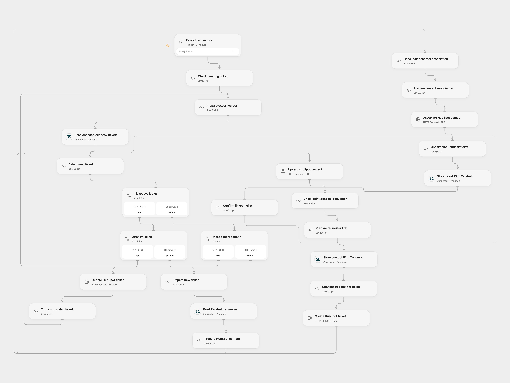

# Sync Zendesk Tickets to HubSpot

Create or update HubSpot tickets from changed Zendesk tickets and link new tickets to their requester.

<picture>
  <source media="(prefers-color-scheme: dark)" srcset="preview-dark.png">
  
</picture>

[Open Flow JSON](templates/sync-zendesk-tickets-to-hubspot.openflow.json) · [n8n JSON](templates/sync-zendesk-tickets-to-hubspot.n8n.json)

## Setup

Connect Zendesk for incremental ticket export and user/ticket updates. Bind a HubSpot private app token with contact, ticket and association access as Secret Variable `HUBSPOT_TOKEN`. Set the HubSpot ticket pipeline and stage IDs in **Prepare new ticket**. Enable persistent State and prevent overlapping runs.

In n8n configure the Zendesk subdomain, a fixed initial Unix start time, and the HubSpot pipeline and stage in **Configure export**. Use HTTP Header Auth credentials containing the appropriate Zendesk OAuth bearer token and HubSpot private app bearer token for their respective HTTP nodes. Create a Data Table with text columns `ticket_key` and `status`, select it in the checkpoint nodes, and prevent overlapping runs. Activate one format.

## Behavior

Every five minutes the workflow reads changed Zendesk tickets using a cursor-based incremental export. In Open Flow the initial cursor starts two minutes before activation; Zendesk holds back the most recent minute. Existing external IDs identify HubSpot tickets to update. For a new ticket, the workflow upserts the requester by email, stores the contact ID on the Zendesk user, creates and associates a HubSpot ticket, then stores its ID on the Zendesk ticket.

The cursor advances only after every ticket on a page is confirmed. If a write result is unknown, inspect both services and complete or undo the partial work before entering that Zendesk ticket ID in **Check pending ticket** to acknowledge it. Previously completed tickets are skipped during page retry. In n8n one export page is processed per scheduled run, so a backlog takes multiple runs. On a pending row, inspect and reconcile both services before setting its status to `done`; remove the row only if it is safe to retry. The initial start time must be at least one minute old and remains fixed across retries.

Inspiration &amp; credits

## Changes to the source

- Replace the missing source node reference and use cursor-based export to retain pages and commit progress after processing.
- Use HubSpot REST and a private app token; create the contact association explicitly.

Adapted from [Sync Zendesk tickets to HubSpot](https://github.com/Zie619/n8n-workflows/blob/ae8cf6dc5b873cbb4f74587aa9180ed3a9f70682/workflows/Zendesk/0286_Zendesk_HubSpot_Create_Scheduled.json) in [Zie619/n8n-workflows](https://github.com/Zie619/n8n-workflows). The source export does not identify a separate template author or license.

The collection’s [MIT notice](https://github.com/Zie619/n8n-workflows/blob/94007c1445d9258a7da116646b79473e7c7c3282/LICENSE) is pinned at a later revision. This is the collection notice at that revision; it does not establish a separate original template author's license. Our changes are listed above; see [repository licensing](../../README.md#licensing).

> MIT License
>
> Copyright (c) 2025 Zie619
>
> Permission is hereby granted, free of charge, to any person obtaining a copy
> of this software and associated documentation files (the "Software"), to deal
> in the Software without restriction, including without limitation the rights
> to use, copy, modify, merge, publish, distribute, sublicense, and/or sell
> copies of the Software, and to permit persons to whom the Software is
> furnished to do so, subject to the following conditions:
>
> The above copyright notice and this permission notice shall be included in all
> copies or substantial portions of the Software.
>
> THE SOFTWARE IS PROVIDED "AS IS", WITHOUT WARRANTY OF ANY KIND, EXPRESS OR
> IMPLIED, INCLUDING BUT NOT LIMITED TO THE WARRANTIES OF MERCHANTABILITY,
> FITNESS FOR A PARTICULAR PURPOSE AND NONINFRINGEMENT. IN NO EVENT SHALL THE
> AUTHORS OR COPYRIGHT HOLDERS BE LIABLE FOR ANY CLAIM, DAMAGES OR OTHER
> LIABILITY, WHETHER IN AN ACTION OF CONTRACT, TORT OR OTHERWISE, ARISING FROM,
> OUT OF OR IN CONNECTION WITH THE SOFTWARE OR THE USE OR OTHER DEALINGS IN THE
> SOFTWARE.

