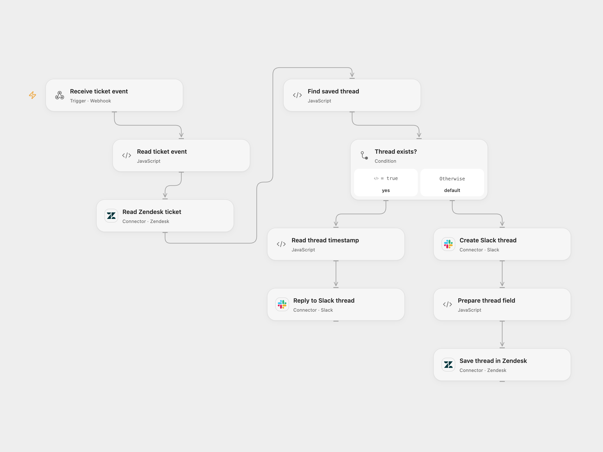

# Sync Zendesk Tickets to Slack Threads

Create a Slack thread for a Zendesk ticket and send later comments to that thread.

<picture>
  <source media="(prefers-color-scheme: dark)" srcset="preview-dark.png">
  
</picture>

[Open Flow JSON](templates/sync-zendesk-tickets-to-slack-threads.openflow.json) · [n8n JSON](templates/sync-zendesk-tickets-to-slack-threads.n8n.json)

## Setup

Create a Zendesk text custom field for the Slack thread timestamp. Set its numeric field ID in both **Find saved thread** and **Prepare thread field**, and set the same Slack channel ID in both message nodes. Connect Zendesk and Slack. Configure a Zendesk trigger and webhook to POST JSON containing numeric ticket id and comment text to the deployed endpoint. In n8n set the field ID in **Code** and **Update ticket**, configure the channel, and connect Zendesk and Slack.

## Behavior

If the ticket has no saved thread timestamp, the workflow posts its subject to Slack and stores the returned timestamp in Zendesk. Later events with that field set post the event comment as a reply. The webhook does not authenticate the sender; restrict access as appropriate. Its acknowledgment confirms receipt, not Slack or Zendesk completion. Repeated events may create duplicate messages. A failed or unknown Zendesk update after Slack posting leaves a thread without a saved timestamp; inspect Slack and the ticket before retrying. Concurrent events for one ticket may create multiple threads.

Inspiration &amp; credits

## Changes to the source

- Repair the source's stale Determine node reference and replace its account-specific custom field and channel with configurable values.

Adapted from [Sync Zendesk tickets to Slack threads](https://github.com/Zie619/n8n-workflows/blob/ae8cf6dc5b873cbb4f74587aa9180ed3a9f70682/workflows/Code/0273_Code_Webhook_Create_Webhook.json) in [Zie619/n8n-workflows](https://github.com/Zie619/n8n-workflows). The source export does not identify a separate template author or license.

The collection’s [MIT notice](https://github.com/Zie619/n8n-workflows/blob/94007c1445d9258a7da116646b79473e7c7c3282/LICENSE) is pinned at a later revision. This is the collection notice at that revision; it does not establish a separate original template author's license. Our changes are listed above; see [repository licensing](../../README.md#licensing).

> MIT License
>
> Copyright (c) 2025 Zie619
>
> Permission is hereby granted, free of charge, to any person obtaining a copy
> of this software and associated documentation files (the "Software"), to deal
> in the Software without restriction, including without limitation the rights
> to use, copy, modify, merge, publish, distribute, sublicense, and/or sell
> copies of the Software, and to permit persons to whom the Software is
> furnished to do so, subject to the following conditions:
>
> The above copyright notice and this permission notice shall be included in all
> copies or substantial portions of the Software.
>
> THE SOFTWARE IS PROVIDED "AS IS", WITHOUT WARRANTY OF ANY KIND, EXPRESS OR
> IMPLIED, INCLUDING BUT NOT LIMITED TO THE WARRANTIES OF MERCHANTABILITY,
> FITNESS FOR A PARTICULAR PURPOSE AND NONINFRINGEMENT. IN NO EVENT SHALL THE
> AUTHORS OR COPYRIGHT HOLDERS BE LIABLE FOR ANY CLAIM, DAMAGES OR OTHER
> LIABILITY, WHETHER IN AN ACTION OF CONTRACT, TORT OR OTHERWISE, ARISING FROM,
> OUT OF OR IN CONNECTION WITH THE SOFTWARE OR THE USE OR OTHER DEALINGS IN THE
> SOFTWARE.

