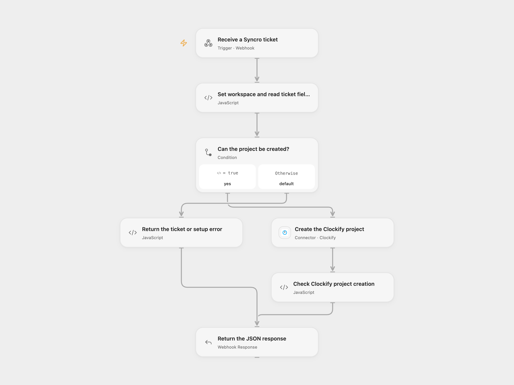

# Create Clockify Projects for Syncro Tickets

Create a Clockify project for a Syncro ticket and return the created project in the same webhook response.

<!-- template-actions:start -->
[](https://openflow.run/templates/syncro-ticket-clockify-project/) [](templates/syncro-ticket-clockify-project.n8n.json)
<!-- template-actions:end -->

<picture>
  <source media="(prefers-color-scheme: dark)" srcset="preview-dark.png">
  
</picture>

## Setup

1. Enter the Clockify workspace ID in **Set workspace and read ticket fields**. Select a Clockify connection with Provider API access in **Create the Clockify project**. The connected account needs permission to create projects in that workspace.
2. Publish the workflow and put the webhook URL in a Syncro Notification Set that sends the intended ticket event. Keep the URL private. If the sender can provide an authentication header, configure webhook authentication before publishing. [Syncro Notification Sets](https://docs.syncrosecure.com/administration/create-notification-sets)
3. Send a JSON object with these ticket attributes. The number and ID can be text or integers.

```json
{"attributes":{"number":123,"customer_business_then_name":"Example Company","id":456}}
```

## Behavior

This example creates `Ticket 123 - Example Company [456]`. The webhook ignores other ticket attributes and returns HTTP 200 with a one-item JSON array containing the full Clockify project record. Project visibility and billing use the Clockify account defaults. [Clockify API](https://docs.clockify.me/)

Missing or invalid ticket fields return HTTP 400. An unconfigured workspace returns HTTP 503. A failed or unconfirmed Clockify creation returns HTTP 502. The workflow submits one create request per execution. Check Clockify before sending a ticket again after a failed or timed-out response, since another delivery can create a duplicate.

<details>
<summary>In n8n</summary>

Enter the workspace ID in **Set workspace and read ticket fields** and select a Clockify API credential in **Create the Clockify project**. Set a private path in **Receive a Syncro ticket**, activate the workflow and use its production webhook URL in Syncro. Configure native webhook authentication if the sender supports it.

</details>

<details>
<summary>Inspiration &amp; credits</summary>

## Changes to the source

Validate the required ticket attributes and return an explicit error when Clockify cannot confirm creation. Preserve the original naming format and one-item project array.

Adapted from [Syncro ticket to Clockify project](https://github.com/Zie619/n8n-workflows/blob/ae8cf6dc5b873cbb4f74587aa9180ed3a9f70682/workflows/Clockify/0750_Clockify_Webhook_Sync_Webhook.json) in [Zie619/n8n-workflows](https://github.com/Zie619/n8n-workflows). Attribution: Zie619 / n8n-workflows.

The collection’s [MIT notice](https://github.com/Zie619/n8n-workflows/blob/94007c1445d9258a7da116646b79473e7c7c3282/LICENSE) is pinned at a later revision. This is the collection notice at that revision; it does not establish a separate original template author's license. Our changes are listed above; see [repository licensing](../../README.md#licensing).

> MIT License
>
> Copyright (c) 2025 Zie619
>
> Permission is hereby granted, free of charge, to any person obtaining a copy
> of this software and associated documentation files (the "Software"), to deal
> in the Software without restriction, including without limitation the rights
> to use, copy, modify, merge, publish, distribute, sublicense, and/or sell
> copies of the Software, and to permit persons to whom the Software is
> furnished to do so, subject to the following conditions:
>
> The above copyright notice and this permission notice shall be included in all
> copies or substantial portions of the Software.
>
> THE SOFTWARE IS PROVIDED "AS IS", WITHOUT WARRANTY OF ANY KIND, EXPRESS OR
> IMPLIED, INCLUDING BUT NOT LIMITED TO THE WARRANTIES OF MERCHANTABILITY,
> FITNESS FOR A PARTICULAR PURPOSE AND NONINFRINGEMENT. IN NO EVENT SHALL THE
> AUTHORS OR COPYRIGHT HOLDERS BE LIABLE FOR ANY CLAIM, DAMAGES OR OTHER
> LIABILITY, WHETHER IN AN ACTION OF CONTRACT, TORT OR OTHERWISE, ARISING FROM,
> OUT OF OR IN CONNECTION WITH THE SOFTWARE OR THE USE OR OTHER DEALINGS IN THE
> SOFTWARE.

</details>
