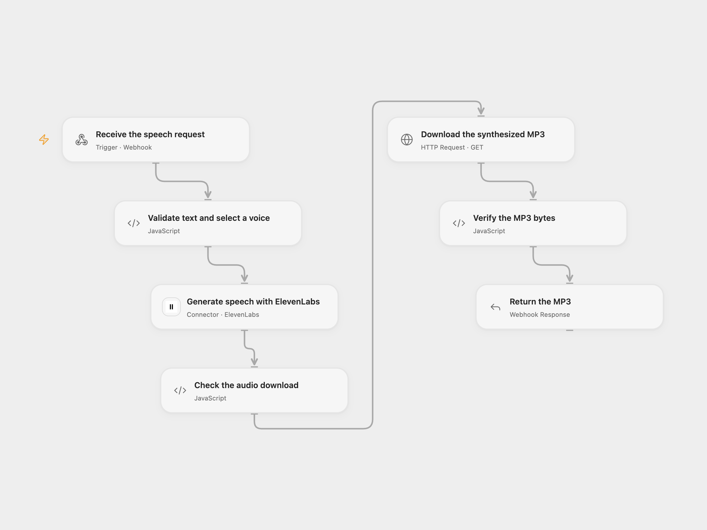

# Synthesize Audio from a Webhook

Turn submitted text into a downloadable MP3 and return it in the same POST response.

<!-- template-actions:start -->
 
<!-- template-actions:end -->

<picture>
  <source media="(prefers-color-scheme: dark)" srcset="preview-dark.png">
  
</picture>

## Setup

1. Connect ElevenLabs in **Generate speech with ElevenLabs**. Add the Eldrin voice to your ElevenLabs voice library, or replace the voice ID in **Validate text and select a voice** with a voice available to your account.
2. In **Receive the speech request**, select **Header** authentication, name the header `X-Speech-Webhook-Key`, and bind a secret Variable. Publish with **Enable Calls** off. Check that a POST without the header returns HTTP 401, then enable calls in **Validate text and select a voice** and publish again.
3. Send a POST to the published HTTPS webhook with the key header, `Content-Type: application/json` and a body such as `{"text_to_convert":"The visitor center opens at noon."}`.

## Behavior

The workflow sends up to 4,096 characters to ElevenLabs, waits up to 60 seconds, and returns the resulting MP3 bytes as an `audio/mpeg` attachment named `speech.mp3`. Audio may be up to 8 MiB. Invalid text and provider or download failures return an error. Tell listeners that the voice is AI-generated.

In n8n

1. Set a **Header Auth** credential in **Receive the speech request** with the header name `X-Speech-Webhook-Key`.
2. In **Generate speech with ElevenLabs**, set a separate **Header Auth** credential with the name `xi-api-key` and your ElevenLabs API key. To select another voice in your library, edit the voice ID in **Validate text and select a voice**.
3. Activate the workflow and call its production POST path `generate_audio` with the same JSON body and key header. Keep the webhook connection open across the provider's 55-second timeout.

Inspiration &amp; credits

Adapted from [Generate audio from text using OpenAI - text-to-speech Workflow](https://github.com/Zie619/n8n-workflows/blob/ae8cf6dc5b873cbb4f74587aa9180ed3a9f70682/workflows/Respondtowebhook/1474_Respondtowebhook_Stickynote_Create_Webhook.json) in [Zie619/n8n-workflows](https://github.com/Zie619/n8n-workflows). Attribution: Ayoub (original workflow); Zie619 / n8n-workflows (collection).

The collection’s [MIT notice](https://github.com/Zie619/n8n-workflows/blob/94007c1445d9258a7da116646b79473e7c7c3282/LICENSE) is pinned at a later revision. This is the collection notice at that revision; it does not establish a separate original template author's license. Our changes are listed above; see [repository licensing](../../README.md#licensing).

> MIT License
>
> Copyright (c) 2025 Zie619
>
> Permission is hereby granted, free of charge, to any person obtaining a copy
> of this software and associated documentation files (the "Software"), to deal
> in the Software without restriction, including without limitation the rights
> to use, copy, modify, merge, publish, distribute, sublicense, and/or sell
> copies of the Software, and to permit persons to whom the Software is
> furnished to do so, subject to the following conditions:
>
> The above copyright notice and this permission notice shall be included in all
> copies or substantial portions of the Software.
>
> THE SOFTWARE IS PROVIDED "AS IS", WITHOUT WARRANTY OF ANY KIND, EXPRESS OR
> IMPLIED, INCLUDING BUT NOT LIMITED TO THE WARRANTIES OF MERCHANTABILITY,
> FITNESS FOR A PARTICULAR PURPOSE AND NONINFRINGEMENT. IN NO EVENT SHALL THE
> AUTHORS OR COPYRIGHT HOLDERS BE LIABLE FOR ANY CLAIM, DAMAGES OR OTHER
> LIABILITY, WHETHER IN AN ACTION OF CONTRACT, TORT OR OTHERWISE, ARISING FROM,
> OUT OF OR IN CONNECTION WITH THE SOFTWARE OR THE USE OR OTHER DEALINGS IN THE
> SOFTWARE.

[Original n8n template by Ayoub](https://n8n.io/workflows/2386-generate-audio-from-text-using-openai-and-webhook-or-text-to-speech-workflow/).

## Changes to the source

ElevenLabs Multilingual v2 and Eldrin replace OpenAI TTS-1 and Fable. OpenAI says its Speech API models will shut down on January 6, 2027. This migration keeps the original JSON field and synchronous MP3 response. It also adds caller authentication to protect the synthesis quota. [OpenAI speech model retirement](https://developers.openai.com/api/docs/guides/text-to-speech)

