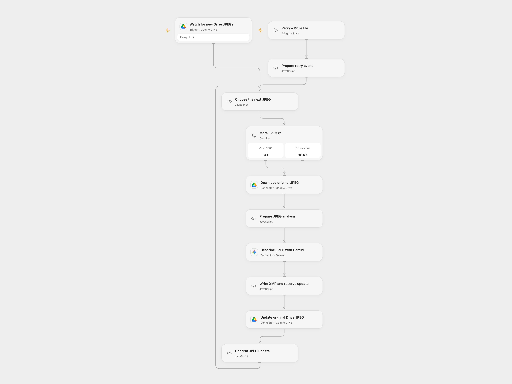

# Tag Drive JPEGs with AI Keywords

Analyze new JPEG images and add descriptive XMP keywords to the original files.

<!-- template-actions:start -->
[](https://openflow.run/templates/tag-drive-jpegs-with-ai-keywords/) [](templates/tag-drive-jpegs-with-ai-keywords.n8n.json)
<!-- template-actions:end -->

<picture>
  <source media="(prefers-color-scheme: dark)" srcset="preview-dark.png">
  
</picture>

## Setup

Connect Google Drive and Gemini. Select a Drive folder in **Watch for new Drive JPEGs**, enable persistent State and set the connector transit hostname in **Prepare JPEG analysis**. Use one format and avoid overlapping runs.

## Behavior

The workflow analyzes each new JPEG and embeds keywords in an XMP subject in the same Drive file. Gemini receives the image; generated keywords may be inaccurate. Open Flow handles files whose complete bytes and encoded request fit its 1 MiB Code and fetch budgets. It merges keywords into existing XMP subject metadata and retains other XMP fields and JPEG segments. Invalid or ambiguous XMP stops the run for review. Keep original backups and restrict transit URLs and execution history.

An uncertain update stops processing. Inspect the original file before retrying. For Open Flow enter `drive-xmp:<file ID>` and `confirmed` or `absent` in **Choose the next JPEG**, use **Retry a Drive file** with the same file ID, and clear the recovery fields.

<details>
<summary>In n8n</summary>

In n8n select the same folder, connect Google Drive and Gemini, and select one Data Table with text columns `item_key` and `status` for the checkpoint nodes. For n8n inspect the pending Data Table row, mark it done if the change is present or delete it only if absent, enable the authenticated **Resume JPEG** webhook and POST the original `fileId`.

</details>

<details>
<summary>Inspiration &amp; credits</summary>

The source credits [Friedemann Schütz](https://www.linkedin.com/in/friedemann-schuetz). This version merges keywords into existing XMP, preserves file identity, and stops on uncertain updates. It bundles @xmldom/xmldom 0.8.10 under the MIT license.

Adapted from [Automated Image Metadata Tagging](https://github.com/Zie619/n8n-workflows/blob/ae8cf6dc5b873cbb4f74587aa9180ed3a9f70682/workflows/Code/1761_Code_Extractfromfile_Automate_Triggered.json) in [Zie619/n8n-workflows](https://github.com/Zie619/n8n-workflows). Attribution: Friedemann Schütz / Zie619.

The collection’s [MIT notice](https://github.com/Zie619/n8n-workflows/blob/94007c1445d9258a7da116646b79473e7c7c3282/LICENSE) is pinned at a later revision. This is the collection notice at that revision; it does not establish a separate original template author's license. Our changes are listed above; see [repository licensing](../../README.md#licensing).

> MIT License
>
> Copyright (c) 2025 Zie619
>
> Permission is hereby granted, free of charge, to any person obtaining a copy
> of this software and associated documentation files (the "Software"), to deal
> in the Software without restriction, including without limitation the rights
> to use, copy, modify, merge, publish, distribute, sublicense, and/or sell
> copies of the Software, and to permit persons to whom the Software is
> furnished to do so, subject to the following conditions:
>
> The above copyright notice and this permission notice shall be included in all
> copies or substantial portions of the Software.
>
> THE SOFTWARE IS PROVIDED "AS IS", WITHOUT WARRANTY OF ANY KIND, EXPRESS OR
> IMPLIED, INCLUDING BUT NOT LIMITED TO THE WARRANTIES OF MERCHANTABILITY,
> FITNESS FOR A PARTICULAR PURPOSE AND NONINFRINGEMENT. IN NO EVENT SHALL THE
> AUTHORS OR COPYRIGHT HOLDERS BE LIABLE FOR ANY CLAIM, DAMAGES OR OTHER
> LIABILITY, WHETHER IN AN ACTION OF CONTRACT, TORT OR OTHERWISE, ARISING FROM,
> OUT OF OR IN CONNECTION WITH THE SOFTWARE OR THE USE OR OTHER DEALINGS IN THE
> SOFTWARE.


**@xmldom/xmldom 0.8.10 MIT license**

```text
Copyright 2019 - present Christopher J. Brody and other contributors, as listed in: https://github.com/xmldom/xmldom/graphs/contributors
Copyright 2012 - 2017 @jindw <jindw@xidea.org> and other contributors, as listed in: https://github.com/jindw/xmldom/graphs/contributors

Permission is hereby granted, free of charge, to any person obtaining a copy of this software and associated documentation files (the "Software"), to deal in the Software without restriction, including without limitation the rights to use, copy, modify, merge, publish, distribute, sublicense, and/or sell copies of the Software, and to permit persons to whom the Software is furnished to do so, subject to the following conditions:

The above copyright notice and this permission notice shall be included in all copies or substantial portions of the Software.

THE SOFTWARE IS PROVIDED "AS IS", WITHOUT WARRANTY OF ANY KIND, EXPRESS OR IMPLIED, INCLUDING BUT NOT LIMITED TO THE WARRANTIES OF MERCHANTABILITY, FITNESS FOR A PARTICULAR PURPOSE AND NONINFRINGEMENT. IN NO EVENT SHALL THE AUTHORS OR COPYRIGHT HOLDERS BE LIABLE FOR ANY CLAIM, DAMAGES OR OTHER LIABILITY, WHETHER IN AN ACTION OF CONTRACT, TORT OR OTHERWISE, ARISING FROM, OUT OF OR IN CONNECTION WITH THE SOFTWARE OR THE USE OR OTHER DEALINGS IN THE SOFTWARE.
```

</details>
