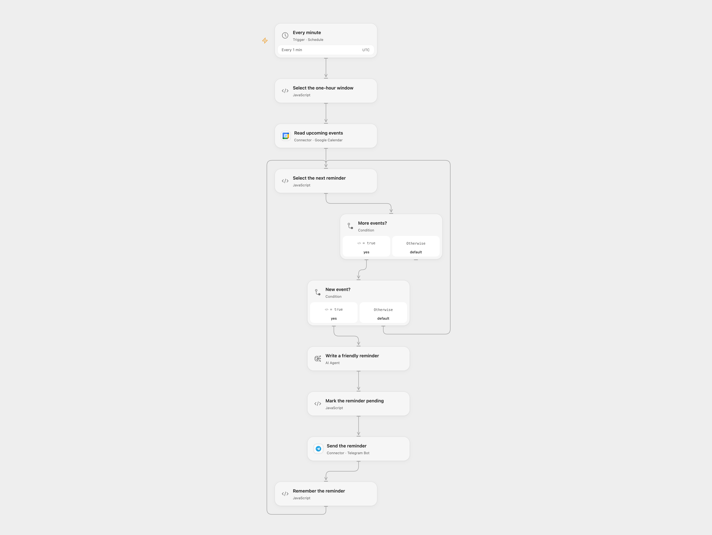

# Send AI Calendar Event Reminders to Telegram

Generate friendly Telegram reminders for upcoming calendar events.

<picture>
  <source media="(prefers-color-scheme: dark)" srcset="preview-dark.png">
  
</picture>

[Open Flow JSON](templates/telegram-ai-calendar-event-reminders.openflow.json) · [n8n JSON](templates/telegram-ai-calendar-event-reminders.n8n.json)

## Setup

Connect Google Calendar and set its calendar ID in **Read upcoming events**. Connect an OpenAI model and the Telegram bot, and set the destination chat ID. Enable persistent State and prevent overlapping runs. In n8n configure Calendar, OpenAI and Telegram credentials. Create a Data Table with text columns event_id and status, select it in the four checkpoint nodes, and enable the disabled schedule trigger. Activate one format.

## Behavior

Every minute the workflow checks up to five events starting between one hour and one hour and one minute ahead. It generates one friendly message per unseen event and sends it to Telegram. The event details are sent to the model and may be retained in execution history. Both formats mark success after Telegram confirms the send. n8n stores pending and sent rows in its Data Table; an existing row prevents automatic resend. Inspect pending rows and Telegram before resolving them. IDs accumulate in State and must fit its limits.

If a Telegram send fails or its outcome is unknown, inspect the chat. To proceed without automatically resending, enter that event ID in **Select the next reminder → acknowledgeEventId**, run once, then clear it. The event is treated as handled. In n8n inspect pending rows, then mark them sent if already delivered or remove them only when it is safe to permit another send. No automatic retry of pending rows is performed. A one-minute polling window can miss events when execution is delayed or interrupted, and only the first five returned events are considered.

Inspiration &amp; credits

## Changes to the source

- Replace the private calendar ID. The source schedule is disabled and uses Europe/Rome; Open Flow enables the minute schedule in UTC, while n8n keeps it disabled and uses UTC.
- Both formats reserve each event before sending and mark it sent only after confirmation. n8n uses a Data Table checkpoint and processes events one at a time. The n8n Agent reads the current event and disables the unconnected output parser.

Adapted from [Google Calendar Event Reminder](https://github.com/Zie619/n8n-workflows/blob/ae8cf6dc5b873cbb4f74587aa9180ed3a9f70682/workflows/Telegram/1679_Telegram_GoogleCalendar_Automation_Scheduled.json) in [Zie619/n8n-workflows](https://github.com/Zie619/n8n-workflows). The source export does not identify a separate template author or license.

The collection’s [MIT notice](https://github.com/Zie619/n8n-workflows/blob/94007c1445d9258a7da116646b79473e7c7c3282/LICENSE) is pinned at a later revision. This is the collection notice at that revision; it does not establish a separate original template author's license. Our changes are listed above; see [repository licensing](../../README.md#licensing).

> MIT License
>
> Copyright (c) 2025 Zie619
>
> Permission is hereby granted, free of charge, to any person obtaining a copy
> of this software and associated documentation files (the "Software"), to deal
> in the Software without restriction, including without limitation the rights
> to use, copy, modify, merge, publish, distribute, sublicense, and/or sell
> copies of the Software, and to permit persons to whom the Software is
> furnished to do so, subject to the following conditions:
>
> The above copyright notice and this permission notice shall be included in all
> copies or substantial portions of the Software.
>
> THE SOFTWARE IS PROVIDED "AS IS", WITHOUT WARRANTY OF ANY KIND, EXPRESS OR
> IMPLIED, INCLUDING BUT NOT LIMITED TO THE WARRANTIES OF MERCHANTABILITY,
> FITNESS FOR A PARTICULAR PURPOSE AND NONINFRINGEMENT. IN NO EVENT SHALL THE
> AUTHORS OR COPYRIGHT HOLDERS BE LIABLE FOR ANY CLAIM, DAMAGES OR OTHER
> LIABILITY, WHETHER IN AN ACTION OF CONTRACT, TORT OR OTHERWISE, ARISING FROM,
> OUT OF OR IN CONNECTION WITH THE SOFTWARE OR THE USE OR OTHER DEALINGS IN THE
> SOFTWARE.

