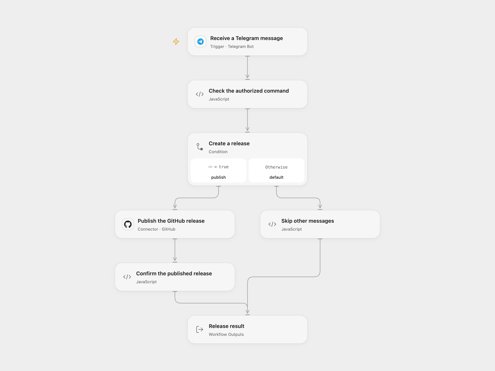

# Telegram Command to GitHub Release

Create a GitHub release from a message sent by an authorized Telegram user.

<picture>
  <source media="(prefers-color-scheme: dark)" srcset="preview-dark.png">
  
</picture>

[Open Flow JSON](templates/telegram-command-to-github-release.openflow.json) · [n8n JSON](templates/telegram-command-to-github-release.n8n.json)

## Setup

Connect a Telegram bot to **Receive a Telegram message** and publish the workflow to a public HTTPS callback. Set **Allowed Chat ID** and **Allowed User ID** in **Check the authorized command** to the numeric IDs of the permitted chat and sender. Both must match. Do not use a group unless the sender ID belongs to the person authorized to publish.

Connect GitHub in **Publish the GitHub release**, set the repository owner and name, and grant the account permission to create releases. The operation creates a published release, not a draft. GitHub may create a missing tag at the repository's default branch.

In n8n, choose Telegram and GitHub OAuth2 credentials, set the same allowed IDs in **Check the authorized command**, and set the owner and repository in **GitHub**. Only one webhook can be active per Telegram bot; activate one format for this process.

## Behavior

Send a message containing the exact text /deploy. The workflow uses the second field produced by splitting the full message on a single space as the release tag, matching the source. For example, /deploy v1.2.3 uses v1.2.3. Missing or empty tags stop before GitHub; a message from another chat or sender is skipped. Other messages are skipped. The confirmed result contains the GitHub release.

Open Flow validates Telegram's webhook secret and uses update ID deduplication where available. The native trigger is upgraded to version 1.2 to validate its webhook secret. Neither format promises exactly-once creation. A failed or uncertain create may already have published a release or created a tag; inspect GitHub before replaying. No workflow retry or rollback is added. The n8n OAuth2 helper can refresh credentials and resend once after HTTP 401.

## Changes to the source

- Replace repository and account identities with setup, and require both a permitted chat and sender before publishing.
- Validate the tag and the returned published release; retain the source's contains and space-splitting rules.
- Upgrade the native Telegram trigger to verify its webhook secret.

Source and license

Adapted from [Telegram command to create a GitHub release](https://github.com/Zie619/n8n-workflows/blob/ae8cf6dc5b873cbb4f74587aa9180ed3a9f70682/workflows/Noop/0061_Noop_GitHub_Automate_Triggered.json) in [Zie619/n8n-workflows](https://github.com/Zie619/n8n-workflows). The source export does not identify a separate template author or license.

The collection’s [MIT notice](https://github.com/Zie619/n8n-workflows/blob/94007c1445d9258a7da116646b79473e7c7c3282/LICENSE) is pinned at a later revision. This is the collection notice at that revision; it does not establish a separate original template author's license. Our changes are listed above; see [repository licensing](../../README.md#licensing).

> MIT License
>
> Copyright (c) 2025 Zie619
>
> Permission is hereby granted, free of charge, to any person obtaining a copy
> of this software and associated documentation files (the "Software"), to deal
> in the Software without restriction, including without limitation the rights
> to use, copy, modify, merge, publish, distribute, sublicense, and/or sell
> copies of the Software, and to permit persons to whom the Software is
> furnished to do so, subject to the following conditions:
>
> The above copyright notice and this permission notice shall be included in all
> copies or substantial portions of the Software.
>
> THE SOFTWARE IS PROVIDED "AS IS", WITHOUT WARRANTY OF ANY KIND, EXPRESS OR
> IMPLIED, INCLUDING BUT NOT LIMITED TO THE WARRANTIES OF MERCHANTABILITY,
> FITNESS FOR A PARTICULAR PURPOSE AND NONINFRINGEMENT. IN NO EVENT SHALL THE
> AUTHORS OR COPYRIGHT HOLDERS BE LIABLE FOR ANY CLAIM, DAMAGES OR OTHER
> LIABILITY, WHETHER IN AN ACTION OF CONTRACT, TORT OR OTHERWISE, ARISING FROM,
> OUT OF OR IN CONNECTION WITH THE SOFTWARE OR THE USE OR OTHER DEALINGS IN THE
> SOFTWARE.

