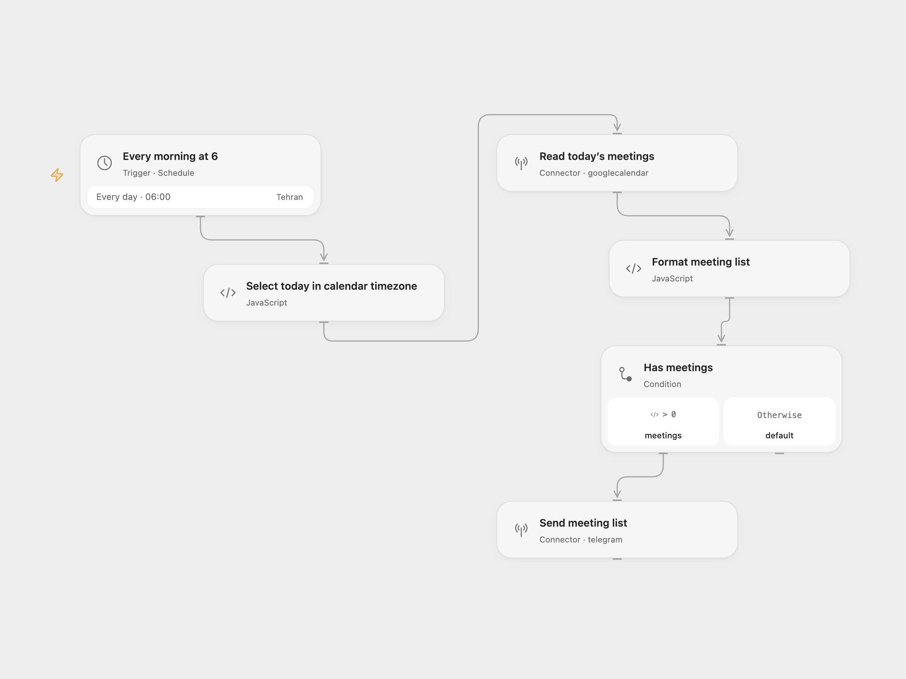

# Telegram Daily Meeting List

Send a Google Calendar meeting list to Telegram at 06:00 each day. The source timezone is Asia/Tehran.

<picture>
  <source media="(prefers-color-scheme: dark)" srcset="preview-dark.png">
  
</picture>

[Open Flow JSON](templates/telegram-daily-meeting-list.openflow.json) · [n8n JSON](templates/telegram-daily-meeting-list.n8n.json)

## Setup

In Open Flow, connect Google Calendar in **Read today’s meetings** and replace `YOUR_CALENDAR_ID`. Connect your Telegram bot in **Send meeting list** and replace `@YOUR_TELEGRAM_CHANNEL` with a channel username or numeric chat ID. The bot needs permission to post there.

Keep the timezone in **Every morning at 6** and **Select today in calendar timezone** aligned. Both default to `Asia/Tehran`. The calendar window covers the day when the run executes, including daylight-saving changes when you select another IANA timezone.

In n8n, configure the calendar and Telegram account in their service nodes and set the chat ID in **Telegram**. The workflow timezone is `Asia/Tehran`; change it with the schedule if needed.

Enable the workflow after setup. It reads the first batch of up to 50 calendar events overlapping the day, expands recurring events, and sends one list in the order returned by Google. It does not fetch another page or send a message when no events match. Times use Persian digits, as in the source, with each event’s timezone when supplied and the workflow timezone otherwise. All-day entries show “All day”; attendee email addresses appear below each event.

The workflow stops on a calendar or Telegram error. It also stops before sending if the formatted list exceeds Telegram’s 4096-character message limit. It does not truncate, split, retry, or deduplicate the list; rerunning can send it again. Read the next-page token in the calendar node if more than 50 events match.

## Changes to the source

- Format the event objects directly and preserve attendee arrays.
- Support all-day events, missing titles, and a missing event timezone.
- Repair the guest-list characters and escape event text for Telegram HTML.
- Make the source’s 50-event limit explicit and disable the automatic n8n footer.

## Source and license

Adapted from [Automatically Send Daily Meeting List to Telegram](https://github.com/Zie619/n8n-workflows/blob/ae8cf6dc5b873cbb4f74587aa9180ed3a9f70682/workflows/Schedule/1932_Schedule_Telegram_Send_Scheduled.json) in [Zie619/n8n-workflows](https://github.com/Zie619/n8n-workflows). The source export does not identify a separate template author or license.

The collection’s [MIT notice](https://github.com/Zie619/n8n-workflows/blob/94007c1445d9258a7da116646b79473e7c7c3282/LICENSE) is pinned at a later revision. This is the collection notice at that revision; it does not establish a separate original template author's license. Our changes are listed above; see [repository licensing](../../README.md#licensing).

> MIT License
>
> Copyright (c) 2025 Zie619
>
> Permission is hereby granted, free of charge, to any person obtaining a copy
> of this software and associated documentation files (the "Software"), to deal
> in the Software without restriction, including without limitation the rights
> to use, copy, modify, merge, publish, distribute, sublicense, and/or sell
> copies of the Software, and to permit persons to whom the Software is
> furnished to do so, subject to the following conditions:
>
> The above copyright notice and this permission notice shall be included in all
> copies or substantial portions of the Software.
>
> THE SOFTWARE IS PROVIDED "AS IS", WITHOUT WARRANTY OF ANY KIND, EXPRESS OR
> IMPLIED, INCLUDING BUT NOT LIMITED TO THE WARRANTIES OF MERCHANTABILITY,
> FITNESS FOR A PARTICULAR PURPOSE AND NONINFRINGEMENT. IN NO EVENT SHALL THE
> AUTHORS OR COPYRIGHT HOLDERS BE LIABLE FOR ANY CLAIM, DAMAGES OR OTHER
> LIABILITY, WHETHER IN AN ACTION OF CONTRACT, TORT OR OTHERWISE, ARISING FROM,
> OUT OF OR IN CONNECTION WITH THE SOFTWARE OR THE USE OR OTHER DEALINGS IN THE
> SOFTWARE.
