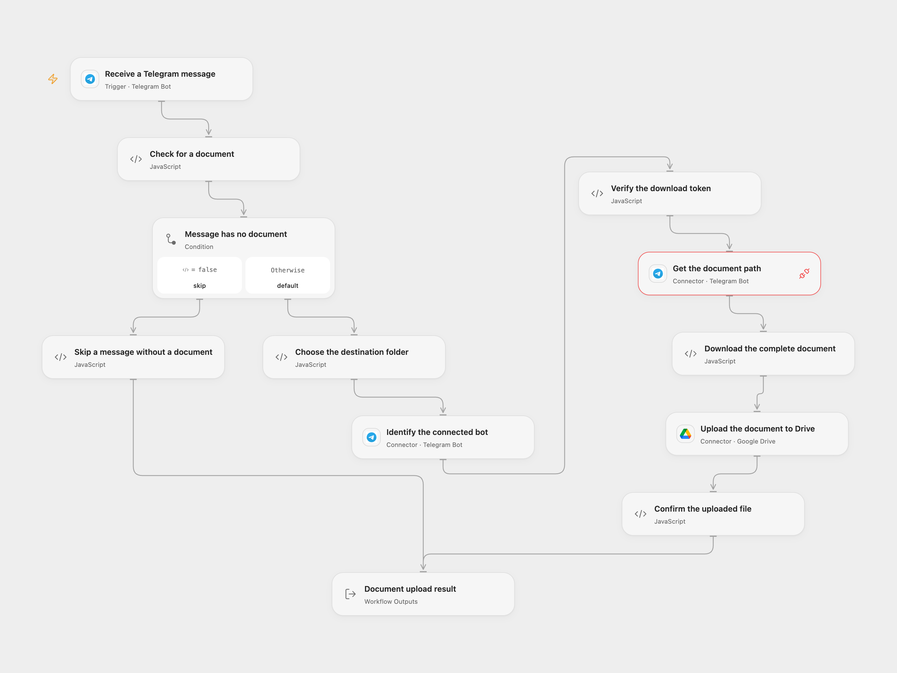

# Telegram Documents to Google Drive

Save each document sent to a Telegram bot in a Google Drive folder.

<picture>
  <source media="(prefers-color-scheme: dark)" srcset="preview-dark.png">
  
</picture>

[Open Flow JSON](templates/telegram-documents-to-google-drive.openflow.json) · [n8n JSON](templates/telegram-documents-to-google-drive.n8n.json)

## Setup

Connect the same Telegram bot to **Receive a Telegram message**, **Identify the connected bot** and **Get the document path**. The red marker on **Get the document path** means its Connection needs to be selected. Set a My Drive **Folder ID** in **Choose the destination folder** and connect **Upload the document to Drive** to a Google account that can create files there.

Create a secret Variable named TELEGRAM_DOCUMENT_BOT_TOKEN containing the same bot token, and select it in **Verify the download token** and **Download the complete document**. Allow Telegram Proxy for getFile and the api.telegram.org HTTP capability. The default accepts messages from any chat that can reach the bot; configure the trigger chat or user filters if needed. Only one webhook can be active per Telegram bot; activate one format for this process. Open Flow checks the Telegram webhook secret. The source n8n trigger is version 1 and does not check a webhook secret; protect its callback URL.

In n8n, select the Telegram and Google Drive credentials and set the folder in **Upload File to GDrive**.

## Behavior

Each incoming Telegram message with a document downloads the complete file and creates one Drive file with its original filename. If Telegram omits the filename, the returned file-path basename is used. Messages without a document do not upload anything. The upload uses the document's MIME type when available, otherwise application/octet-stream. The native trigger infers MIME type from the downloaded file path.

Open Flow checks that the separately configured download token belongs to the connected bot. File content must fit the host’s 1 MiB fetch and Code input/result limits, including Base64 expansion. Larger files fail instead of being truncated. For an empty file, the Drive request creates an empty file using metadata. A failed or uncertain upload may already have created the file; inspect Drive before replaying. The native Drive node also updates metadata after creating the file, so that later step can fail after creation. No workflow retry or rollback is added. The n8n Google OAuth2 helper can refresh credentials and resend a request once after HTTP 401. Telegram's delivery ID is used for trigger deduplication when available; this is not an exactly-once guarantee. Callback acknowledgment confirms receipt, not completion of the upload.

Inspiration &amp; credits

## Changes to the source

- Replace private account and folder identities with setup and make the document-only branch explicit.
- Use the managed getFile request, validate the download token and path, and send complete bytes to Drive.
- Check the Drive receipt before returning an uploaded result.

Adapted from [Save new Files received on Telegram to Google Drive](https://github.com/Zie619/n8n-workflows/blob/ae8cf6dc5b873cbb4f74587aa9180ed3a9f70682/workflows/Telegram/1797_Telegram_GoogleDrive_Create_Triggered.json) in [Zie619/n8n-workflows](https://github.com/Zie619/n8n-workflows). The source export does not identify a separate template author or license.

The collection’s [MIT notice](https://github.com/Zie619/n8n-workflows/blob/94007c1445d9258a7da116646b79473e7c7c3282/LICENSE) is pinned at a later revision. This is the collection notice at that revision; it does not establish a separate original template author's license. Our changes are listed above; see [repository licensing](../../README.md#licensing).

> MIT License
>
> Copyright (c) 2025 Zie619
>
> Permission is hereby granted, free of charge, to any person obtaining a copy
> of this software and associated documentation files (the "Software"), to deal
> in the Software without restriction, including without limitation the rights
> to use, copy, modify, merge, publish, distribute, sublicense, and/or sell
> copies of the Software, and to permit persons to whom the Software is
> furnished to do so, subject to the following conditions:
>
> The above copyright notice and this permission notice shall be included in all
> copies or substantial portions of the Software.
>
> THE SOFTWARE IS PROVIDED "AS IS", WITHOUT WARRANTY OF ANY KIND, EXPRESS OR
> IMPLIED, INCLUDING BUT NOT LIMITED TO THE WARRANTIES OF MERCHANTABILITY,
> FITNESS FOR A PARTICULAR PURPOSE AND NONINFRINGEMENT. IN NO EVENT SHALL THE
> AUTHORS OR COPYRIGHT HOLDERS BE LIABLE FOR ANY CLAIM, DAMAGES OR OTHER
> LIABILITY, WHETHER IN AN ACTION OF CONTRACT, TORT OR OTHERWISE, ARISING FROM,
> OUT OF OR IN CONNECTION WITH THE SOFTWARE OR THE USE OR OTHER DEALINGS IN THE
> SOFTWARE.

