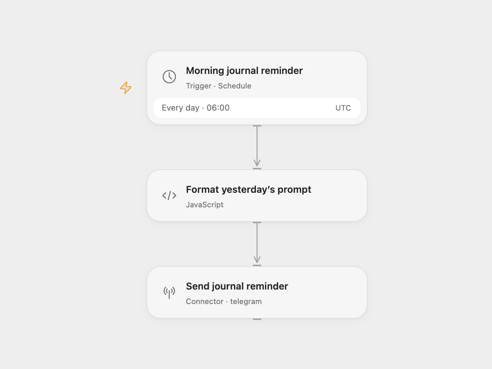

# Telegram Journal Reminder

Send a daily prompt to write about yesterday: “What did you do: YYYY-MM-DD”.

<picture>
  <source media="(prefers-color-scheme: dark)" srcset="preview-dark.png">
  
</picture>

[Open Flow JSON](templates/telegram-journal-reminder.openflow.json) · [n8n JSON](templates/telegram-journal-reminder.n8n.json)

## Setup

Connect your Telegram bot in **Send journal reminder** in Open Flow or the node with the same name in n8n. Replace `@YOUR_TELEGRAM_CHANNEL` with your destination channel username or numeric chat ID. Start a private chat with the bot, or allow it to post in the chosen group or channel.

Both formats default to 06:00 UTC. The source used the n8n instance’s schedule timezone. Set the reminder time and timezone before enabling the workflow. The date inside the prompt uses yesterday in UTC in both formats, even if you change the schedule timezone.

Each run formats the date when it executes and sends one message. It does not store journal entries or check whether you answered. A Telegram error stops the run without retry; rerunning sends another reminder.

Inspiration &amp; credits

## Changes to the source

- Replace the personal chat ID with a setup placeholder.
- Use an explicit UTC schedule and calculate yesterday consistently in UTC.
- Expose the date formatter as a Code step in both formats.

Adapted from [Daily Journal Reminder](https://github.com/Zie619/n8n-workflows/blob/ae8cf6dc5b873cbb4f74587aa9180ed3a9f70682/workflows/Telegram/0346_Telegram_Cron_Automation_Scheduled.json) in [Zie619/n8n-workflows](https://github.com/Zie619/n8n-workflows). The source export does not identify a separate template author or license.

The collection’s [MIT notice](https://github.com/Zie619/n8n-workflows/blob/94007c1445d9258a7da116646b79473e7c7c3282/LICENSE) is pinned at a later revision. This is the collection notice at that revision; it does not establish a separate original template author's license. Our changes are listed above; see [repository licensing](../../README.md#licensing).

> MIT License
>
> Copyright (c) 2025 Zie619
>
> Permission is hereby granted, free of charge, to any person obtaining a copy
> of this software and associated documentation files (the "Software"), to deal
> in the Software without restriction, including without limitation the rights
> to use, copy, modify, merge, publish, distribute, sublicense, and/or sell
> copies of the Software, and to permit persons to whom the Software is
> furnished to do so, subject to the following conditions:
>
> The above copyright notice and this permission notice shall be included in all
> copies or substantial portions of the Software.
>
> THE SOFTWARE IS PROVIDED "AS IS", WITHOUT WARRANTY OF ANY KIND, EXPRESS OR
> IMPLIED, INCLUDING BUT NOT LIMITED TO THE WARRANTIES OF MERCHANTABILITY,
> FITNESS FOR A PARTICULAR PURPOSE AND NONINFRINGEMENT. IN NO EVENT SHALL THE
> AUTHORS OR COPYRIGHT HOLDERS BE LIABLE FOR ANY CLAIM, DAMAGES OR OTHER
> LIABILITY, WHETHER IN AN ACTION OF CONTRACT, TORT OR OTHERWISE, ARISING FROM,
> OUT OF OR IN CONNECTION WITH THE SOFTWARE OR THE USE OR OTHER DEALINGS IN THE
> SOFTWARE.

