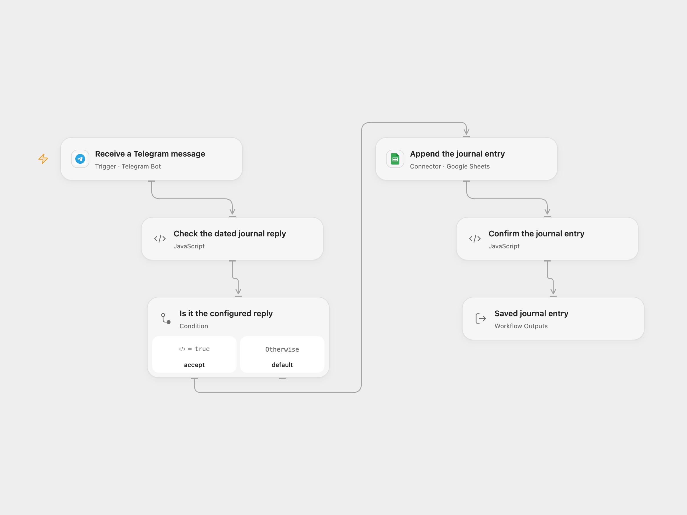

# Telegram Journal Replies to Google Sheets

Save a user’s reply to a bot’s dated journal prompt as a row in Google Sheets.

<picture>
  <source media="(prefers-color-scheme: dark)" srcset="preview-dark.png">
  
</picture>

[Open Flow JSON](templates/telegram-journal-replies-to-google-sheets.openflow.json) · [n8n JSON](templates/telegram-journal-replies-to-google-sheets.n8n.json)

## Setup

Connect your Telegram bot in **Receive a Telegram message**, deploy a public HTTPS callback and activate the workflow. Set the bot and user usernames without `@` in **Check the dated journal reply**. Both accounts must have usernames, and the bot must receive the user’s reply in the chosen chat.

Connect Google Sheets in **Append the journal entry**, set the spreadsheet ID and A1 range, and place `entry` and `date` headers in that order. In n8n, select Telegram and Google Sheets OAuth2 credentials, set the same usernames in **Check the dated journal reply**, and configure the sheet and range in **Add entry to sheet**. Activate only one format for the bot webhook.

## Behavior

Reply to a message from the configured bot with a text entry. The bot’s prompt must contain a colon followed by the date, for example `What did you do: 2026-11-10`. The workflow takes the text after the first colon up to any next colon, removes whitespace and saves that value as `date`; the reply text becomes `entry`. It does not validate the date or send a reminder. This can be paired with [Telegram Journal Reminder](../telegram-journal-reminder/README.md).

Other users, non-replies and non-text messages are ignored. A matching reply with a malformed bot prompt fails before writing. Usernames are Telegram profile fields and can change; restrict the bot and sheet to people who should access journal entries. Google Sheets receives values as RAW text. A failed or uncertain append may already have written a row; inspect the sheet before replaying. Open Flow uses Telegram update IDs to help deduplicate webhook admission; the native n8n trigger does not add that same key. Neither format guarantees exactly-once sheet writes or automatic failed-run replay.

## Changes to the source

- Make bot/user setup explicit and ignore unrelated updates before reading reply fields.
- Preserve the original colon-based date extraction and entry text, and append only matching replies.
- Use a secret-checked Telegram trigger version and replace private spreadsheet/credential identifiers.

Source and license

Adapted from [Save Telegram reply to journal spreadsheet](https://github.com/Zie619/n8n-workflows/blob/ae8cf6dc5b873cbb4f74587aa9180ed3a9f70682/workflows/Googlesheets/0974_GoogleSheets_Telegram_Export_Triggered.json) in [Zie619/n8n-workflows](https://github.com/Zie619/n8n-workflows). The source export does not identify a separate template author or license.

The collection’s [MIT notice](https://github.com/Zie619/n8n-workflows/blob/94007c1445d9258a7da116646b79473e7c7c3282/LICENSE) is pinned at a later revision. This is the collection notice at that revision; it does not establish a separate original template author's license. Our changes are listed above; see [repository licensing](../../README.md#licensing).

> MIT License
>
> Copyright (c) 2025 Zie619
>
> Permission is hereby granted, free of charge, to any person obtaining a copy
> of this software and associated documentation files (the "Software"), to deal
> in the Software without restriction, including without limitation the rights
> to use, copy, modify, merge, publish, distribute, sublicense, and/or sell
> copies of the Software, and to permit persons to whom the Software is
> furnished to do so, subject to the following conditions:
>
> The above copyright notice and this permission notice shall be included in all
> copies or substantial portions of the Software.
>
> THE SOFTWARE IS PROVIDED "AS IS", WITHOUT WARRANTY OF ANY KIND, EXPRESS OR
> IMPLIED, INCLUDING BUT NOT LIMITED TO THE WARRANTIES OF MERCHANTABILITY,
> FITNESS FOR A PARTICULAR PURPOSE AND NONINFRINGEMENT. IN NO EVENT SHALL THE
> AUTHORS OR COPYRIGHT HOLDERS BE LIABLE FOR ANY CLAIM, DAMAGES OR OTHER
> LIABILITY, WHETHER IN AN ACTION OF CONTRACT, TORT OR OTHERWISE, ARISING FROM,
> OUT OF OR IN CONNECTION WITH THE SOFTWARE OR THE USE OR OTHER DEALINGS IN THE
> SOFTWARE.

