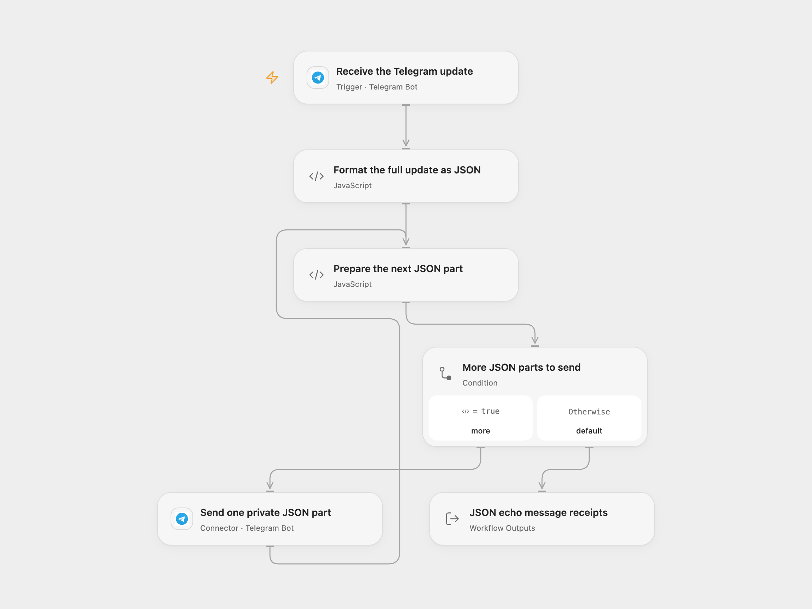

# Telegram Message JSON Debugger

Inspect the complete JSON update received by a Telegram bot. The bot sends the formatted JSON privately to the original message sender.

<picture>
  <source media="(prefers-color-scheme: dark)" srcset="preview-dark.png">
  
</picture>

[Open Flow JSON](templates/telegram-message-json-debugger.openflow.json) · [n8n JSON](templates/telegram-message-json-debugger.n8n.json)

## Setup

Connect the same Telegram bot in **Receive the Telegram update** and **Send one private JSON part**. In n8n, select the same **Telegram API** bot credentials on its trigger and send node. Activate one format for this bot. Telegram supports one webhook destination per bot, so another active workflow can prevent registration or replace its destination.

Use a dedicated bot for this debugger and start a private conversation with it before testing. The response goes to `message.from.id`, as in the source. A group message is echoed privately to its sender, rather than posted back to the group. The bot must be allowed to message that sender.

Keep the trigger’s default update selection and file downloading disabled. Open Flow keeps pending updates when registering the webhook; the n8n trigger uses version 1.2, which also keeps pending updates and checks the webhook secret header.

## Use

Send a text message, sticker, emoji, photo, voice note, document or forwarded message to the bot. The response shows the entire update as JSON with two-space indentation, including message and media metadata. File contents are not downloaded. The JSON includes the data present in the received update, such as sender/chat information and file identifiers.

The processor requires a new `message` update with a valid sender ID. The default Telegram subscription can also deliver other update types, such as edited messages, channel posts and callbacks. Those updates do not have the source’s `message.from.id` path and are rejected before an echo can be sent, or handled by the trigger itself. n8n’s native trigger can route its own approval callbacks to its platform handler without running this echo workflow. Open Flow may filter unsupported update types. The echo processor does not choose another recipient.

JSON is escaped inside an HTML code block so backticks, markup and special characters in message content remain literal. A long update is divided into numbered parts, sent in order. Each encoded message stays within 4096 characters, including its markup. Join the JSON content after each part label to reconstruct the full update. No fields or text are truncated.

Each returned message is checked for its ID, private recipient and complete rendered part text before the next part is sent. Errors, missing receipts or uncertain sends stop later parts. Earlier messages can already have been sent; check the conversation before replaying a failed run. No workflow retry or cross-run echo history is added.

Open Flow identifies webhook deliveries by the Telegram update ID. The n8n trigger adds no workflow-level delivery history. Manual replays or uncertain sends can produce duplicate messages. Complete updates, encoded parts and accumulated receipts must fit the inspected Open Flow host’s 1 MiB per-Code input/result budget; oversized data fails without truncation. The Open Flow result keeps all normalized message receipts (`messageId`, `chat`, `text` and other returned fields) plus a count. n8n keeps the Telegram API response envelopes.

## Changes to the source

- Keep private replies to the original sender and make unsupported update handling explicit.
- Use the n8n trigger’s supported secret-checking version while preserving pending updates.
- Replace unescaped Markdown fences with escaped HTML code blocks, disable generated n8n message attribution and split oversized JSON into sequential parts.
- Confirm each sent part without fetching media files.

Source and license

Adapted from [Telegram update JSON echo debugger](https://github.com/Zie619/n8n-workflows/blob/ae8cf6dc5b873cbb4f74587aa9180ed3a9f70682/workflows/Telegram/1941_Telegram_Stickynote_Automate_Triggered.json) in [Zie619/n8n-workflows](https://github.com/Zie619/n8n-workflows). The source export does not identify a separate template author or license.

The collection’s [MIT notice](https://github.com/Zie619/n8n-workflows/blob/94007c1445d9258a7da116646b79473e7c7c3282/LICENSE) is pinned at a later revision. This is the collection notice at that revision; it does not establish a separate original template author's license. Our changes are listed above; see [repository licensing](../../README.md#licensing).

> MIT License
>
> Copyright (c) 2025 Zie619
>
> Permission is hereby granted, free of charge, to any person obtaining a copy
> of this software and associated documentation files (the "Software"), to deal
> in the Software without restriction, including without limitation the rights
> to use, copy, modify, merge, publish, distribute, sublicense, and/or sell
> copies of the Software, and to permit persons to whom the Software is
> furnished to do so, subject to the following conditions:
>
> The above copyright notice and this permission notice shall be included in all
> copies or substantial portions of the Software.
>
> THE SOFTWARE IS PROVIDED "AS IS", WITHOUT WARRANTY OF ANY KIND, EXPRESS OR
> IMPLIED, INCLUDING BUT NOT LIMITED TO THE WARRANTIES OF MERCHANTABILITY,
> FITNESS FOR A PARTICULAR PURPOSE AND NONINFRINGEMENT. IN NO EVENT SHALL THE
> AUTHORS OR COPYRIGHT HOLDERS BE LIABLE FOR ANY CLAIM, DAMAGES OR OTHER
> LIABILITY, WHETHER IN AN ACTION OF CONTRACT, TORT OR OTHERWISE, ARISING FROM,
> OUT OF OR IN CONNECTION WITH THE SOFTWARE OR THE USE OR OTHER DEALINGS IN THE
> SOFTWARE.

