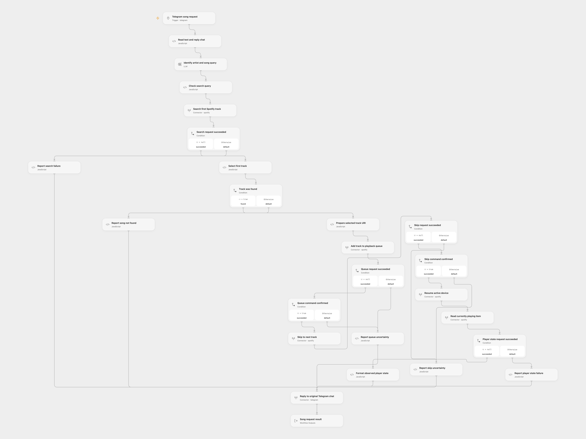

# Telegram Spotify Player

Send a song description to your Telegram bot. A model turns it into a Spotify search query; the workflow queues the first result, requests next/resume playback and replies with Spotify’s observed player state.

<picture>
  <source media="(prefers-color-scheme: dark)" srcset="preview-dark.png">
  
</picture>

[Open Flow JSON](templates/telegram-spotify-player.openflow.json) · [n8n JSON](templates/telegram-spotify-player.n8n.json)

## Setup

Connect **Telegram song request** to your bot. Choose the model service on **Identify artist and song query**. Select the same Spotify account on all five Spotify action nodes. Playback controls require Spotify Premium, the `user-modify-playback-state` scope and an active Spotify device; reading the current item requires `user-read-currently-playing`. Open Spotify on that device before sending a request.

For n8n, select Telegram and OpenAI credentials, Spotify credentials on the four native Spotify nodes, and a Spotify OAuth2 credential on the **Currently Playing** HTTP node. That read includes the HTTP status so an empty 204 response can be handled explicitly.

The model is `gpt-4o-mini`, with provider-default generation settings. OpenAI lists its retirement as January 14, 2027; replace it in both formats before that date. This is one generation step. No workflow-level retries are configured; model or managed Provider transports may have their own retry behavior.

Anyone allowed to send a request to this bot can control the connected Spotify account. Configure the Telegram trigger’s allowed user/chat IDs for your intended users. Open Flow’s empty lists accept all users/chats, matching the source. The bot does not select a different Spotify account based on the sender.

## Use and behavior

Publish and enable the configured workflow, and send the bot a text such as `Play Dreams by Fleetwood Mac`. The model produces a search query, and Spotify is asked for only the first matching track. Its URI is added to the current queue; the workflow requests next track, then resume, then reads the current item. No playlist is created and no audio file is downloaded.

These requests are awaited in that order. Spotify does not guarantee execution ordering across Player API endpoints, so a successful command sequence does not prove that the requested track is already playing. The reply reports the item and play/pause state actually returned by Spotify, which can differ from the selected result. If no current item is reported, the reply says so.

An empty search returns `Song not found` without changing playback. A handled search, queue, skip or current-state failure produces a short stage-specific reply. A handled resume failure still proceeds to the current-state read, preserving the source behavior. Open Flow only routes failures the platform marks catchable; ordinary or result-unknown failures stop. Earlier playback changes remain in place. Failed Telegram delivery stops without repeating any playback command. There are no duplicate-message checks, so repeated requests can add the same track or skip again.

Nontext or blank Telegram messages, a blank model query, malformed search/state data and oversized replies stop the run. Replies escape HTML-sensitive characters. Open Flow results and the final n8n result contain the search query, reply and `observed`, `unavailable`, `not_found` or `failed` status.

Your message text goes to the configured model service. Spotify receives its generated query and the playback commands. Telegram receives the observed item or a short failure status. The model can misidentify a song; this template uses the first search result without an approval step.

## Changes to the source

- Use n8n Telegram Trigger 1.2 so its allowed-user/chat filters take effect while preserving pending updates.
- Validate text requests and preserve the original chat ID across search and playback responses.
- Make an empty native search reach the no-match branch instead of ending without a reply.
- Keep queue, next, resume and observation as visible ordered operations, including the source’s resume-error continuation.
- Handle empty current-state responses and distinguish observed play/pause state from command acceptance.
- Use safe JSON/data bindings and escaped HTML replies, with generic failure messages in place of raw service errors.
- Return the same status context after Telegram delivery instead of depending on a write response to echo the input.

## Source and license

Adapted from [Telegram to Spotify with OpenAI](https://github.com/enescingoz/awesome-n8n-templates/blob/827110332c21cbe000ab13f6d292d5adb1f1f8db/Telegram/Telegram%20to%20Spotify%20with%20OpenAI.json) in [enescingoz/awesome-n8n-templates](https://github.com/enescingoz/awesome-n8n-templates).

Source collection notice: © 2024–2026 Enes Cingoz, [CC BY 4.0](https://github.com/enescingoz/awesome-n8n-templates/blob/827110332c21cbe000ab13f6d292d5adb1f1f8db/LICENSE). The source export does not identify a separate template author or license. See [repository licensing](../../README.md#licensing) for the scope of OOMOL contributions and third-party material.
