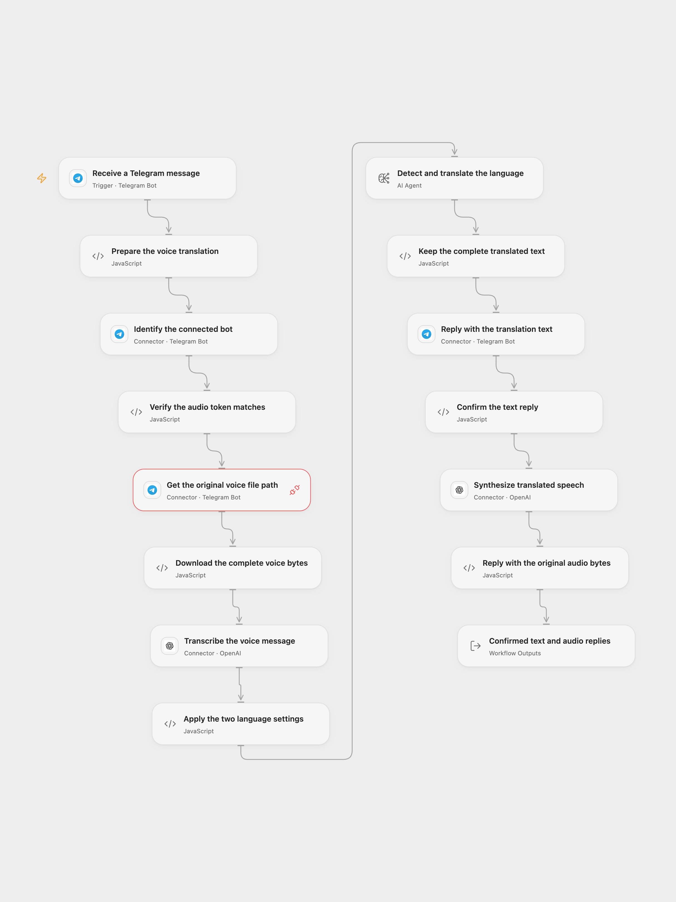

# Telegram Voice Language Translator

Translate spoken Telegram messages between your two configured languages and reply with the full translated text and MP3 audio.

<picture>
  <source media="(prefers-color-scheme: dark)" srcset="preview-dark.png">
  
</picture>

[Open Flow JSON](templates/telegram-voice-language-translator.openflow.json) · [n8n JSON](templates/telegram-voice-language-translator.n8n.json)

## Setup

Connect one Telegram bot in the update trigger, **Identify the connected bot**, **Get the original voice file path** and **Reply with the translation text**. Grant Telegram Proxy permission for `getFile`. The red connection marker on the `getFile` step indicates that its Connection still needs to be selected. Use only one active workflow/webhook for this bot. In **Prepare the voice translation**, set the two language names; the initial pair is English and French.

Create a secret Variable named `TELEGRAM_AUDIO_BOT_TOKEN` containing that same bot’s token. Select it in **Verify the audio token matches**, **Download the complete voice bytes** and **Reply with the original audio bytes**. Exported templates clear external Variable references, so select the Variable after import. Keep these Code nodes’ HTTP capability restricted to `api.telegram.org`.

This extra token configuration supplies operations absent from the current Telegram catalog: file-byte download and multipart audio upload. Existing Telegram actions and the managed `getFile` Proxy retain their Connection. The workflow calls `get_me` through the Connection and `getMe` through the separately configured token, and requires the same bot identity before downloading, transcribing or sending a reply. The extra Code steps do not read or copy the Connection’s stored secret. No external file hosting or public upload service is used.

Connect OpenAI in the transcription and speech nodes. Configure a `gpt-5-mini` model route for the Open Flow translation Agent. n8n uses the same current native Chat Model default explicitly, with no tools or memory. The native model retains its default maximum of two transport retries; the inspected Open Flow Agent transport uses zero retries and one round. Neither format adds workflow-level retries for sends.

Describe audio replies as AI-generated in your bot’s profile.

In n8n, select Telegram credentials on the trigger, file download and both reply nodes; select OpenAI credentials on the transcription, chat model and speech nodes. Set the language pair in **Settings**. No extra token Variable is needed by the native Telegram nodes. Activate one format for this bot.

## Behavior

Send a Telegram voice message. The workflow downloads its entire file, transcribes with `whisper-1`, and uses the original translation instructions: when the detected text is in either configured language, translate into the other language and return only the translation. Languages outside that pair follow the model’s interpretation of the original prompt; no additional routing or guaranteed language detection is added.

The text reply completes before `tts-1` synthesizes the same full translation with the `alloy` voice, MP3 format and speed `1`. The exact synthesized bytes are uploaded as a Telegram audio attachment to the same chat. Open Flow returns the transcription, translation and both confirmed message records. A confirmed text reply can remain if speech generation or audio upload subsequently fails.

Both formats require a voice message and subscribe to ordinary message updates, avoiding the source’s attempts to read a voice file from unrelated update types. Text replies display the literal translation without interpreting Markdown. Open Flow sends plain text; the native Telegram node uses HTML mode with the full translation escaped, because omitting its parse mode would reintroduce Markdown. Open Flow rejects empty or malformed transcription/translation before replies and validates returned message records; native nodes retain their own API error behavior. Neither format selects a first record or truncates audio/text. API input, model-context and Telegram message limits still apply.

Open Flow uses the published host’s normal maximum of 1 MiB per fetch body and response. Its Code input/result JSON must also fit 1 MiB, including base64 expansion; a file or speech result can reach that JSON budget before its raw bytes reach 1 MiB. Oversized input/output fails without sending a partial audio file. n8n’s native binary handling has its own platform and API limits. Use short voice messages that fit the chosen deployment.

No workflow retry or rollback is added. An uncertain text or audio send is attempted once and stops the run; inspect the chat before replaying. File/model errors stop later work. The bot-identity check prevents using a token for a different connected bot, but does not guarantee exactly-once message delivery. A webhook acknowledgment confirms receipt rather than completed translation.

## Model lifecycle

The current native source defaults are retained while they remain available: `gpt-5-mini` is scheduled to shut down on December 11, 2026, `tts-1` on January 6, 2027, and `whisper-1` on February 26, 2027. Update both formats and verify the replacement API, voice/format settings and resulting audio before those dates. The source title’s “55 supported languages” describes the original template; consult the current speech API documentation for language support. [OpenAI deprecations](https://developers.openai.com/api/docs/deprecations), [speech to text](https://developers.openai.com/api/docs/guides/speech-to-text), [text to speech](https://developers.openai.com/api/docs/guides/text-to-speech).

Inspiration &amp; credits

Adapted from [Translate Telegram audio messages with AI (55 supported languages)](https://github.com/enescingoz/awesome-n8n-templates/blob/827110332c21cbe000ab13f6d292d5adb1f1f8db/Telegram/Translate%20Telegram%20audio%20messages%20with%20AI%20(55%20supported%20languages).json) in [enescingoz/awesome-n8n-templates](https://github.com/enescingoz/awesome-n8n-templates).

Source collection notice: © 2024–2026 Enes Cingoz, [CC BY 4.0](https://github.com/enescingoz/awesome-n8n-templates/blob/827110332c21cbe000ab13f6d292d5adb1f1f8db/LICENSE). The source export does not identify a separate template author or license. See [repository licensing](../../README.md#licensing) for the scope of OOMOL contributions and third-party material.

