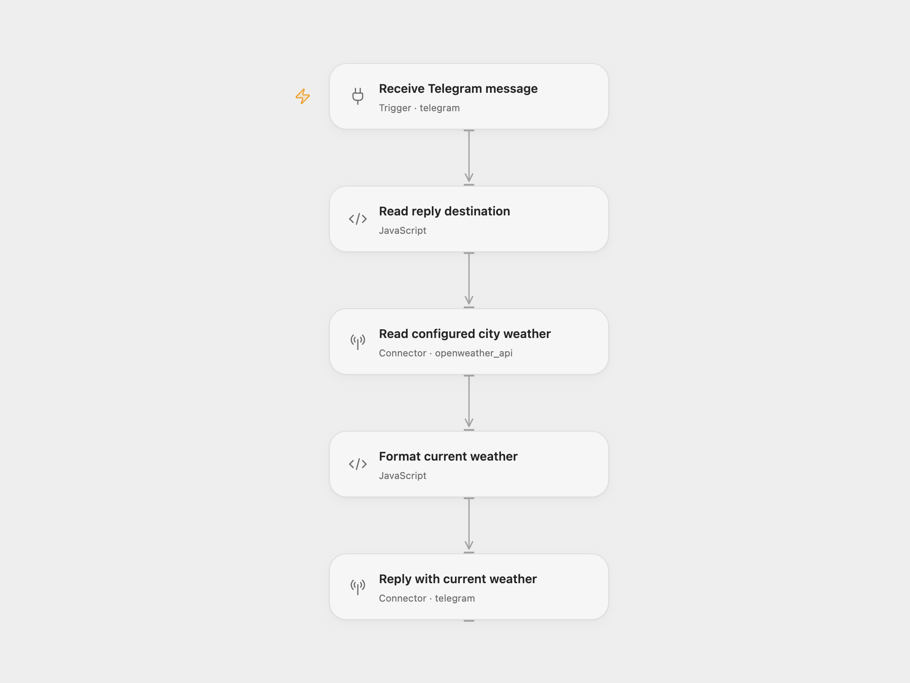

# Telegram Weather Reply

Reply to each incoming Telegram message with the current weather, temperature, and feels-like temperature for a city you configure. The example city is Berlin, Germany.

<picture>
  <source media="(prefers-color-scheme: dark)" srcset="preview-dark.png">
  
</picture>

[Open Flow JSON](templates/telegram-weather-reply.openflow.json) · [n8n JSON](templates/telegram-weather-reply.n8n.json)

## Setup

In Open Flow, select the same Telegram bot account in **Receive Telegram message** and **Reply with current weather**. Connect OpenWeather in **Read configured city weather** and edit its city query, for example `berlin,de` or `london,gb`. Keep Units set to `metric` for the Celsius reply.

In n8n, connect the same Telegram bot in **Telegram Trigger** and **Telegram**. Connect OpenWeather in **OpenWeatherMap**, choose the city, and keep Metric format. The trigger uses version 1.2.

Enable one format with this bot at a time: Telegram supports one active webhook per bot. Send it a message in a private chat, or a message it can receive in a group. Every delivered message triggers one weather lookup and one reply to that message’s chat. The reply always describes the configured city; message text is not interpreted as a city query.

Queued updates are retained when the webhook is created. Open Flow’s optional chat/user filters are initially empty, matching the source’s unrestricted message trigger. A malformed update, incomplete weather response, or service error stops the run without a reply or retry. Replaying an event can send another reply.

## Changes to the source

- Make metric units explicit and escape the weather description for Telegram HTML.
- Check the incoming chat ID and required weather fields before replying.
- Update the n8n Telegram trigger to version 1.2 while retaining queued updates.

## Source and license

Adapted from [Telegram Weather Workflow](https://github.com/Zie619/n8n-workflows/blob/ae8cf6dc5b873cbb4f74587aa9180ed3a9f70682/workflows/Openweathermap/0751_Openweathermap_Telegram_Automate_Triggered.json) in [Zie619/n8n-workflows](https://github.com/Zie619/n8n-workflows). The source export does not identify a separate template author or license.

The collection’s [MIT notice](https://github.com/Zie619/n8n-workflows/blob/94007c1445d9258a7da116646b79473e7c7c3282/LICENSE) is pinned at a later revision. This is the collection notice at that revision; it does not establish a separate original template author's license. Our changes are listed above; see [repository licensing](../../README.md#licensing).

> MIT License
>
> Copyright (c) 2025 Zie619
>
> Permission is hereby granted, free of charge, to any person obtaining a copy
> of this software and associated documentation files (the "Software"), to deal
> in the Software without restriction, including without limitation the rights
> to use, copy, modify, merge, publish, distribute, sublicense, and/or sell
> copies of the Software, and to permit persons to whom the Software is
> furnished to do so, subject to the following conditions:
>
> The above copyright notice and this permission notice shall be included in all
> copies or substantial portions of the Software.
>
> THE SOFTWARE IS PROVIDED "AS IS", WITHOUT WARRANTY OF ANY KIND, EXPRESS OR
> IMPLIED, INCLUDING BUT NOT LIMITED TO THE WARRANTIES OF MERCHANTABILITY,
> FITNESS FOR A PARTICULAR PURPOSE AND NONINFRINGEMENT. IN NO EVENT SHALL THE
> AUTHORS OR COPYRIGHT HOLDERS BE LIABLE FOR ANY CLAIM, DAMAGES OR OTHER
> LIABILITY, WHETHER IN AN ACTION OF CONTRACT, TORT OR OTHERWISE, ARISING FROM,
> OUT OF OR IN CONNECTION WITH THE SOFTWARE OR THE USE OR OTHER DEALINGS IN THE
> SOFTWARE.
