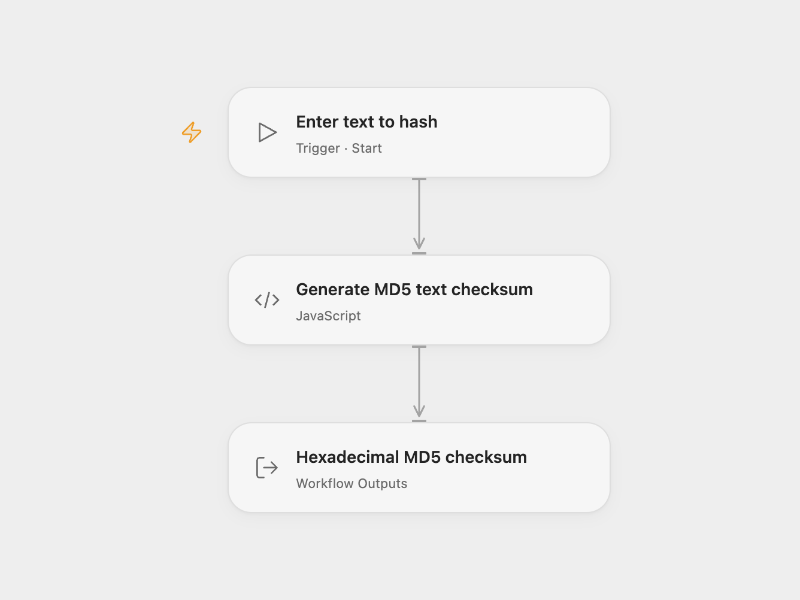

# Text Hash Generator

Generate an MD5 checksum of UTF-8 text and return its 32-character lowercase hexadecimal value as `data`.

<picture>
  <source media="(prefers-color-scheme: dark)" srcset="preview-dark.png">
  
</picture>

[Open Flow JSON](templates/text-hash-generator.openflow.json) · [n8n JSON](templates/text-hash-generator.n8n.json)

## Usage

In Open Flow, run with **Text**. In n8n, edit **Value** in **Crypto** and run manually. Both formats preserve the source’s MD5 algorithm and hexadecimal output.

The exact text is hashed without trimming whitespace, changing line endings or normalizing Unicode. An empty string has a valid checksum. Use the result to compare text content with another MD5 checksum.

The text is hashed in the workflow engine. It makes no network requests and reads no files.

Inspiration &amp; credits

## Changes to the source

- Require configurable text as the Open Flow run input.
- Make the source’s MD5, text-input and hexadecimal defaults explicit.
- Expose the checksum as a workflow output in Open Flow.

Adapted from [Crypto text hash workflow](https://github.com/Zie619/n8n-workflows/blob/ae8cf6dc5b873cbb4f74587aa9180ed3a9f70682/workflows/Manual/1038_Manual_Crypto_Automate_Triggered.json) in [Zie619/n8n-workflows](https://github.com/Zie619/n8n-workflows). The source export does not identify a separate template author or license.

The collection’s [MIT notice](https://github.com/Zie619/n8n-workflows/blob/94007c1445d9258a7da116646b79473e7c7c3282/LICENSE) is pinned at a later revision. This is the collection notice at that revision; it does not establish a separate original template author's license. Our changes are listed above; see [repository licensing](../../README.md#licensing).

> MIT License
>
> Copyright (c) 2025 Zie619
>
> Permission is hereby granted, free of charge, to any person obtaining a copy
> of this software and associated documentation files (the "Software"), to deal
> in the Software without restriction, including without limitation the rights
> to use, copy, modify, merge, publish, distribute, sublicense, and/or sell
> copies of the Software, and to permit persons to whom the Software is
> furnished to do so, subject to the following conditions:
>
> The above copyright notice and this permission notice shall be included in all
> copies or substantial portions of the Software.
>
> THE SOFTWARE IS PROVIDED "AS IS", WITHOUT WARRANTY OF ANY KIND, EXPRESS OR
> IMPLIED, INCLUDING BUT NOT LIMITED TO THE WARRANTIES OF MERCHANTABILITY,
> FITNESS FOR A PARTICULAR PURPOSE AND NONINFRINGEMENT. IN NO EVENT SHALL THE
> AUTHORS OR COPYRIGHT HOLDERS BE LIABLE FOR ANY CLAIM, DAMAGES OR OTHER
> LIABILITY, WHETHER IN AN ACTION OF CONTRACT, TORT OR OTHERWISE, ARISING FROM,
> OUT OF OR IN CONNECTION WITH THE SOFTWARE OR THE USE OR OTHER DEALINGS IN THE
> SOFTWARE.

