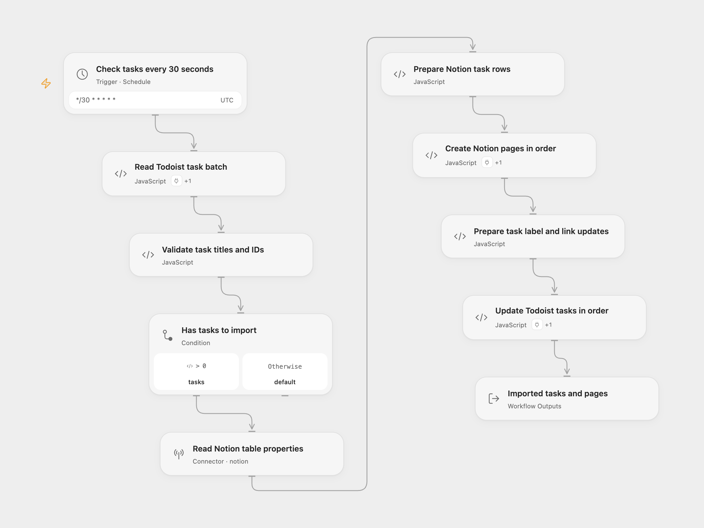

# Todoist to Notion Sync

Copy labeled Todoist tasks into a Notion table. After creating the rows, add each Notion page link to its Todoist task and replace the routing label with `sent`.

<picture>
  <source media="(prefers-color-scheme: dark)" srcset="preview-dark.png">
  
</picture>

[Open Flow JSON](templates/todoist-to-notion-sync.openflow.json) · [n8n JSON](templates/todoist-to-notion-sync.n8n.json)

## Setup

Create a Notion table with its normal title property and a **Text** property named **Todoist ID**. Task IDs are stored as text, including current alphanumeric Todoist IDs. Share the table with your Notion connection.

For Open Flow:

| Node | Configuration |
| --- | --- |
| Read Todoist task batch | Connect Todoist through Actions. Set the source label and batch size; defaults are `send-to-notion` and 50. |
| Read Notion table properties | Connect Notion and set the data source ID, available under the database’s Manage data sources menu. |
| Prepare Notion task rows | Edit ID Property if your text column has another name. The title property is discovered from Notion. |
| Create Notion pages in order | Select the same Notion account through Actions. |
| Prepare task label and link updates | Edit Sent Label if needed; it defaults to `sent`. |
| Update Todoist tasks in order | Select the same Todoist account through Actions. |

For n8n, configure Todoist OAuth2 in both Todoist nodes and Notion in **Add to Notion database**. Select the source label, destination database, and the **Todoist ID** rich-text property. Set the completed label in the last line of **Prepare task updates** if needed. The n8n Notion node uses the older database API, so use a database containing one data source. Its database ID differs from the data source ID used by Open Flow.

Both formats check every 30 seconds with an explicit UTC schedule. Enable the workflow after setup. Each run reads up to 50 matching active tasks by default, following cursors as needed to fill that batch. It validates all titles, IDs, and label arrays before any page creation. Titles must contain 1–2,000 characters. With no tasks, it does not call Notion or update Todoist.

All Notion rows are created in task order before any Todoist task is updated. Each row contains the task title and full task ID. Each update removes the configured source label, adds `sent`, keeps other labels, and prepends `Notion Link: <page URL>` to the existing description. Open Flow returns the task-to-page associations and updated task records; n8n returns update confirmations.

This sequence is not atomic. A page-creation error leaves earlier rows in Notion and all task labels unchanged. An update error leaves later tasks with their routing label even though their Notion rows already exist. A later poll, overlapping run, or manual retry can create duplicate rows. Check and reconcile the two services before retrying an uncertain run. The workflow does not query for existing Notion rows or automatically replay failed calls.

## Changes to the source

- Store Todoist IDs in a text column instead of parsing them as numbers.
- Validate the whole task batch before creating pages.
- Keep unrelated task labels while replacing the routing label.
- Update n8n Todoist to version 2.2 for the current paginated API, retain the default 50-task batch, and make the 30-second interval explicit.
- Use Notion’s data source API in Open Flow and expose task-to-page associations.

## Source and license

Adapted from [Sync Todoist tasks to Notion](https://github.com/Zie619/n8n-workflows/blob/ae8cf6dc5b873cbb4f74587aa9180ed3a9f70682/workflows/Schedule/1607_Schedule_Notion_Sync_Scheduled.json) in [Zie619/n8n-workflows](https://github.com/Zie619/n8n-workflows). The source export does not identify a separate template author or license.

The collection’s [MIT notice](https://github.com/Zie619/n8n-workflows/blob/94007c1445d9258a7da116646b79473e7c7c3282/LICENSE) is pinned at a later revision. This is the collection notice at that revision; it does not establish a separate original template author's license. Our changes are listed above; see [repository licensing](../../README.md#licensing).

> MIT License
>
> Copyright (c) 2025 Zie619
>
> Permission is hereby granted, free of charge, to any person obtaining a copy
> of this software and associated documentation files (the "Software"), to deal
> in the Software without restriction, including without limitation the rights
> to use, copy, modify, merge, publish, distribute, sublicense, and/or sell
> copies of the Software, and to permit persons to whom the Software is
> furnished to do so, subject to the following conditions:
>
> The above copyright notice and this permission notice shall be included in all
> copies or substantial portions of the Software.
>
> THE SOFTWARE IS PROVIDED "AS IS", WITHOUT WARRANTY OF ANY KIND, EXPRESS OR
> IMPLIED, INCLUDING BUT NOT LIMITED TO THE WARRANTIES OF MERCHANTABILITY,
> FITNESS FOR A PARTICULAR PURPOSE AND NONINFRINGEMENT. IN NO EVENT SHALL THE
> AUTHORS OR COPYRIGHT HOLDERS BE LIABLE FOR ANY CLAIM, DAMAGES OR OTHER
> LIABILITY, WHETHER IN AN ACTION OF CONTRACT, TORT OR OTHERWISE, ARISING FROM,
> OUT OF OR IN CONNECTION WITH THE SOFTWARE OR THE USE OR OTHER DEALINGS IN THE
> SOFTWARE.
