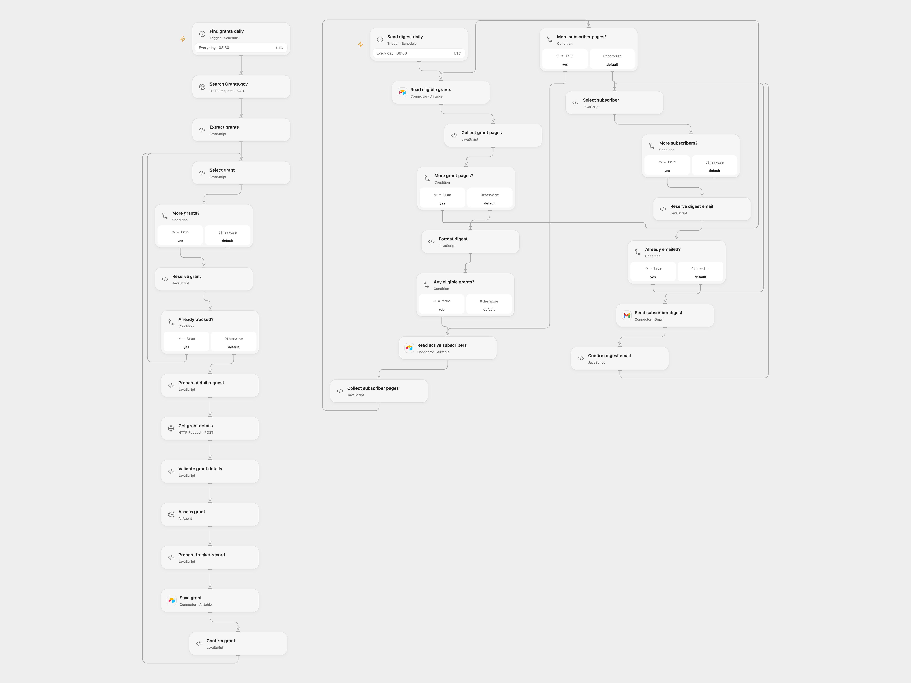

# Track AI Grants and Send a Digest

Track new AI grant opportunities and email a digest of eligible listings.

<picture>
  <source media="(prefers-color-scheme: dark)" srcset="preview-dark.png">
  
</picture>

[Open Flow JSON](templates/track-ai-grants-and-send-digest.openflow.json) · [n8n JSON](templates/track-ai-grants-and-send-digest.n8n.json)

## Setup

Configure the Airtable base, grants and subscribers tables, organization profile, Gmail connection and model. The grants table needs the fields Opportunity Number, Status, Title, URL, Agency, Goal, Notes, Success Criteria, Duration, Eligibility?, Eligibility Notes, Posted Date, Response Date, Funding, Award Floor, Award Ceiling, Agency Email, Agency Phone and Created; subscribers need Email and Status. Enable persistent State. In n8n configure both Airtable tables, Gmail, model and a Data Table with item_key and status text columns. Prevent overlapping runs.

## Behavior

At 08:30 UTC search Grants.gov for recent AI grants, assess each against the configured profile and save records. At 09:00 UTC send today's eligible new grants to active subscribers. The search stops if Grants.gov reports more than 5,000 results rather than omitting records. Model eligibility is a lead for human review, not a determination. Grant text and organization profile are sent to the model provider. Inspect Airtable or Gmail before clearing pending checkpoints after uncertain writes.

<details>
<summary>Inspiration &amp; credits</summary>

Adapted from [Deduplicate Scraping AI Grants for Eligibility using AI](https://github.com/enescingoz/awesome-n8n-templates/blob/827110332c21cbe000ab13f6d292d5adb1f1f8db/AI_Research_RAG_and_Data_Analysis/Deduplicate%20Scraping%20AI%20Grants%20for%20Eligibility%20using%20AI.json) in [enescingoz/awesome-n8n-templates](https://github.com/enescingoz/awesome-n8n-templates).

Source collection notice: © 2024–2026 Enes Cingoz, [CC BY 4.0](https://github.com/enescingoz/awesome-n8n-templates/blob/827110332c21cbe000ab13f6d292d5adb1f1f8db/LICENSE). The source export does not identify a separate template author or license. See [repository licensing](../../README.md#licensing) for the scope of OOMOL contributions and third-party material.


Changes from source: Replace the embedded organization profile with configuration, repair the two model-result merge and the digest schedule so it follows ingestion, add pagination and write checkpoints, and use UTC schedules.

Collection license notice:

```text
Creative Commons Attribution 4.0 International License

Copyright (c) 2024-2026 Enes Cingoz

You are free to:

  Share - copy and redistribute the material in any medium or format
  Adapt - remix, transform, and build upon the material for any purpose,
  even commercially.

Under the following terms:

  Attribution - You must give appropriate credit, provide a link to the
  license, and indicate if changes were made. You may do so in any
  reasonable manner, but not in any way that suggests the licensor
  endorses you or your use.

  No additional restrictions - You may not apply legal terms or
  technological measures that legally restrict others from doing
  anything the license permits.

Notices:

  You do not have to comply with the license for elements of the
  material in the public domain or where your use is permitted by an
  applicable exception or limitation.

  No warranties are given. The license may not give you all of the
  permissions necessary for your intended use. For example, other rights
  such as publicity, privacy, or moral rights may limit how you use the
  material.

For the full license text, see:
https://creativecommons.org/licenses/by/4.0/legalcode
```

</details>
