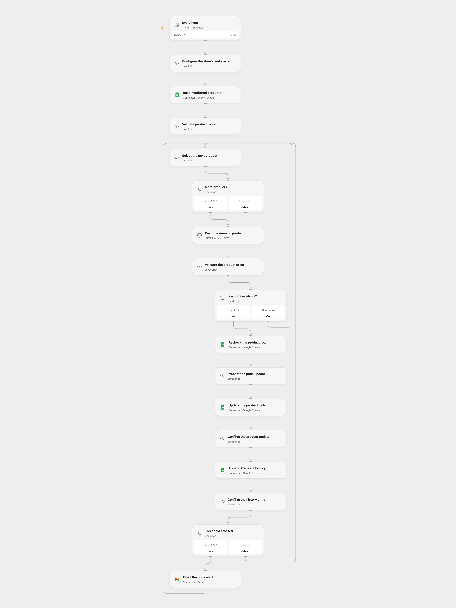

# Track Amazon Prices from Sheets

Track Amazon product prices from a sheet, record price history and email threshold alerts.

<picture>
  <source media="(prefers-color-scheme: dark)" srcset="preview-dark.png">
  
</picture>

[Open Flow JSON](templates/track-amazon-prices-from-sheets.openflow.json) · [n8n JSON](templates/track-amazon-prices-from-sheets.n8n.json)

## Setup

Connect Google Sheets and Gmail. In **Configure the sheets and alerts**, set the spreadsheet ID, the two distinct sheet names and an alert email. The products sheet requires unique headers asin, name, pricing, product_url, alert_status, last_updated, price_change, average_rating, percent_change, alert_threshold_low and alert_threshold_high. The history sheet has asin, pricing and timestamp columns in that order. Thresholds are decimal fractions: -0.1 means a 10% drop and 0.1 a 10% increase. Every populated row needs a unique ten-character ASIN and both thresholds.

Create a secret Variable **SCRAPEOPS_API_KEY** and bind it in **Read the Amazon product**. The request uses ScrapeOps' Amazon Auto Extract parser for the US marketplace and places the key in its required query parameter; upstream servers and proxies may log request URLs. In n8n configure the same sheets and recipient in **Configure the sheets and alerts**, connect Google Sheets and Gmail, and connect a Query Auth credential named api_key on **Read the Amazon product**. Enable one format. Restrict access to the API key and execution history.

## Behavior

Each hour the workflow reads the complete product sheet and processes rows in order. A valid US-dollar price updates only that product's designated cells, including product rating, then appends one history entry. It emails when the price change divided by the previous nonzero price crosses a configured threshold. A missing previous price establishes a baseline without an alert. A response must identify the same ASIN in product_information.ASIN; missing or mismatched identity stops the run before that product is written. Unavailable prices are skipped; ambiguous prices or malformed data stop the run. Last-updated timestamps use UTC. n8n uses a fixed second within the scheduled minute; Open Flow starts at the minute boundary.

Each product row is checked again before its update, but the check and write are not atomic. Avoid overlapping runs or editing those rows during a run. A later failure can leave the product update without history or an email, or an earlier product fully processed. An uncertain write or email may have succeeded; inspect the sheet and mailbox before retrying. n8n OAuth may refresh credentials and retry once after HTTP 401. No workflow-level write retry or cross-run deduplication is added.

Inspiration &amp; credits

## Changes to the source

- Replace private configuration and use managed credentials. Use Gmail for alert mail in Open Flow and n8n instead of SMTP.
- Update only the eight intended product cells after checking the row, preserving unrelated columns and formulas. Compare the unrounded price ratio rather than the source's rounded ratio, and reject ambiguous price strings instead of turning them into zero.
- Use ScrapeOps Amazon Auto Extract in place of the source's Product API endpoint to preserve the documented name, price and rating response; use UTC timestamps and an explicit US marketplace. The configured range must cover the complete product sheet.

Adapted from [Amazon Product Price Tracker](https://github.com/Zie619/n8n-workflows/blob/ae8cf6dc5b873cbb4f74587aa9180ed3a9f70682/workflows/Schedule/1697_Schedule_HTTP_Monitor_Scheduled.json) in [Zie619/n8n-workflows](https://github.com/Zie619/n8n-workflows). The matching [n8n listing](https://n8n.io/workflows/3806-track-amazon-product-prices-with-scrapeops-api-and-google-sheets-alerts/) credits ScrapeOps. No separate original template license is stated.

The collection’s [MIT notice](https://github.com/Zie619/n8n-workflows/blob/94007c1445d9258a7da116646b79473e7c7c3282/LICENSE) is pinned at a later revision. This is the collection notice at that revision; it does not establish a separate original template author's license. Our changes are listed above; see [repository licensing](../../README.md#licensing).

> MIT License
>
> Copyright (c) 2025 Zie619
>
> Permission is hereby granted, free of charge, to any person obtaining a copy
> of this software and associated documentation files (the "Software"), to deal
> in the Software without restriction, including without limitation the rights
> to use, copy, modify, merge, publish, distribute, sublicense, and/or sell
> copies of the Software, and to permit persons to whom the Software is
> furnished to do so, subject to the following conditions:
>
> The above copyright notice and this permission notice shall be included in all
> copies or substantial portions of the Software.
>
> THE SOFTWARE IS PROVIDED "AS IS", WITHOUT WARRANTY OF ANY KIND, EXPRESS OR
> IMPLIED, INCLUDING BUT NOT LIMITED TO THE WARRANTIES OF MERCHANTABILITY,
> FITNESS FOR A PARTICULAR PURPOSE AND NONINFRINGEMENT. IN NO EVENT SHALL THE
> AUTHORS OR COPYRIGHT HOLDERS BE LIABLE FOR ANY CLAIM, DAMAGES OR OTHER
> LIABILITY, WHETHER IN AN ACTION OF CONTRACT, TORT OR OTHERWISE, ARISING FROM,
> OUT OF OR IN CONNECTION WITH THE SOFTWARE OR THE USE OR OTHER DEALINGS IN THE
> SOFTWARE.

