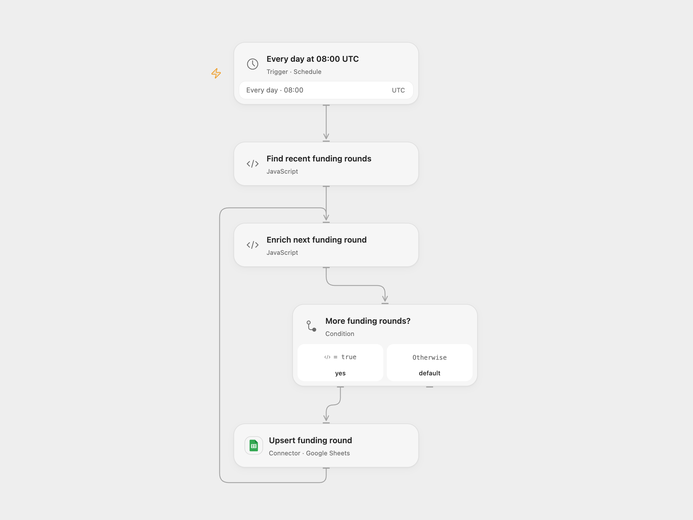

# Track Crunchbase Funding Rounds in Google Sheets

Track recent seed and Series A/B funding rounds with company details in Google Sheets.

<picture>
  <source media="(prefers-color-scheme: dark)" srcset="preview-dark.png">
  
</picture>

[Open Flow JSON](templates/track-crunchbase-funding-rounds-in-sheets.openflow.json) · [n8n JSON](templates/track-crunchbase-funding-rounds-in-sheets.n8n.json)

## Setup

Create a Piloterr API key and bind the secret Variable PILOTERR_API_KEY to both Piloterr Code nodes. Connect Google Sheets and set the spreadsheet ID and sheet name in **Upsert funding round**. The first row must have these headers: `company_name`, `website_url`, `type`, `money_raised`, `linkedin_url`, `announced_on`, `funding_total`, `employee_count`, `investment_type`, `monthly_traffic_semrush`, `country`, `link`, `event_link`, `founded_date`.

In n8n, connect an HTTP Header Auth credential with header `x-api-key` to all Piloterr nodes, and connect Google Sheets with the same headers and destination. Enable one format.

## Behavior

At 08:00 UTC each day, query funding rounds announced in the last day for seed, Series A and Series B. Piloterr currently returns at most 15 results per request, so a category can be incomplete. Each round is enriched with its company details and upserted by its event permalink. If enrichment fails, the funding row is saved with blank company details. Piloterr's current documented funding response does not always include the round amount or announcement date; those cells are blank when unavailable. Review data before use.

A failed funding lookup stops the run. A Sheets write with an unknown result may already have succeeded; inspect the event row before rerunning. Changing the sheet during a run can affect matching.

Inspiration &amp; credits

## Changes to the source

- Use Piloterr's current API hostname and a UTC schedule. Match enrichment to its source event and retain rows when enrichment fails.

Adapted from [Get recent fundraising in Google Sheets](https://github.com/Zie619/n8n-workflows/blob/ae8cf6dc5b873cbb4f74587aa9180ed3a9f70682/workflows/Code/0397_Code_Schedule_Import_Scheduled.json) in [Zie619/n8n-workflows](https://github.com/Zie619/n8n-workflows). The source export does not identify a separate template author or license.

The collection’s [MIT notice](https://github.com/Zie619/n8n-workflows/blob/94007c1445d9258a7da116646b79473e7c7c3282/LICENSE) is pinned at a later revision. This is the collection notice at that revision; it does not establish a separate original template author's license. Our changes are listed above; see [repository licensing](../../README.md#licensing).

> MIT License
>
> Copyright (c) 2025 Zie619
>
> Permission is hereby granted, free of charge, to any person obtaining a copy
> of this software and associated documentation files (the "Software"), to deal
> in the Software without restriction, including without limitation the rights
> to use, copy, modify, merge, publish, distribute, sublicense, and/or sell
> copies of the Software, and to permit persons to whom the Software is
> furnished to do so, subject to the following conditions:
>
> The above copyright notice and this permission notice shall be included in all
> copies or substantial portions of the Software.
>
> THE SOFTWARE IS PROVIDED "AS IS", WITHOUT WARRANTY OF ANY KIND, EXPRESS OR
> IMPLIED, INCLUDING BUT NOT LIMITED TO THE WARRANTIES OF MERCHANTABILITY,
> FITNESS FOR A PARTICULAR PURPOSE AND NONINFRINGEMENT. IN NO EVENT SHALL THE
> AUTHORS OR COPYRIGHT HOLDERS BE LIABLE FOR ANY CLAIM, DAMAGES OR OTHER
> LIABILITY, WHETHER IN AN ACTION OF CONTRACT, TORT OR OTHERWISE, ARISING FROM,
> OUT OF OR IN CONNECTION WITH THE SOFTWARE OR THE USE OR OTHER DEALINGS IN THE
> SOFTWARE.

