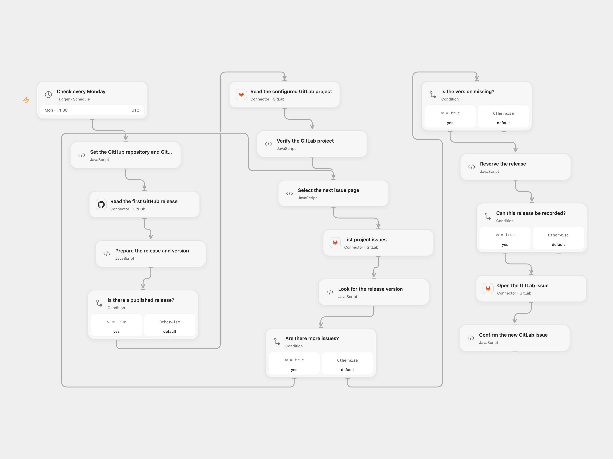

# Track GitHub Releases in GitLab

Check one GitHub repository each week and open a GitLab issue for its newest release when the version has no existing issue.

<!-- template-actions:start -->
 
<!-- template-actions:end -->

<picture>
  <source media="(prefers-color-scheme: dark)" srcset="preview-dark.png">
  
</picture>

## Setup

1. In **Set the GitHub repository and GitLab project**, enter the GitHub owner and repository, the numeric GitLab project ID, and its canonical HTTPS GitLab site URL. Use a GitHub repository whose release notes you are allowed to copy to that project's viewers.
2. Connect GitHub in **Read the first GitHub release**. Select the same GitLab connection in **Read the configured GitLab project**, **List project issues**, and **Open the GitLab issue**. Its account needs to see the project's existing issues and create new ones. For self-managed GitLab, use a site reachable by the GitLab connection and enter the same canonical URL in the connection and settings.
3. Enable persistent State and publish one active copy for that source and destination. **Check every Monday** runs each Monday at 14:00 UTC. Change the schedule there to use a different time or timezone.

## Behavior

Each run reads the first result from GitHub's release listing. An empty result or a draft ends the check. Published prereleases can create issues. Releases between checks are outside the scope of this workflow. [GitHub releases API](https://docs.github.com/en/rest/releases/releases#list-releases)

The workflow validates the target project and checks open and closed issues for the version in the title. For example, an issue about `v1.2.30` leaves `v1.2.3` eligible. It reads up to 50 pages of 100 issues. A read failure or an incomplete scan stops the run before issue creation. A new issue is titled `Upstream release: <tag>` and contains the GitHub API release link followed by the notes as a literal Markdown block. The creation result includes the tag, project ID, issue number, and issue URL. [GitLab issues API](https://docs.gitlab.com/api/issues/) · [GitLab quick actions](https://docs.gitlab.com/user/project/quick_actions/)

A release is reserved before the creation request. If GitLab's reply is missing or does not confirm the exact issue, check for the version in your GitLab project. Keep the reservation if the issue exists. Clear it only after confirming the request created no issue. Keep the same State scope on subsequent runs and avoid a second writer for the same release and project.

In n8n

Use the same settings and weekly UTC schedule. In **Read the first GitHub release**, attach a Header Auth credential with `Authorization: Bearer YOUR_GITHUB_TOKEN` and read access to the repository releases. In the three GitLab HTTP nodes, attach the same Header Auth credential with `PRIVATE-TOKEN: YOUR_GITLAB_TOKEN` and access to list and create issues in the configured project.

Create an n8n Data Table with a string column named `request_key`. Select it in **Check for a previous creation attempt** and **Reserve the release**. Use one self-hosted instance in regular mode with `N8N_CONCURRENCY_PRODUCTION_LIMIT=1`. Avoid overlapping manual executions. The table stores creation attempts. If a response is uncertain, look for the issue in the configured project before removing its row. [n8n concurrency control](https://docs.n8n.io/hosting/scaling/concurrency-control/)

Inspiration &amp; credits

## Changes to the source

The release comparison is connected to the two read paths and the issue creation step. The previously implicit Monday time is set to 14:00 UTC. The check now includes all visible issue states and pages up to the documented limit. Version boundaries prevent one tag from matching a longer version. Draft release notes are skipped and published notes are displayed literally.

Adapted from [GitHub releases to GitLab issues](https://github.com/Zie619/n8n-workflows/blob/ae8cf6dc5b873cbb4f74587aa9180ed3a9f70682/workflows/Github/0135_GitHub_Cron_Create_Scheduled.json) in [Zie619/n8n-workflows](https://github.com/Zie619/n8n-workflows). Attribution: Zie619 / n8n-workflows.

The collection’s [MIT notice](https://github.com/Zie619/n8n-workflows/blob/94007c1445d9258a7da116646b79473e7c7c3282/LICENSE) is pinned at a later revision. This is the collection notice at that revision; it does not establish a separate original template author's license. Our changes are listed above; see [repository licensing](../../README.md#licensing).

> MIT License
>
> Copyright (c) 2025 Zie619
>
> Permission is hereby granted, free of charge, to any person obtaining a copy
> of this software and associated documentation files (the "Software"), to deal
> in the Software without restriction, including without limitation the rights
> to use, copy, modify, merge, publish, distribute, sublicense, and/or sell
> copies of the Software, and to permit persons to whom the Software is
> furnished to do so, subject to the following conditions:
>
> The above copyright notice and this permission notice shall be included in all
> copies or substantial portions of the Software.
>
> THE SOFTWARE IS PROVIDED "AS IS", WITHOUT WARRANTY OF ANY KIND, EXPRESS OR
> IMPLIED, INCLUDING BUT NOT LIMITED TO THE WARRANTIES OF MERCHANTABILITY,
> FITNESS FOR A PARTICULAR PURPOSE AND NONINFRINGEMENT. IN NO EVENT SHALL THE
> AUTHORS OR COPYRIGHT HOLDERS BE LIABLE FOR ANY CLAIM, DAMAGES OR OTHER
> LIABILITY, WHETHER IN AN ACTION OF CONTRACT, TORT OR OTHERWISE, ARISING FROM,
> OUT OF OR IN CONNECTION WITH THE SOFTWARE OR THE USE OR OTHER DEALINGS IN THE
> SOFTWARE.

