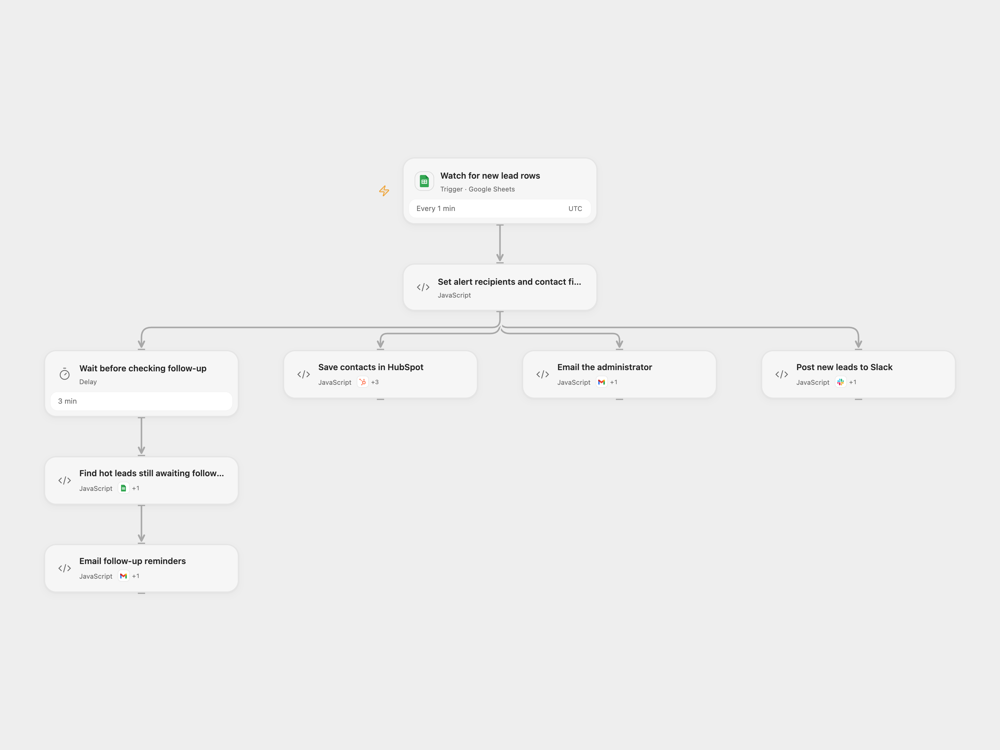

# Track Hot Leads from Google Sheets

Send new lead alerts to Slack and Gmail, save contacts in HubSpot, and remind an administrator about hot leads awaiting follow-up.

<!-- template-actions:start -->
 
<!-- template-actions:end -->

<picture>
  <source media="(prefers-color-scheme: dark)" srcset="preview-dark.png">
  
</picture>

## Setup

1. Connect Google Sheets in **Watch for new lead rows** and **Find hot leads still awaiting follow-up**. Select your response tab in the trigger. The first poll starts from the current end of the tab. Keep appending new responses at the end.
2. Put these headers in row 1, within columns A–Z. The workflow accepts the extra spaces around column names used in the original sheet. Keep each submission’s `Timestamp` and `E-Mail` unchanged and unique together.

| Column | Use |
| --- | --- |
| Timestamp | Original Google Forms timestamp and part of the stable row key |
| E-Mail | HubSpot contact email and part of the stable row key |
| Name Surname | Name shown in both administrator alerts |
| Phone | Phone number |
| Interest Level | Use `Hot` for leads that need a follow-up reminder |
| Lead Source | Lead acquisition source |
| Notes | Lead notes |
| Followed Up? | Leave blank until someone follows up, then enter a value such as `Yes` |

3. Connect Slack, Gmail, and HubSpot. Use the same Gmail account for both email steps. Create the HubSpot contact text properties `form_lead_source` and `form_interest_level`, or enter your existing custom property names in **Set alert recipients and contact fields**.
4. Enter a Slack channel ID and administrator email in **Set alert recipients and contact fields**. Set the interval in **Wait before checking follow-up**, which defaults to three minutes. Enable the workflow.

## Behavior

Every newly appended lead produces a Slack alert, a Gmail alert to the administrator, and a HubSpot contact lookup by email. HubSpot creates or updates the contact with the nonempty phone, notes, lead source, and interest fields. If several new rows share an email, HubSpot uses the latest row in that poll.

After the delay, the workflow reads the same tab by its Google Sheets ID. It finds each lead by timestamp and email, even if rows have moved. A lead gets a reminder only if its current interest is `Hot` and `Followed Up?` is still blank. Missing rows receive no reminder. An ambiguous row match stops the reminder branch.

The Slack channel and administrator inbox receive lead contact details. An unconfirmed write fails the execution. Other branches may already have sent alerts or saved a contact. Review each destination before rerunning to avoid repeating alerts.

In n8n

Select the spreadsheet and tab in **Watch for new lead rows** using **By ID**. Use the tab’s numeric `gid`, such as `0`. Connect Google Sheets in the trigger and **Read the same response tab** to the same spreadsheet. Attach Slack OAuth to **Post new leads to Slack**, Gmail OAuth to both email nodes, and HubSpot OAuth to the three CRM requests. Edit the recipients and property names in **Set alert recipients and contact fields** and the interval in **Wait before checking follow-up**. Activate the workflow to watch for appended rows. The native trigger can return existing rows during a manual test.

Inspiration &amp; credits

Adapted from [Monitor new leads and follow-ups from Google Sheets](https://github.com/Zie619/n8n-workflows/blob/ae8cf6dc5b873cbb4f74587aa9180ed3a9f70682/workflows/Wait/1879_Wait_Slack_Monitor_Triggered.json) in [Zie619/n8n-workflows](https://github.com/Zie619/n8n-workflows). Attribution: Zie619 / n8n-workflows.

The collection’s [MIT notice](https://github.com/Zie619/n8n-workflows/blob/94007c1445d9258a7da116646b79473e7c7c3282/LICENSE) is pinned at a later revision. This is the collection notice at that revision; it does not establish a separate original template author's license. Our changes are listed above; see [repository licensing](../../README.md#licensing).

> MIT License
>
> Copyright (c) 2025 Zie619
>
> Permission is hereby granted, free of charge, to any person obtaining a copy
> of this software and associated documentation files (the "Software"), to deal
> in the Software without restriction, including without limitation the rights
> to use, copy, modify, merge, publish, distribute, sublicense, and/or sell
> copies of the Software, and to permit persons to whom the Software is
> furnished to do so, subject to the following conditions:
>
> The above copyright notice and this permission notice shall be included in all
> copies or substantial portions of the Software.
>
> THE SOFTWARE IS PROVIDED "AS IS", WITHOUT WARRANTY OF ANY KIND, EXPRESS OR
> IMPLIED, INCLUDING BUT NOT LIMITED TO THE WARRANTIES OF MERCHANTABILITY,
> FITNESS FOR A PARTICULAR PURPOSE AND NONINFRINGEMENT. IN NO EVENT SHALL THE
> AUTHORS OR COPYRIGHT HOLDERS BE LIABLE FOR ANY CLAIM, DAMAGES OR OTHER
> LIABILITY, WHETHER IN AN ACTION OF CONTRACT, TORT OR OTHERWISE, ARISING FROM,
> OUT OF OR IN CONNECTION WITH THE SOFTWARE OR THE USE OR OTHER DEALINGS IN THE
> SOFTWARE.

## Changes to the source

The trigger watches new rows explicitly. The follow-up check uses a fresh read after the original three-minute delay and treats a blank **Followed Up?** as pending. The lead source and interest level go to dedicated HubSpot properties instead of salutation and relationship status.

