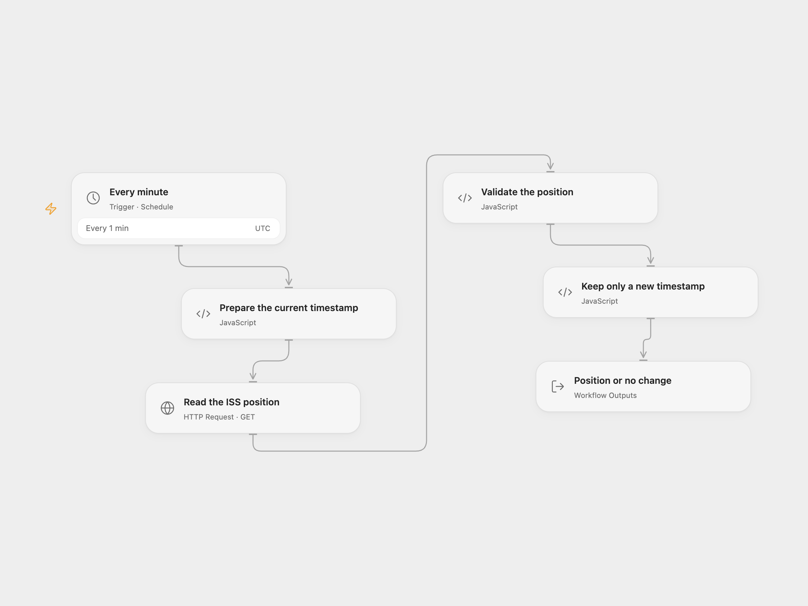

# Track New ISS Position

Fetch the current ISS position every minute and return it when its timestamp changes.

<picture>
  <source media="(prefers-color-scheme: dark)" srcset="preview-dark.png">
  
</picture>

[Open Flow JSON](templates/track-new-iss-position.openflow.json) · [n8n JSON](templates/track-new-iss-position.n8n.json)

## Setup

Enable persistent workflow State and activate one format. The workflow needs access to the Where the ISS at? API. n8n requires active workflow static data to persist between scheduled runs.

## Behavior

Each minute the workflow requests the ISS position for the current Unix second. A new timestamp returns latitude, longitude and timestamp; a repeated timestamp returns `No new items`. It remembers the last successful timestamp, rather than a complete history. Inspect the workflow result to use the data; no notification or external database write is configured.

The schedule starts in UTC; the source inherited its n8n instance timezone. n8n Cron V1 selects a fixed second within the minute, while Open Flow starts at the minute boundary. Open Flow does not follow HTTP redirects and limits each request to 30 seconds and each response to 4 MiB; n8n uses its HTTP node defaults. Avoid overlapping runs, which may race when updating State. API or State errors fail the run.

Inspiration &amp; credits

## Changes to the source

- Send Unix seconds instead of JavaScript milliseconds and validate the returned position. Set UTC explicitly.

Adapted from [Track new ISS positions](https://github.com/Zie619/n8n-workflows/blob/ae8cf6dc5b873cbb4f74587aa9180ed3a9f70682/workflows/Http/1171_HTTP_Cron_Automation_Scheduled.json) in [Zie619/n8n-workflows](https://github.com/Zie619/n8n-workflows). The matching [n8n listing](https://n8n.io/workflows/880-receive-updates-of-the-position-of-the-iss-every-minute/) credits Harshil Agrawal. The original template does not state a separate license.

The collection’s [MIT notice](https://github.com/Zie619/n8n-workflows/blob/94007c1445d9258a7da116646b79473e7c7c3282/LICENSE) is pinned at a later revision. This is the collection notice at that revision; it does not establish a separate original template author's license. Our changes are listed above; see [repository licensing](../../README.md#licensing).

> MIT License
>
> Copyright (c) 2025 Zie619
>
> Permission is hereby granted, free of charge, to any person obtaining a copy
> of this software and associated documentation files (the "Software"), to deal
> in the Software without restriction, including without limitation the rights
> to use, copy, modify, merge, publish, distribute, sublicense, and/or sell
> copies of the Software, and to permit persons to whom the Software is
> furnished to do so, subject to the following conditions:
>
> The above copyright notice and this permission notice shall be included in all
> copies or substantial portions of the Software.
>
> THE SOFTWARE IS PROVIDED "AS IS", WITHOUT WARRANTY OF ANY KIND, EXPRESS OR
> IMPLIED, INCLUDING BUT NOT LIMITED TO THE WARRANTIES OF MERCHANTABILITY,
> FITNESS FOR A PARTICULAR PURPOSE AND NONINFRINGEMENT. IN NO EVENT SHALL THE
> AUTHORS OR COPYRIGHT HOLDERS BE LIABLE FOR ANY CLAIM, DAMAGES OR OTHER
> LIABILITY, WHETHER IN AN ACTION OF CONTRACT, TORT OR OTHERWISE, ARISING FROM,
> OUT OF OR IN CONNECTION WITH THE SOFTWARE OR THE USE OR OTHER DEALINGS IN THE
> SOFTWARE.

