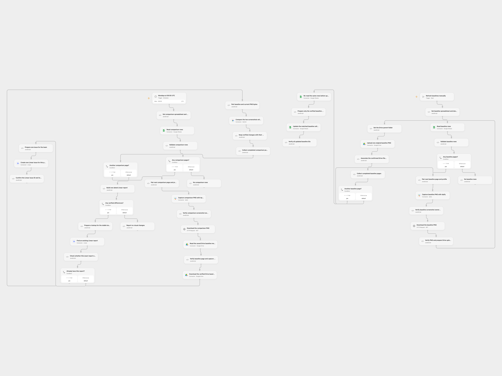

# Track Website Visual Regressions

Save website screenshot baselines, compare them with fresh captures each week, and collect detected differences in one Linear issue.

<!-- template-actions:start -->
 
<!-- template-actions:end -->

<picture>
  <source media="(prefers-color-scheme: dark)" srcset="preview-dark.png">
  
</picture>

## Setup

1. Create a Google Sheet tab with `service`, `url` and `base` in columns A through C, in that order. Enter one authorized public HTTPS page per row. The service label is optional. Leave `base` empty.
2. Set the same spreadsheet ID and tab in both settings nodes. Set the destination My Drive folder ID in **Set baseline spreadsheet and destination** and the Linear team UUID in **Set comparison spreadsheet and destination**. Connect Google Sheets and Drive. Use the same Drive account for baseline upload, file metadata and file download.
3. Connect Apify and Gemini with Provider API access and connect Linear with access to the destination team. Run **Refresh baselines manually** before publishing the Monday schedule. [Apify screenshot actor](https://apify.com/apify/screenshot-url/input-schema) · [Gemini image understanding](https://aistudio.google.com/docs/image-understanding)

## Behavior

The manual branch captures full-page PNGs at a 1280 × 1080 viewport, uploads them to Drive, and writes the file IDs to the original `base` cells. It re-reads the table before writing. Keep the rows and baselines unchanged while either branch runs. Refresh existing screenshots with this workflow before the first comparison so each file has the expected page and capture profile.

Every Monday at 06:00 UTC, the comparison branch checks each tracked page against its baseline. It sends the pair to Gemini in baseline/current order and includes only reported differences with distinct before and after states. If there are any changes, it creates one Linear issue for the spreadsheet, tab, team and week. Review the findings against the page. Missing baselines, invalid screenshots and unmatched rows stop the run before reporting.

Track up to 12 pages. Each direct page URL must resolve without redirects. Each PNG must be 1280 pixels wide, at most 16,384 pixels high, and at most 2 MiB. The pair must fit within 3 MB combined. Each Apify capture must finish within the Provider Proxy's 30-second timeout. If an upload is uncertain or rows changed, check the Drive folder for uploaded baselines before refreshing again. If Linear's creation result is uncertain, check the dated issue. A retry within the same UTC week looks for the same issue ID.

In n8n

Set the same spreadsheet ID and tab in both settings nodes and set the Drive folder and Linear team there. Select Google Sheets and Google Drive OAuth2 credentials on the corresponding requests. Attach Apify **Bearer Auth** in both capture nodes and a Google Gemini (PaLM) API credential in **Compare the two screenshots with Gemini**. For both Linear requests, set the `Authorization` header to a Linear personal API key using a Header Auth credential. Run the manual baseline branch before activating the schedule. Each Apify request has a 120-second timeout.

Inspiration &amp; credits

Adapted from [Visual Regression Testing with Apify and AI Vision Model](https://github.com/enescingoz/awesome-n8n-templates/blob/827110332c21cbe000ab13f6d292d5adb1f1f8db/AI_Research_RAG_and_Data_Analysis/Visual%20Regression%20Testing%20with%20Apify%20and%20AI%20Vision%20Model.json) in [enescingoz/awesome-n8n-templates](https://github.com/enescingoz/awesome-n8n-templates).

Source collection notice: © 2024–2026 Enes Cingoz, [CC BY 4.0](https://github.com/enescingoz/awesome-n8n-templates/blob/827110332c21cbe000ab13f6d292d5adb1f1f8db/LICENSE). The [original n8n gallery template](https://n8n.io/workflows/2419-visual-regression-testing-with-apify-and-ai-vision-model/) credits Jimleuk. See [repository licensing](../../README.md#licensing) for the scope of OOMOL contributions and third-party material.

## Changes to the source

The schedule compares all configured rows and uses Gemini 3.8 Flash. Each report uses a stable weekly ID. The manual branch updates the baseline cells only after matching the original table rows and receiving a Drive file ID for every page.

