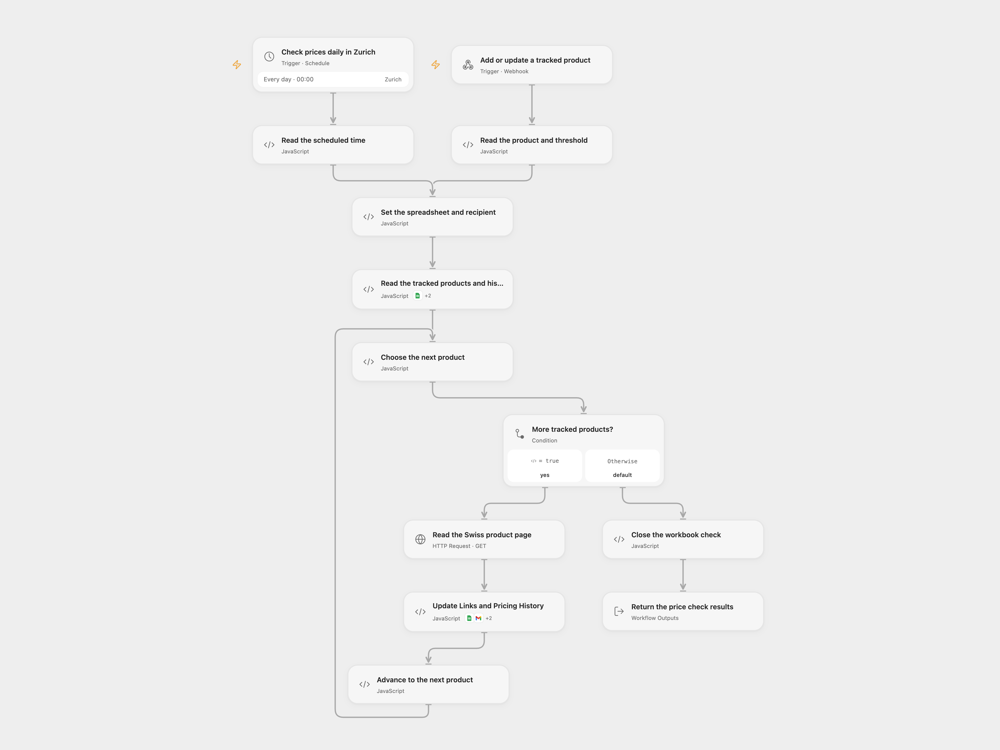

# Track Zalando Swiss Prices

Track Zalando Switzerland product prices in Google Sheets and send a Gmail alert when a price reaches your CHF threshold.

<!-- template-actions:start -->
 
<!-- template-actions:end -->

<picture>
  <source media="(prefers-color-scheme: dark)" srcset="preview-dark.png">
  
</picture>

## Setup

1. Create a Google spreadsheet with the following headers in row 1, in the order shown. Existing history rows can retain their original values. Add the two new header cells so future observations can use their own keys and currency.

| Tab | Columns |
| --- | --- |
| Links | `link`, `price_alert`, `price`, `name`, `update` |
| Pricing History | `price`, `name`, `link`, `update`, `key`, `currency` |

2. Enter the spreadsheet ID and alert email address in **Set the spreadsheet and recipient**. Connect the same Google Sheets account with edit access in **Read the tracked products and history** and **Update Links and Pricing History**. Select your Gmail connection in **Update Links and Pricing History**. Keep one active workflow per workbook and avoid reordering its rows during checks.
3. Publish and enable the workflow. Open **Add or update a tracked product** and paste a public Swiss Zalando product page ending in `.html` and its alert threshold in CHF. Submit the same page again to change its threshold. The form confirms receipt and queues an immediate check.

## Behavior

A form submission saves the product and checks all tracked links. The workflow also checks them each day at midnight in Europe/Zurich. It reads the public page title and the CHF price in the page's `twitter:data1` metadata, updates the current price in **Links**, and keeps one observation per product and Zurich date in **Pricing History**. A product with an unreadable price or a rejected HTTP response produces no new price or email.

When the price is at or below the threshold, Gmail sends one alert per product and Zurich date. The alert can recur the next day while the price qualifies. If a send is uncertain, check Gmail Sent before recovering that day's reservation. A later daily check can send its own reminder.

The exported workflow was tested against synthetic HTML and service responses. The live Zalando pages and current availability were outside that test. A blocked page is skipped. Changes to the page markup, access restrictions, or unavailable listings can prevent price readings. If a workbook write fails, verify the Sheets rows and check that no run is active before clearing the workbook reservation in State.

In n8n

Set the same spreadsheet and recipient in **Set the spreadsheet and recipient**. Bind a Google Sheets OAuth2 credential to **Read the tracked products and history**, **Save the URL and threshold**, and **Update Links and Pricing History**. Bind your Gmail OAuth2 credential to **Send the Gmail price alert**.

Use one production execution slot and one Data Table with text columns `key`, `status`, and `messageId`. Select it in **Check the earlier alert**, **Reserve the Gmail alert**, and **Record the Gmail message ID**. Inspect Gmail Sent and the pending entry before retrying an uncertain send. Start from the original workflow entry to reapply the reservation check.

Inspiration &amp; credits

Adapted from [Zalando product price tracking workflow](https://github.com/Zie619/n8n-workflows/blob/ae8cf6dc5b873cbb4f74587aa9180ed3a9f70682/workflows/Schedule/0478_Schedule_HTTP_Create_Webhook.json) in [Zie619/n8n-workflows](https://github.com/Zie619/n8n-workflows). Attribution: n8n.ninja (original workflow) / Zie619 (collection).

The collection’s [MIT notice](https://github.com/Zie619/n8n-workflows/blob/94007c1445d9258a7da116646b79473e7c7c3282/LICENSE) is pinned at a later revision. This is the collection notice at that revision; it does not establish a separate original template author's license. Our changes are listed above; see [repository licensing](../../README.md#licensing).

> MIT License
>
> Copyright (c) 2025 Zie619
>
> Permission is hereby granted, free of charge, to any person obtaining a copy
> of this software and associated documentation files (the "Software"), to deal
> in the Software without restriction, including without limitation the rights
> to use, copy, modify, merge, publish, distribute, sublicense, and/or sell
> copies of the Software, and to permit persons to whom the Software is
> furnished to do so, subject to the following conditions:
>
> The above copyright notice and this permission notice shall be included in all
> copies or substantial portions of the Software.
>
> THE SOFTWARE IS PROVIDED "AS IS", WITHOUT WARRANTY OF ANY KIND, EXPRESS OR
> IMPLIED, INCLUDING BUT NOT LIMITED TO THE WARRANTIES OF MERCHANTABILITY,
> FITNESS FOR A PARTICULAR PURPOSE AND NONINFRINGEMENT. IN NO EVENT SHALL THE
> AUTHORS OR COPYRIGHT HOLDERS BE LIABLE FOR ANY CLAIM, DAMAGES OR OTHER
> LIABILITY, WHETHER IN AN ACTION OF CONTRACT, TORT OR OTHERWISE, ARISING FROM,
> OUT OF OR IN CONNECTION WITH THE SOFTWARE OR THE USE OR OTHER DEALINGS IN THE
> SOFTWARE.

