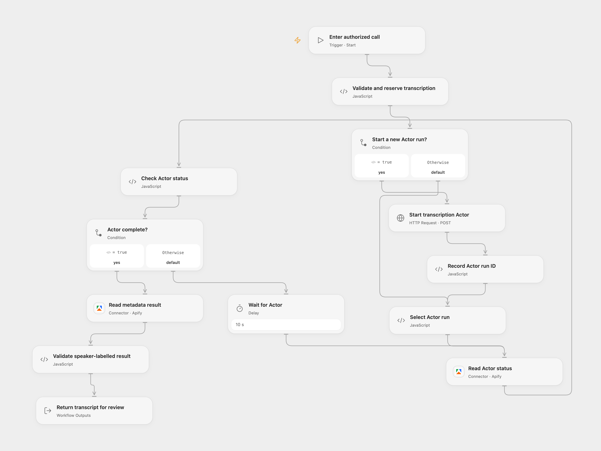

# Transcribe an Authorized Support Call with Speakers

Transcribe one authorized call with anonymous speaker labels.

<picture>
  <source media="(prefers-color-scheme: dark)" srcset="preview-dark.png">
  
</picture>

[Open Flow JSON](templates/transcribe-authorized-support-call-with-speakers.openflow.json) · [n8n JSON](templates/transcribe-authorized-support-call-with-speakers.n8n.json)

## Setup

Connect Apify and set APIFY_TOKEN for the same account. Supply one direct public HTTPS audio or video URL with an ASCII hostname or IPv4 address, an ISO language (default pt), a maximum duration from 1 to 20 minutes, a unique request ID and explicit confirmation of processing rights and any required speaker consent. The URL checks do not verify DNS resolution. Enable persistent State and prevent overlapping runs. In n8n configure Header Auth for Apify, the input and a Data Table with item_key and status columns. Use one format.

## Behavior

The Actor returns one transcript with timed segments, anonymous speaker labels and JSON, SRT, VTT and TXT files. Speaker labels are placeholders for human review, not verified identities. The workflow checks the result URL, integration source, structure and charged duration. It retains the source maximum of one result and a US$0.05 run cap. The recording and transcript are processed by Apify; review access and retention.

Open Flow stores a known Actor run ID and can resume polling it with the same request ID and inputs. If the start response is unknown, inspect Apify before resolving the pending state. n8n uses the original synchronous endpoint; inspect the pending Data Table record and account before retrying an uncertain run.

Inspiration &amp; credits

Adapted from [Transcribe authorized PT-BR support calls with speaker labels using Apify](https://github.com/enescingoz/awesome-n8n-templates/blob/827110332c21cbe000ab13f6d292d5adb1f1f8db/Other_Integrations_and_Use_Cases/Transcribe%20authorized%20PT-BR%20support%20calls%20with%20speaker%20labels%20using%20Apify.json) in [enescingoz/awesome-n8n-templates](https://github.com/enescingoz/awesome-n8n-templates).

Source collection notice: © 2024–2026 Enes Cingoz, [CC BY 4.0](https://github.com/enescingoz/awesome-n8n-templates/blob/827110332c21cbe000ab13f6d292d5adb1f1f8db/LICENSE). The source export does not identify a separate template author or license. See [repository licensing](../../README.md#licensing) for the scope of OOMOL contributions and third-party material.

