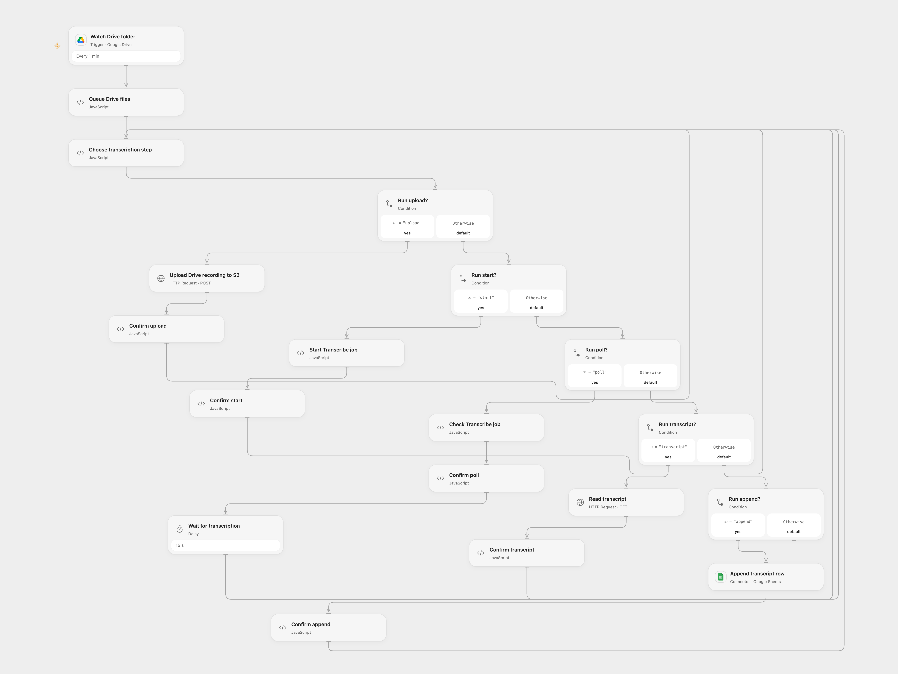

# Transcribe New Drive Recordings to Sheets

Transcribe new Drive recordings with Amazon Transcribe and append the results to Google Sheets.

<!-- template-actions:start -->
 
<!-- template-actions:end -->

<picture>
  <source media="(prefers-color-scheme: dark)" srcset="preview-dark.png">
  
</picture>

## Setup

Select the Drive folder in **Watch Drive folder**. Connect Google Sheets and configure the S3 bucket, spreadsheet ID and A:D range in **Choose transcription step**. The sheet columns are recording name, Drive link, transcription creation time and transcript. Bind AWS access key ID and secret Variables to both Transcribe steps; bind a session token when needed. The default Transcribe region is us-east-1; for another region update the region and allowed HTTP host in both Transcribe steps. Grant S3 and Transcribe access in the same region.

In n8n configure the authenticated binary relay webhook, Google Drive and AWS credentials, and select a Data Table with text columns item_key and status. Bind secret Variable N8N_RELAY_TOKEN to the webhook Header Auth value Authorization: Bearer followed by the same token. Set the relay production URL in **Choose transcription step**. Enable persistent State and prevent overlapping executions. For direct n8n mode configure its Drive folder, AWS and Sheets credentials, spreadsheet ID, and the same Data Table on direct checkpoint nodes. Set the bucket in **AWS S3 1** and replace YOUR_S3_BUCKET in the media URI expression on **AWS Transcribe 1** with that same bucket. Use one format.

## Behavior

New files are downloaded from Drive and uploaded to S3 with a key containing their Drive ID. Amazon Transcribe uses the source default US English, then the workflow polls until completion and appends the transcript and matching recording details. The folder should contain audio or video formats supported by Transcribe; unsupported files fail. The n8n relay transfers file bytes without placing base64 in Open Flow ports.

If an upload, Transcribe start or sheet append has an unknown result, inspect S3, the deterministic job name or the spreadsheet. In **Choose transcription step** enter the pending key and resolution confirmed or absent, trigger another poll, then clear the fields. For an uncertain relay upload, mark the relay row done when the object exists and confirm the Open Flow upload; if the object is absent delete the relay row and resolve it as absent before retrying. For an n8n direct pending row, complete the remaining steps manually before marking it done. Protect the relay and execution history.

Inspiration &amp; credits

Replaced the literal S3 upload and unwired webhook wait with a binary transfer and Transcribe status polling; corrected file and result association.

Adapted from [Transcribe new Drive recordings to Sheets](https://github.com/Zie619/n8n-workflows/blob/ae8cf6dc5b873cbb4f74587aa9180ed3a9f70682/workflows/Awss3/0149_Awss3_Wait_Automate_Triggered.json) in [Zie619/n8n-workflows](https://github.com/Zie619/n8n-workflows). The source export does not identify a separate template author or license.

The collection’s [MIT notice](https://github.com/Zie619/n8n-workflows/blob/94007c1445d9258a7da116646b79473e7c7c3282/LICENSE) is pinned at a later revision. This is the collection notice at that revision; it does not establish a separate original template author's license. Our changes are listed above; see [repository licensing](../../README.md#licensing).

> MIT License
>
> Copyright (c) 2025 Zie619
>
> Permission is hereby granted, free of charge, to any person obtaining a copy
> of this software and associated documentation files (the "Software"), to deal
> in the Software without restriction, including without limitation the rights
> to use, copy, modify, merge, publish, distribute, sublicense, and/or sell
> copies of the Software, and to permit persons to whom the Software is
> furnished to do so, subject to the following conditions:
>
> The above copyright notice and this permission notice shall be included in all
> copies or substantial portions of the Software.
>
> THE SOFTWARE IS PROVIDED "AS IS", WITHOUT WARRANTY OF ANY KIND, EXPRESS OR
> IMPLIED, INCLUDING BUT NOT LIMITED TO THE WARRANTIES OF MERCHANTABILITY,
> FITNESS FOR A PARTICULAR PURPOSE AND NONINFRINGEMENT. IN NO EVENT SHALL THE
> AUTHORS OR COPYRIGHT HOLDERS BE LIABLE FOR ANY CLAIM, DAMAGES OR OTHER
> LIABILITY, WHETHER IN AN ACTION OF CONTRACT, TORT OR OTHERWISE, ARISING FROM,
> OUT OF OR IN CONNECTION WITH THE SOFTWARE OR THE USE OR OTHER DEALINGS IN THE
> SOFTWARE.

