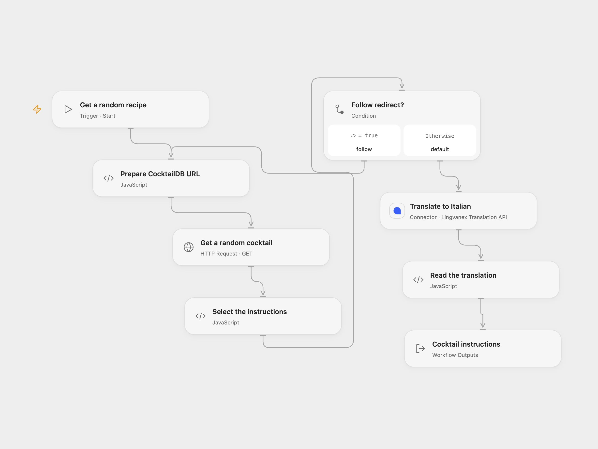

# Translate Random Cocktail Instructions

Translate the instructions for a random CocktailDB drink into Italian.

<picture>
  <source media="(prefers-color-scheme: dark)" srcset="preview-dark.png">
  
</picture>

[Open Flow JSON](templates/translate-random-cocktail-instructions.openflow.json) · [n8n JSON](templates/translate-random-cocktail-instructions.n8n.json)

## Setup

Connect Lingvanex in **Translate to Italian**. In n8n, select a LingvaNex credential. The formats use different Lingvanex API endpoints, so the account must support the endpoint used by the chosen format.

The CocktailDB URL uses its public test key `1`, intended for development and education. Review [CocktailDB API access](https://www.thecocktaildb.com/api.php) for your use and replace the key in **Prepare CocktailDB URL** or the n8n **HTTP Request** node if needed.

## Behavior

A manual run fetches one random drink, selects its first instructions field and translates it into Italian. The result contains the source instructions and translated instructions. A missing or empty instructions field, request error or missing translation stops the run. The workflow follows up to 21 HTTP redirects, with a 30-second timeout per request. Open Flow limits each response to 4 MiB.

Open Flow uses the Lingvanex `api-gl.lingvanex.com` endpoint, which includes the API key in the request URL. Protect URL logs. The n8n LingvaNex node uses the legacy `api-b2b.backenster.com` endpoint with a Bearer credential. Both use automatic source-language detection; translation quality and availability depend on the service.

## Changes to the source

- Check the API response and return both source and translated instructions.

Source and license

Adapted from [Translate cocktail instructions using LingvaNex](https://github.com/Zie619/n8n-workflows/blob/ae8cf6dc5b873cbb4f74587aa9180ed3a9f70682/workflows/Manual/0166_Manual_Lingvanex_Automation_Webhook.json) in [Zie619/n8n-workflows](https://github.com/Zie619/n8n-workflows). The source export does not identify a separate template author or license.

The collection’s [MIT notice](https://github.com/Zie619/n8n-workflows/blob/94007c1445d9258a7da116646b79473e7c7c3282/LICENSE) is pinned at a later revision. This is the collection notice at that revision; it does not establish a separate original template author's license. Our changes are listed above; see [repository licensing](../../README.md#licensing).

> MIT License
>
> Copyright (c) 2025 Zie619
>
> Permission is hereby granted, free of charge, to any person obtaining a copy
> of this software and associated documentation files (the "Software"), to deal
> in the Software without restriction, including without limitation the rights
> to use, copy, modify, merge, publish, distribute, sublicense, and/or sell
> copies of the Software, and to permit persons to whom the Software is
> furnished to do so, subject to the following conditions:
>
> The above copyright notice and this permission notice shall be included in all
> copies or substantial portions of the Software.
>
> THE SOFTWARE IS PROVIDED "AS IS", WITHOUT WARRANTY OF ANY KIND, EXPRESS OR
> IMPLIED, INCLUDING BUT NOT LIMITED TO THE WARRANTIES OF MERCHANTABILITY,
> FITNESS FOR A PARTICULAR PURPOSE AND NONINFRINGEMENT. IN NO EVENT SHALL THE
> AUTHORS OR COPYRIGHT HOLDERS BE LIABLE FOR ANY CLAIM, DAMAGES OR OTHER
> LIABILITY, WHETHER IN AN ACTION OF CONTRACT, TORT OR OTHERWISE, ARISING FROM,
> OUT OF OR IN CONNECTION WITH THE SOFTWARE OR THE USE OR OTHER DEALINGS IN THE
> SOFTWARE.

