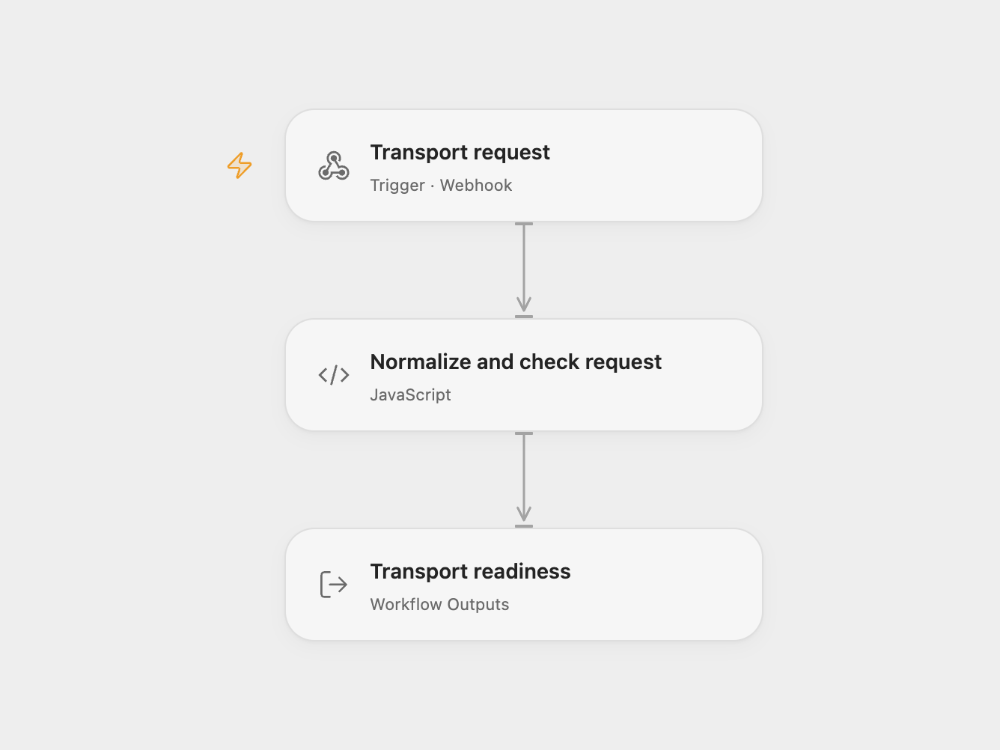

# Transport Request Intake

Normalize pickup and delivery postcodes, pickup date, and shipment weight. The webhook returns a readiness status and a list of fields that need review.

<picture>
  <source media="(prefers-color-scheme: dark)" srcset="preview-dark.png">
  
</picture>

[Open Flow JSON](templates/transport-request-intake.openflow.json) · [n8n JSON](templates/transport-request-intake.n8n.json)

## Use

Import the JSON, publish and enable the configured workflow, and POST a JSON object to its webhook URL. No service accounts are required.

```json
{
  "pickup_postcode": " SW1A 1AA ",
  "delivery_postcode": "75001",
  "pickup_date": "2026-12-01",
  "weight_kg": "12,5"
}
```

The response contains `status`, `missing_fields`, and `normalized_request`. Text fields are trimmed. Weight accepts a decimal number or decimal text using a period or comma; invalid or missing weight becomes `null`. Whitespace inside numeric text is ignored. Missing text fields or weight set `status` to `needs_review`; otherwise it is `ready`. Both statuses return HTTP 200.

This checks field presence and numeric weight. It does not validate postcode geography, date format, positive weight, availability, or pricing, and creates no booking.

## Changes to the source

- Read the JSON webhook body instead of looking for submitted fields in the HTTP envelope.
- Keep normalized values available through validation and the final response.
- Reject partial numbers such as `12kg` instead of silently treating them as `12`, and emit JSON `null` for nonfinite or invalid weight.
- Configure the response through the actual JSON response fields.

<details>
<summary>Source and license</summary>

Adapted from [Transport_Request_Intake_Lite](https://github.com/enescingoz/awesome-n8n-templates/blob/827110332c21cbe000ab13f6d292d5adb1f1f8db/Other_Integrations_and_Use_Cases/Transport_Request_Intake_Lite.json) in [enescingoz/awesome-n8n-templates](https://github.com/enescingoz/awesome-n8n-templates).

Source collection notice: © 2024–2026 Enes Cingoz, [CC BY 4.0](https://github.com/enescingoz/awesome-n8n-templates/blob/827110332c21cbe000ab13f6d292d5adb1f1f8db/LICENSE). The source export does not identify a separate template author or license. See [repository licensing](../../README.md#licensing) for the scope of OOMOL contributions and third-party material.

</details>
