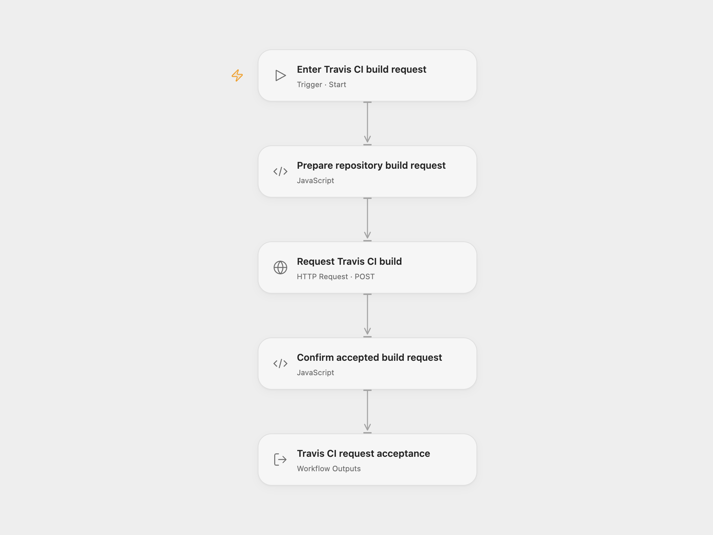

# Travis CI Build Request

Request one Travis CI Cloud build of a repository branch and return its acceptance record.

<picture>
  <source media="(prefers-color-scheme: dark)" srcset="preview-dark.png">
  
</picture>

[Open Flow JSON](templates/travisci-build-request.openflow.json) · [n8n JSON](templates/travisci-build-request.n8n.json)

## Setup

Create a secret Variable whose full value is `token YOUR_TRAVIS_API_TOKEN`, including the `token ` prefix. In **Request Travis CI build**, bind **Authentication Token** (`auth.token`) to that Variable. The HTTP step sends it as the `Authorization` header. Choose the Variable after import; the shared file contains no token or Variable binding.

Run with **Repository Slug** in `owner/repository` form and **Branch**. The repository must be enabled in Travis CI Cloud, and the token must have permission to request a build. The build uses the selected branch’s current commit and `.travis.yml`.

In n8n, choose an **HTTP Header Auth** credential in **Request Travis CI build**. Set its header name to `Authorization` and its value to `token YOUR_TRAVIS_API_TOKEN`. Replace `YOUR_OWNER%2FYOUR_REPOSITORY` in the URL, keeping the slash between owner and repository encoded as `%2F`, and edit the branch in the JSON body.

Each run makes one build request. The `202` pending result and request ID confirm acceptance, not a completed or successful build. The workflow does not poll for build status, override build configuration, retry jobs or cancel builds.

The Open Flow HTTP step has a 30-second execution budget. A rejected request, unexpected response or transport failure stops the run. No duplicate check or automatic retry is configured. Check Travis CI before repeating an uncertain request, since it may already have started a build.

## Changes to the source

- Replace example repository and branch values with user configuration.
- Use formal HTTP authentication in both formats and correct the source’s JSON content type.
- Check the pending acceptance record and preserve the complete response.

Source and license

Adapted from [Trigger a build in Travis CI](https://github.com/Zie619/n8n-workflows/blob/ae8cf6dc5b873cbb4f74587aa9180ed3a9f70682/workflows/Manual/1000_Manual_Travisci_Create_Triggered.json) in [Zie619/n8n-workflows](https://github.com/Zie619/n8n-workflows). The source export does not identify a separate template author or license.

The collection’s [MIT notice](https://github.com/Zie619/n8n-workflows/blob/94007c1445d9258a7da116646b79473e7c7c3282/LICENSE) is pinned at a later revision. This is the collection notice at that revision; it does not establish a separate original template author's license. Our changes are listed above; see [repository licensing](../../README.md#licensing).

> MIT License
>
> Copyright (c) 2025 Zie619
>
> Permission is hereby granted, free of charge, to any person obtaining a copy
> of this software and associated documentation files (the "Software"), to deal
> in the Software without restriction, including without limitation the rights
> to use, copy, modify, merge, publish, distribute, sublicense, and/or sell
> copies of the Software, and to permit persons to whom the Software is
> furnished to do so, subject to the following conditions:
>
> The above copyright notice and this permission notice shall be included in all
> copies or substantial portions of the Software.
>
> THE SOFTWARE IS PROVIDED "AS IS", WITHOUT WARRANTY OF ANY KIND, EXPRESS OR
> IMPLIED, INCLUDING BUT NOT LIMITED TO THE WARRANTIES OF MERCHANTABILITY,
> FITNESS FOR A PARTICULAR PURPOSE AND NONINFRINGEMENT. IN NO EVENT SHALL THE
> AUTHORS OR COPYRIGHT HOLDERS BE LIABLE FOR ANY CLAIM, DAMAGES OR OTHER
> LIABILITY, WHETHER IN AN ACTION OF CONTRACT, TORT OR OTHERWISE, ARISING FROM,
> OUT OF OR IN CONNECTION WITH THE SOFTWARE OR THE USE OR OTHER DEALINGS IN THE
> SOFTWARE.

