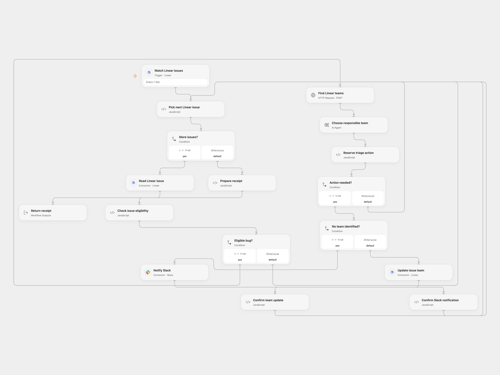

# Route Linear Bugs to Teams

Classify eligible Linear bugs and route them to a responsible team or notify Slack.

<!-- template-actions:start -->
 
<!-- template-actions:end -->

<picture>
  <source media="(prefers-color-scheme: dark)" srcset="preview-dark.png">
  
</picture>

## Setup

Configure the Linear team and credentials on the n8n trigger. Set the state and bug label IDs in **Only tickets that need to be classified**, and list your exact Linear team names and responsibilities in **Set me up**. Configure the model, Linear and Slack credentials and Slack channel. Select one Data Table with item_key and status text columns for checkpoints and prevent overlapping executions.

For Open Flow set mode to relay, configure its webhook URL and matching state, label and team descriptions, bind LINEAR_AUTHORIZATION as a secret for the teams GraphQL query, connect Linear and Slack and enable persistent State. Set a Slack channel ID. The source n8n Linear trigger accepts webhook requests without signature verification; restrict network access to both trigger and relay endpoints. Use one mode.

## Behavior

Issue events with the configured state and label and a description without the placeholder are classified against your team descriptions. An exact unique team name updates that issue; Other sends a Slack notification. Invalid or ambiguous team names stop the run. The Linear teams query uses the API default first page. Model results can be wrong; review assignments. Issue contents are sent to the model and may appear in execution history. Open Flow Code ports must each fit within 1 MiB.

If a Linear update or Slack notification has an unknown result, inspect the issue or channel before retrying. In Open Flow enter the pending key and confirmed or absent in **Reserve triage action**, replay the same event, and clear both fields. In n8n inspect the pending row and downstream result, mark done if applied, or delete only if the action did not occur.

Inspiration &amp; credits

Validate team names and reserve each external write.

Adapted from [Assign Linear bugs to the appropriate team](https://github.com/Zie619/n8n-workflows/blob/ae8cf6dc5b873cbb4f74587aa9180ed3a9f70682/workflows/Filter/1383_Filter_Slack_Create_Webhook.json) in [Zie619/n8n-workflows](https://github.com/Zie619/n8n-workflows). The source export does not identify a separate template author or license.

The collection’s [MIT notice](https://github.com/Zie619/n8n-workflows/blob/94007c1445d9258a7da116646b79473e7c7c3282/LICENSE) is pinned at a later revision. This is the collection notice at that revision; it does not establish a separate original template author's license. Our changes are listed above; see [repository licensing](../../README.md#licensing).

> MIT License
>
> Copyright (c) 2025 Zie619
>
> Permission is hereby granted, free of charge, to any person obtaining a copy
> of this software and associated documentation files (the "Software"), to deal
> in the Software without restriction, including without limitation the rights
> to use, copy, modify, merge, publish, distribute, sublicense, and/or sell
> copies of the Software, and to permit persons to whom the Software is
> furnished to do so, subject to the following conditions:
>
> The above copyright notice and this permission notice shall be included in all
> copies or substantial portions of the Software.
>
> THE SOFTWARE IS PROVIDED "AS IS", WITHOUT WARRANTY OF ANY KIND, EXPRESS OR
> IMPLIED, INCLUDING BUT NOT LIMITED TO THE WARRANTIES OF MERCHANTABILITY,
> FITNESS FOR A PARTICULAR PURPOSE AND NONINFRINGEMENT. IN NO EVENT SHALL THE
> AUTHORS OR COPYRIGHT HOLDERS BE LIABLE FOR ANY CLAIM, DAMAGES OR OTHER
> LIABILITY, WHETHER IN AN ACTION OF CONTRACT, TORT OR OTHERWISE, ARISING FROM,
> OUT OF OR IN CONNECTION WITH THE SOFTWARE OR THE USE OR OTHER DEALINGS IN THE
> SOFTWARE.

