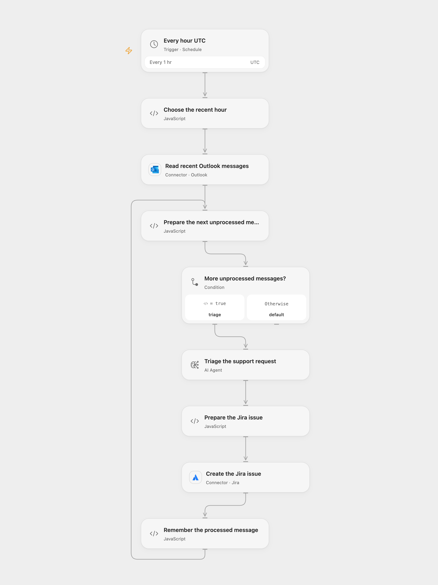

# Triage Outlook Support in Jira

Triage recent Outlook support messages with AI and create Jira issues.

<picture>
  <source media="(prefers-color-scheme: dark)" srcset="preview-dark.png">
  
</picture>

[Open Flow JSON](templates/triage-outlook-support-in-jira.openflow.json) · [n8n JSON](templates/triage-outlook-support-in-jira.n8n.json)

## Setup

Connect an Outlook account whose messages are all appropriate support requests. Connect Jira and set project and issue type IDs in **Create the Jira issue**. Configure five Jira priority IDs, highest through lowest, in **Prepare the Jira issue**. Configure a model and persistent workflow State. In n8n use the same Outlook mailbox and a compatible model, set the Jira project and issue type in **Create Issue**, and set the five priority IDs in the code of **Prepare the Jira issue**. Activate one format and avoid overlapping runs.

## Behavior

Every hour in UTC the workflow requests messages received since one hour earlier. Open Flow measures from the scheduled time; n8n uses its check time. It processes the first service page of up to 100 messages from the connected mailbox, which can include folders other than Inbox. It may miss messages beyond that page or during a longer interruption. Unprocessed messages are triaged by AI and create Jira issues with labels and the configured priority. Open Flow uses a single-round Agent; n8n retains the source chain and HTML-to-Markdown conversion. Open Flow starts on the minute boundary; n8n uses a fixed second within the hour.

IDs are remembered after a confirmed issue; State must fit host limits. A failed or uncertain write may have created an issue. Inspect Jira before retrying; after an uncertain write a later run may create a duplicate. In n8n, a later item failure can also cause earlier successful issues to be repeated if the run state is not saved. Restrict access to email content, model processing and execution history. Review AI output for accuracy.

Inspiration &amp; credits

## Changes to the source

- Replace private Jira IDs and require an explicit project-specific mapping from model priority 1–5 to Jira priority IDs. Validate the structured output before writing.
- Remember each message after a confirmed issue instead of before the model and write. Open Flow passes body text or HTML to the Agent; n8n retains the source HTML conversion. Both use UTC instead of the source instance timezone.

Adapted from [Automatically create JIRA issues from Outlook email support requests](https://github.com/Zie619/n8n-workflows/blob/ae8cf6dc5b873cbb4f74587aa9180ed3a9f70682/workflows/Schedule/0911_Schedule_Removeduplicates_Create_Scheduled.json) in [Zie619/n8n-workflows](https://github.com/Zie619/n8n-workflows). The matching [n8n listing](https://n8n.io/workflows/3893-automatically-create-jira-issues-from-outlook-email-support-requests/) credits Jimleuk. No separate original template license was found.

The collection’s [MIT notice](https://github.com/Zie619/n8n-workflows/blob/94007c1445d9258a7da116646b79473e7c7c3282/LICENSE) is pinned at a later revision. This is the collection notice at that revision; it does not establish a separate original template author's license. Our changes are listed above; see [repository licensing](../../README.md#licensing).

> MIT License
>
> Copyright (c) 2025 Zie619
>
> Permission is hereby granted, free of charge, to any person obtaining a copy
> of this software and associated documentation files (the "Software"), to deal
> in the Software without restriction, including without limitation the rights
> to use, copy, modify, merge, publish, distribute, sublicense, and/or sell
> copies of the Software, and to permit persons to whom the Software is
> furnished to do so, subject to the following conditions:
>
> The above copyright notice and this permission notice shall be included in all
> copies or substantial portions of the Software.
>
> THE SOFTWARE IS PROVIDED "AS IS", WITHOUT WARRANTY OF ANY KIND, EXPRESS OR
> IMPLIED, INCLUDING BUT NOT LIMITED TO THE WARRANTIES OF MERCHANTABILITY,
> FITNESS FOR A PARTICULAR PURPOSE AND NONINFRINGEMENT. IN NO EVENT SHALL THE
> AUTHORS OR COPYRIGHT HOLDERS BE LIABLE FOR ANY CLAIM, DAMAGES OR OTHER
> LIABILITY, WHETHER IN AN ACTION OF CONTRACT, TORT OR OTHERWISE, ARISING FROM,
> OUT OF OR IN CONNECTION WITH THE SOFTWARE OR THE USE OR OTHER DEALINGS IN THE
> SOFTWARE.

