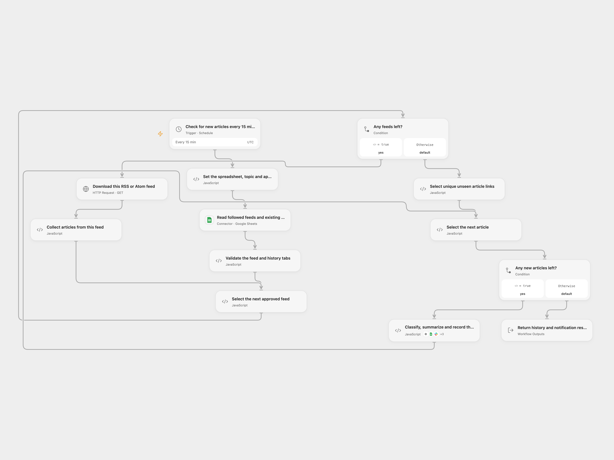

# Monitor RSS Topics and Send Summaries to Slack

Check followed RSS feeds for your topic, keep a Google Sheets history, and send English summaries of new matches to Slack.

<!-- template-actions:start -->
 
<!-- template-actions:end -->

<picture>
  <source media="(prefers-color-scheme: dark)" srcset="preview-dark.png">
  
</picture>

## Setup

1. Create a spreadsheet with the headers below. Keep previously processed URLs in `article_database` when bringing over an existing feed list.
2. In **Set the spreadsheet, topic and approved publishers**, enter your spreadsheet ID, Slack channel ID and a comma-separated list of exact HTTPS feed and publisher hostnames. Change the topic if needed.
3. Connect Google Sheets in **Read followed feeds and existing article URLs**. In **Classify, summarize and record this article**, connect the same spreadsheet, OpenAI and Slack. Bind its **Jina Key** input to a secret variable named `JINA_API_KEY`. Invite the Slack app to the selected channel and publish the workflow.

| Tab | Headers |
| --- | --- |
| `rss_feed` | `rss_feed_url`, `website` and optional `enabled` |
| `article_database` | `article_url`, `summarized`, `summary`, `website`, `fetched_at`, `publish_date` in that order |

## Behavior

The workflow checks every 15 minutes. A blank `enabled` value includes the feed. Use an unchecked box or `No` to pause a feed. Use direct RSS 2.0 or Atom feeds and final article URLs from news sites and blogs you are authorized to process in Jina Reader and OpenAI. The workflow rejects social platform domains, their subdomains and their short-link domains, including WeChat and Threads, even in the approved host list. Existing history rows stay in the spreadsheet.

Google Sheets history is checked by article URL across feeds and runs. The first active feed with a matching article supplies its website name. The workflow classifies the title and excerpt. It records an unrelated article as `NO (not relevant)`. For a match it reads the exact article in Jina Reader, prepares an English summary and saves it as `YES`. Only a confirmed history write permits posting that summary to Slack. Check the result for the article URL if either write is unconfirmed and verify the destination before retrying manually.

The first check includes articles already present in the feeds if their URLs are missing from history. Use up to 20 feeds and 100 unseen articles per check. Use direct feed URLs without redirects. Feeds over 600,000 characters are skipped, and up to 24,000 characters per article are sent for summarization.

In n8n

In **Set the spreadsheet, topic and approved publishers**, replace the same four settings. Select one Google Sheets OAuth2 credential for the read and append HTTP nodes. Use Header Auth credentials named `Authorization` with `Bearer YOUR_OPENAI_KEY` for both OpenAI requests, `Bearer YOUR_JINA_KEY` for Jina Reader and `Bearer YOUR_SLACK_BOT_TOKEN` for Slack. The Slack token needs `chat:write`.

Use a self-hosted regular-mode instance with `N8N_CONCURRENCY_PRODUCTION_LIMIT=1` to serialize scheduled runs. Activate before processing real feeds. Failed article steps and URL-specific write results are available in the execution history. Use a single deployment for a history tab and keep execution history private. [n8n concurrency control](https://docs.n8n.io/hosting/scaling/concurrency-control/)

Inspiration &amp; credits

Adapted from [AI-powered information monitoring with OpenAI, Google Sheets, Jina AI and Slack](https://github.com/Zie619/n8n-workflows/blob/ae8cf6dc5b873cbb4f74587aa9180ed3a9f70682/workflows/Code/1278_Code_Schedule_Monitor_Webhook.json) in [Zie619/n8n-workflows](https://github.com/Zie619/n8n-workflows). Attribution: Dataki (original workflow); Zie619 (collection).

The collection’s [MIT notice](https://github.com/Zie619/n8n-workflows/blob/94007c1445d9258a7da116646b79473e7c7c3282/LICENSE) is pinned at a later revision. This is the collection notice at that revision; it does not establish a separate original template author's license. Our changes are listed above; see [repository licensing](../../README.md#licensing).

> MIT License
>
> Copyright (c) 2025 Zie619
>
> Permission is hereby granted, free of charge, to any person obtaining a copy
> of this software and associated documentation files (the "Software"), to deal
> in the Software without restriction, including without limitation the rights
> to use, copy, modify, merge, publish, distribute, sublicense, and/or sell
> copies of the Software, and to permit persons to whom the Software is
> furnished to do so, subject to the following conditions:
>
> The above copyright notice and this permission notice shall be included in all
> copies or substantial portions of the Software.
>
> THE SOFTWARE IS PROVIDED "AS IS", WITHOUT WARRANTY OF ANY KIND, EXPRESS OR
> IMPLIED, INCLUDING BUT NOT LIMITED TO THE WARRANTIES OF MERCHANTABILITY,
> FITNESS FOR A PARTICULAR PURPOSE AND NONINFRINGEMENT. IN NO EVENT SHALL THE
> AUTHORS OR COPYRIGHT HOLDERS BE LIABLE FOR ANY CLAIM, DAMAGES OR OTHER
> LIABILITY, WHETHER IN AN ACTION OF CONTRACT, TORT OR OTHERWISE, ARISING FROM,
> OUT OF OR IN CONNECTION WITH THE SOFTWARE OR THE USE OR OTHER DEALINGS IN THE
> SOFTWARE.

The [original n8n gallery workflow](https://n8n.io/workflows/2799-ai-powered-information-monitoring-with-openai-google-sheets-jina-ai-and-slack/) credits Dataki. This version reserves article URLs before writing and notifies Slack after the history write is confirmed.

