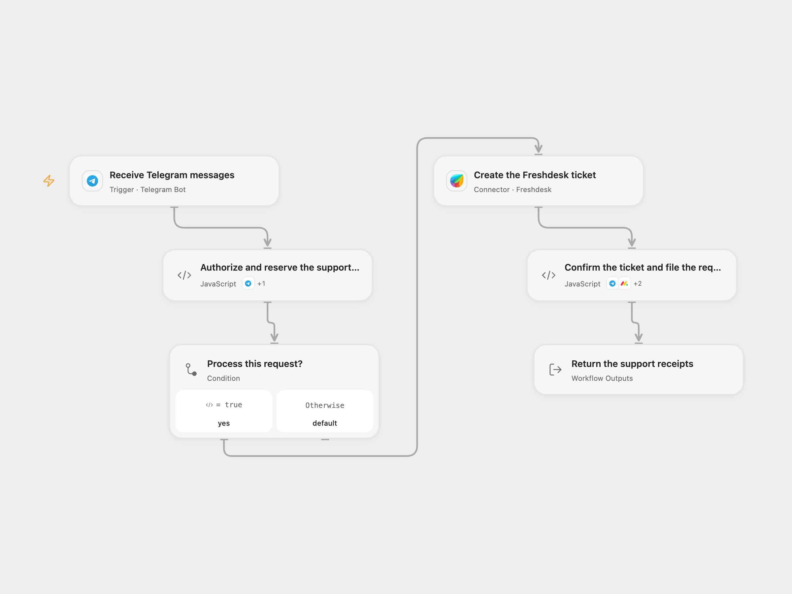

# Route Telegram Support to Freshdesk and Monday.com

Create a Freshdesk ticket from an approved Telegram chat, acknowledge it in the same chat, and file it in the matching monday.com group.

<!-- template-actions:start -->
 
<!-- template-actions:end -->

<picture>
  <source media="(prefers-color-scheme: dark)" srcset="preview-dark.png">
  
</picture>

## Setup

1. Connect one Telegram bot in **Receive Telegram messages**, **Authorize and reserve the support request** and **Confirm the ticket and file the request**. Each bot can use one active webhook. Use a dedicated support bot and publish the workflow to get its active callback URL. With the default empty requester mapping it performs no writes. [Telegram Bot API](https://core.telegram.org/bots/api)
2. In **Authorize and reserve the support request**, set `callbackUrl` to that exact HTTPS callback. Set `botId` to the Telegram bot account’s numeric user ID as a string. Fill in `requesters` as a map from `chat_id:user_id` to the requester’s confirmed Freshdesk email, for example `{ "123456789:123456789": "requester@example.invalid" }`. For a group, use that group’s negative chat ID and the approved sender’s positive user ID. Add only contacts authorized to use that chat for support. Use the trigger’s chat/user filters to further limit delivery if needed.
3. Set `boardId` to one writable monday.com board ID as a string, and set `refundGroup` and `complaintGroup` to the two distinct group IDs. Connect monday.com in **Confirm the ticket and file the request**. Connect Freshdesk in **Create the Freshdesk ticket** and grant **Provider API** access for ticket creation. Publish with your final settings. [Freshdesk tickets](https://developers.freshdesk.com/api/#create_ticket) · [monday.com items](https://developer.monday.com/api-reference/reference/items)

## Behavior

An approved human sender’s text message in their configured private chat, group or supergroup containing lowercase `refund` uses the refund route. Other approved text uses the complaint route. The workflow creates a Freshdesk ticket with the matching tag and requester, sends the route’s acknowledgement as a reply in the same chat and forum topic, when present, and creates one item in the corresponding monday.com group. Refund items use the confirmed Freshdesk subject. Complaint items use the submitted message. Titles use the first 255 characters after whitespace is collapsed, and Freshdesk receives the full message as escaped text. The ticket starts with the source defaults of Pending, Low priority and Portal source. Freshdesk account rules can notify the requester.

For forum messages, the send request includes the original topic ID. The Telegram connection omits that ID from its normalized send receipt, so the workflow cannot verify the reply topic from the receipt.

The workflow reserves the bot, chat and message identity before creating any ticket. A repeated delivery does not create another ticket or send a second acknowledgement. Each action starts after the prior provider has confirmed its result. If a receipt is unavailable, check Freshdesk, the original Telegram chat or the chosen monday.com group before completing the remaining steps manually. The output lists confirmed IDs when a response is available.

In n8n

Set the same **Telegram API** credential on **Receive Telegram messages** and **Acknowledge in the same Telegram chat**. Set the requester map, bot ID, and board and group IDs in **Authorize the support request**. The native Telegram trigger registers and validates its own webhook secret. Use the production webhook. The acknowledgement goes to the same chat and forum topic, when present. The workflow checks the topic ID when the Telegram send response includes it. Set `freshdeskDomain` to your helpdesk subdomain in **Authorize the support request**. Use HTTP Basic Auth in **Create the Freshdesk ticket**, with the Freshdesk API key as the username and `X` as the password. In **Create the item in the matching group**, select Header Auth named `Authorization` with your monday.com API token as its value.

Create an n8n Data Table with a string column named `request_key`. Select the same table in **Skip previously reserved requests** and **Reserve the Telegram message**. Keep receipt rows to block repeats. Use regular mode with `N8N_CONCURRENCY_PRODUCTION_LIMIT=1` and avoid overlapping manual runs so the lookup and insert stay serialized. A failed or unconfirmed action stops later writes and leaves the delivery reserved. [n8n concurrency control](https://docs.n8n.io/hosting/scaling/concurrency-control/)

Inspiration &amp; credits

Adapted from [Telegram support routing through Freshdesk and monday.com](https://github.com/Zie619/n8n-workflows/blob/ae8cf6dc5b873cbb4f74587aa9180ed3a9f70682/workflows/Telegram/0885_Telegram_Mondaycom_Automate_Triggered.json) in [Zie619/n8n-workflows](https://github.com/Zie619/n8n-workflows). Attribution: tanaypant (original n8n template), Zie619 (collection). [Original n8n template](https://n8n.io/workflows/368-create-ticket-on-specific-customer-messages-in-telegram/)

The collection’s [MIT notice](https://github.com/Zie619/n8n-workflows/blob/94007c1445d9258a7da116646b79473e7c7c3282/LICENSE) is pinned at a later revision. This is the collection notice at that revision; it does not establish a separate original template author's license. Our changes are listed above; see [repository licensing](../../README.md#licensing).

> MIT License
>
> Copyright (c) 2025 Zie619
>
> Permission is hereby granted, free of charge, to any person obtaining a copy
> of this software and associated documentation files (the "Software"), to deal
> in the Software without restriction, including without limitation the rights
> to use, copy, modify, merge, publish, distribute, sublicense, and/or sell
> copies of the Software, and to permit persons to whom the Software is
> furnished to do so, subject to the following conditions:
>
> The above copyright notice and this permission notice shall be included in all
> copies or substantial portions of the Software.
>
> THE SOFTWARE IS PROVIDED "AS IS", WITHOUT WARRANTY OF ANY KIND, EXPRESS OR
> IMPLIED, INCLUDING BUT NOT LIMITED TO THE WARRANTIES OF MERCHANTABILITY,
> FITNESS FOR A PARTICULAR PURPOSE AND NONINFRINGEMENT. IN NO EVENT SHALL THE
> AUTHORS OR COPYRIGHT HOLDERS BE LIABLE FOR ANY CLAIM, DAMAGES OR OTHER
> LIABILITY, WHETHER IN AN ACTION OF CONTRACT, TORT OR OTHERWISE, ARISING FROM,
> OUT OF OR IN CONNECTION WITH THE SOFTWARE OR THE USE OR OTHER DEALINGS IN THE
> SOFTWARE.

The adaptation adds an approved requester mapping, signed Telegram admission, protected message reservation and provider receipt checks. Refund and complaint keep the source order and destinations.

